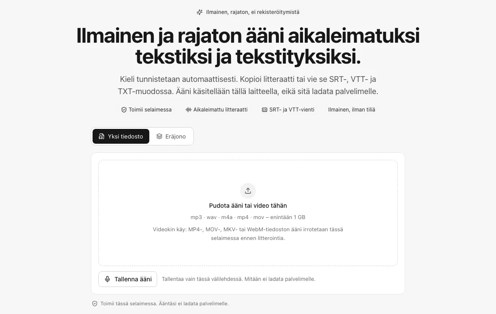

<p align="center">
  <b>🌐 Kielet:</b><br/>
  <a href="README.md">English</a> ·
  <a href="README.zh-CN.md">简体中文</a> ·
  <a href="README.zh-TW.md">繁體中文</a> ·
  <a href="README.ja.md">日本語</a> ·
  <a href="README.ko.md">한국어</a> ·
  <a href="README.es.md">Español</a> ·
  <a href="README.pt-BR.md">Português</a> ·
  <a href="README.fr.md">Français</a> ·
  <a href="README.de.md">Deutsch</a> ·
  <a href="README.it.md">Italiano</a> ·
  <a href="README.nl.md">Nederlands</a> ·
  <a href="README.pl.md">Polski</a> ·
  <a href="README.ru.md">Русский</a> ·
  <a href="README.uk.md">Українська</a> ·
  <a href="README.sv.md">Svenska</a> ·
  <a href="README.nb.md">Norsk</a> ·
  <a href="README.da.md">Dansk</a> ·
  <a href="README.fi.md">Suomi</a> ·
  <a href="README.id.md">Bahasa Indonesia</a> ·
  <a href="README.tr.md">Türkçe</a> ·
  <a href="README.vi.md">Tiếng Việt</a> ·
  <a href="README.th.md">ไทย</a> ·
  <a href="README.hi.md">हिन्दी</a> ·
  <a href="README.bn.md">বাংলা</a>
</p>

<h1 align="center">EarScribe — ilmainen puhe tekstiksi ja litterointi selaimessa</h1>

<p align="center">
  <b>Pudota äänitiedosto, video tai tallenne mikrofonista. Saat aikaleimatun litteroinnin ja tekstitykset.</b><br/>
  <sub>Whisper toimii omalla laitteellasi WebGPUn tai WebAssemblyn kautta — tallennetta ei koskaan ladata palvelimelle.</sub>
</p>

<p align="center">
  <a href="https://earscribe.app"></a>
  <a href="https://earscribe.app"></a>
  <a href="https://earscribe.app"></a>
  <a href="https://earscribe.app"></a>
  
</p>

<p align="center">
  <a href="https://earscribe.app"></a>
</p>

<p align="center">
  <b>🔗 Avaa sovellus:</b> <a href="https://earscribe.app">earscribe.app</a> ·
  <a href="https://earscribe.app/guides">Oppaat</a> ·
  <a href="https://earscribe.app/changelog">Muutosloki</a> ·
  <a href="https://earscribe.app/about">Tietoja</a>
</p>

---

## 🎙️ Mikä EarScribe on

Litterointityötila, joka toimii kokonaan selainvälilehdellä. Anna sille ääntä, videotiedosto tai mikrofonisi; se palauttaa tekstiä aikaleimoilla, joita klikkaamalla voit toistaa kohdan uudelleen, sekä tekstitystiedostoja, jotka voit antaa editorille. Ei tiliä, ei lataamista palvelimelle eikä minuuttikohtaista laskutusta.

Kolme sisääntuloväylää, yksi putki:

- **Tiedosto** — MP3, WAV, M4A, AAC, OGG, FLAC, Opus tai melkein mikä tahansa, minkä Web Audio API osaa purkaa, enintään 1 GiB.
- **Video** — MP4, MOV, MKV, WebM, M4V, TS, QT, M2TS. Ääniraita demuksataan ja koodataan uudelleen 16 kHz monoksi **välilehden sisällä**, minkä jälkeen se litteroidaan kuin mikä tahansa muu tiedosto. Ei ffmpegiä, ei muunnossivustoa.
- **Mikrofoni** — tallenna ja litteroi samassa paikassa: luento, puhelu, jonka saat tallentaa, tai äänimuistio, joka muuten menetettäisiin.

Kun lisäät jonon, voit pudottaa kokonaisen kansiollisen tiedostoja ja lähteä pois; kun lisäät työtilan polussa `/dashboard`, tuloksista tulee projekteja, jotka voit avata uudelleen, muokata ja viedä myöhemmin.

> 👉 **Live-sovellus:** **[earscribe.app](https://earscribe.app)**

---

## 📚 Sisällysluettelo

- [✨ Mitä se tekee](#-mitä-se-tekee)
- [🖼️ Kuvakaappaukset](#️-kuvakaappaukset)
- [🚀 Pika-aloitus](#-pika-aloitus)
- [🗂️ Työtila](#️-työtila)
- [💸 Mitä se maksaa](#-mitä-se-maksaa)
- [🆚 Vertailu](#-vertailu)
- [🌍 Tuetut syötteet & kielet](#-tuetut-syötteet--kielet)
- [💼 Käyttötapaukset](#-käyttötapaukset)
- [🚧 Mitä se ei tee](#-mitä-se-ei-tee)
- [❓ UKK](#-ukk)
- [🛠️ Teknologiapino](#️-teknologiapino)
- [🧑‍💻 Paikallinen kehitys](#-paikallinen-kehitys)
- [☁️ Julkaisu](#️-julkaisu)
- [🌐 Uuden kielen lisääminen](#-uuden-kielen-lisääminen)
- [🔬 Uuden Whisper-mallin lisääminen](#-uuden-whisper-mallin-lisääminen)
- [🤝 Osallistuminen](#-osallistuminen)
- [📄 Lisenssi](#-lisenssi)

---

## ✨ Mitä se tekee

| | Ominaisuus | Mitä todella saa |
|---|---|---|
| 🎬 | **Ääni, video ja mikrofoni** | Videosäiliöt hyväksytään suoraan. Ääniraita erotetaan paikallisesti, joten 200 MB:n MP4 ei sekään poistu koneelta. |
| 📝 | **Aikaleimattu litterointi** | Jokaisella repliikillä on alku- ja loppuaika. Klikkaa riviä kuullaksesi kyseisen hetken; aaltomuotokahva seuraa mukana. |
| 🔍 | **Haku litteroinnin sisällä** | Nimi, luku, termi — hyppää lauseeseen ja toista se sen sijaan, että kuuntelisit tiedoston uudelleen. |
| 🎞️ | **Tekstityksen vienti** | SRT, WebVTT, pelkkä teksti, JSON (litterointiobjekti täyden tarkkuuden aikakoodeilla) tai leikepöytä. |
| 🧪 | **Tekstityksen tarkistus** | Merkitsee repliikit, jotka ovat liian pitkiä, liian nopeita, toistuvia, tyhjiä tai päällekkäisiä, ennen kuin ne viedään. |
| 📚 | **Eräjono** | Pudota useita tiedostoja, aseta yksi malli ja yksi puhuttu kieli, ja anna jonon käsitellä ne järjestyksessä. Keskeytä nykyisen tiedoston jälkeen milloin tahansa. |
| 🗂️ | **Projektit** | Tulokset tallennetaan selaimeen projekteina polkuun `/dashboard`: litteroinnit, tekstitykset, lähdetiedostot ja roskakansio, jotka voi avata uudelleen myöhemmin. |
| ✏️ | **Tekstityksen muokkaus** | Korjaa teksti, siirrä repliikin alku- tai loppupistettä, jaa tai poista repliikki ja vie uudelleen. |
| 💾 | **Varmuuskopiointi ja palautus** | Vie koko työtila yhtenä tiedostona ja tuo se toiseen selaimeen. |
| 🔁 | **Tekstityksen muunto** | SRT ⇄ VTT ja SRT → teksti selaimessa ilman mallilatausta — ainoa työkalu täällä, joka käynnistyy heti. |
| 🆓 | **Ilmainen ja rajoittamaton** | Ei maksullista tasoa, ei päiväkiintiötä, ei minuuttimaksua, ei tiliä. |
| 🔒 | **Yksityinen rakenteensa ansiosta** | Litterointi toimii paikallisesti. Julkisilla sivuilla on analytiikkaa ja mainoksia; `/dashboard` on mainokseton. |
| 🌍 | **27 käyttöliittymäkieltä, 99 puhuttua kieltä** | Käyttöliittymä on käännetty 27 kieliversiolle; Whisper tunnistaa puhutun kielen automaattisesti. |

---

## 🖼️ Kuvakaappaukset

> Aitoja kuvakaappauksia live-sivustolta osoitteessa **[earscribe.app](https://earscribe.app)**.

### 1. Pudota tiedosto tai video tai tallenna — ei rekisteröitymistä, ei lataamista palvelimelle

<p align="center">
  <a href="https://earscribe.app"></a>
</p>

<p align="center"><sub>Etusivu: tiedostojen pudotusvyöhyke, mikrofonipainike ja mallin valinta samassa näkymässä</sub></p>

### 2. Aikaleimattu litterointi aaltomuodolla — klikkaa riviä hypätäksesi

<p align="center">
  <a href="https://earscribe.app"></a>
</p>

<p align="center"><sub>Litterointi aikaleimoilla, aaltomuoto ja SRT- sekä VTT-viennin painikkeet</sub></p>

### 3. Kolme vaihetta: pudota → valitse Whisper-malli → vie

<p align="center">
  <a href="https://earscribe.app"></a>
</p>

<p align="center"><sub>Kolme vaihetta samassa näkymässä: tiedosto, Whisper-malli ja valmis teksti vietäväksi</sub></p>

### 4. Miksi EarScribe — yksityisyys ensin, Whisper selaimessa

<p align="center">
  <a href="https://earscribe.app"></a>
</p>

<p align="center"><sub>Ominaisuuksien yleiskatsaus: paikallinen käsittely, kielen automaattinen tunnistus ja vientimuodot</sub></p>

### 5. Kuka EarScribea käyttää — podcastaajat, toimittajat, opiskelijat, editorit

<p align="center">
  <a href="https://earscribe.app"></a>
</p>

<p align="center"><sub>Käyttöesimerkkejä podcasteihin, haastatteluihin, opiskeluun ja tekstityksiin</sub></p>

### 6. EarScribe vs Otter.ai, Rev, HappyScribe ja paikallinen Whisper-asennus

<p align="center">
  <a href="https://earscribe.app"></a>
</p>

<p align="center"><sub>Vertailutaulukko: Otter.ai, Rev, HappyScribe ja paikallinen Whisper</sub></p>

### 7. UKK — yksityisyys, muodot, tekstityksen vienti, offline-käyttö

<p align="center">
  <a href="https://earscribe.app"></a>
</p>

<p align="center"><sub>Kysymyksiä ja vastauksia yksityisyydestä, tiedostomuodoista ja offline-käytöstä</sub></p>

---

## 🚀 Pika-aloitus

1. Avaa **[earscribe.app](https://earscribe.app)** Chromessa, Edgessä, Safarissa tai Firefoxissa.
2. Pudota tiedosto — tai video, tai paina tallennusta. Hyväksyy enintään 1 GiB tiedostoa kohden; todellinen raja on laitteesi muisti, ei levyn koko.
3. Valitse malli. **base** on oletus ja sopii useimpaan puheeseen; **tiny** on puhelimelle tai nopealle äänimuistiolle; **small** ja **turbo** on tarkoitettu murteelliselle, meluisalle tai tärkeälle äänelle.
4. Paina **Litteroi**. Ääni puretaan ja syötetään Whisperille välilehden sisällä. Ensimmäinen ajo lataa painot, joten seuraa painikkeen kokoa.
5. Lue litterointi, klikkaa riviä toistaaksesi sen, korjaa olennainen ja valitse sitten **Vie → SRT / VTT / TXT / JSON** tai kopioi se.

Haluatko sen sijaan erän? Vaihda jonoon, pudota niin monta tiedostoa kuin haluat ja valitse malli kerran. Jono käsittelee yhden tiedoston kerrallaan, käyttää uudelleen muistissa jo olevaa mallia ja tallentaa jokaisen tuloksen projektiksi.

> 💡 **Muunnosvaihetta ei tarvita.** Kaksituntinen MP4 menee suoraan sisään. Jos haluat säilyttää vain äänen, sovellus voi erottaa videon ääniraidan puolestasi.

---

## 🗂️ Työtila

`/dashboard` on sama litterointimoottori muistilla. Kaikki tallennetaan tähän selaimeen — IndexedDB projektitietueille, CacheStorage mallien painoille — eikä mitään synkronoida tilille, koska tiliä ei ole.

| Osio | Mitä siellä on |
|---|---|
| **Projektit** | Kaikki, uusin ensin. |
| **Litteroinnit** | Litterointiajon luomat projektit. Niiden repliikkien muokkaaminen pitää ne täällä. |
| **Tekstitykset** | Tekstitystiedostosta luodut projektit — muunnin ja tuonnit — jotta tekstitystyö pysyy erillään puhetyöstä. |
| **Tiedostot** | Työtilan sisältämät lähdemediat, suodatettavissa lajin mukaan: litteroinnit, tekstitykset, ääni. Alkuperäistä ääntä **ei** tallenneta oletuksena. |
| **Roskakori** | Poistetut projektit, palautettavissa kunnes tyhjennät sen. |

Projektin sisällä voit hakea litteroinnista, klikata aikaleimaa toistaaksesi sen, muokata tekstitysrepliikkejä (teksti, alku- ja loppupisteet, lisää tai poista), taittaa pitkät repliikit lyhyemmiksi, viedä uudelleen missä tahansa muodossa tai avata mediasoittimen poistumatta sivulta.

**Varmuuskopio:** työtila viedään yhtenä tiedostona (enintään 320 MB) ja tuodaan toiseen selaimeen tai toiselle koneelle. Koska projektit eivät koskaan poistu laitteelta, tämä tiedosto on ainoa mukana kulkeva kopio — käsittele sitä kuin mitä tahansa asiakirjavarmuuskopiota.

---

## 💸 Mitä se maksaa

Ilmainen ei tarkoita painotonta. Nämä ovat mitattuja latauskokoja mallia ja taustajärjestelmää kohden, eivät arvioita:

| Malli | WebGPU | WebAssembly | Tyypillinen käyttö |
|---|---:|---:|---|
| **tiny** | 151 MB | 41 MB | Äänimuistiot, edulliset puhelimet, ensimmäinen kokeilu |
| **base** *(oletus)* | 291 MB | 77 MB | Haastattelut, kokoukset, podcastit |
| **small** | 968 MB | 249 MB | Murteellinen puhe, meluisat huoneet |
| **turbo** | 3.24 GB | 1.09 GB | Studiolaatuiset litteroinnit, kun tarkkuus on tärkeämpää kuin aika |

- **Lataa kerran, sen jälkeen välimuistissa.** Painot ovat selaimen välimuistissa; toinen ajo ei lataa mitään. Toinen selainprofiili tarkoittaa uutta latausta.
- **GPU on sen arvoinen.** Samalla koneella WebGPU sai 40 minuutin tiedoston valmiiksi base-mallilla noin 3.8 minuutissa, kun CPU:lla meni 9.4 — noin 2.5× nopeammin, kolmesta neljään kertaan suuremmalla latauksella. `turbo` WebGPU:lla ei koskaan saanut 3.24 GB:n lataustaan valmiiksi testissämme, joten se on merkitty mittaamattomaksi eikä nopeaksi.
- **Muisti ratkaisee, ei tiedostokoko.** Pitkät tallenteet puretaan 16 kHz monoksi ennen litterointia. 40 minuutin MP3 vaatii muutaman sadan megatavun; kaksituntinen stereo-WAV voi tyhjentää välilehden ennen kuin se alkaa. Purku pyytää nyt suoraan 16 kHz:ä, mikä pienensi kaksituntisen stereotiedoston huippumuistia noin 1.6 GB:stä 0.5 GB:hen.
- **Ei palvelinta, ei jonoa jonkun toisen koneella.** Aika on oman CPU:si, joten hidas kannettava on hidas. Se on sen hinta, ettei mitään ladata palvelimelle.

Täydelliset mittaukset, menetelmä ja epäonnistuneet ajot ovat [oppaissa](https://earscribe.app/guides).

---

## 🆚 Vertailu

Miten EarScribe vertautuu muihin tapoihin litteroida ääntä vuonna 2026?

| | **EarScribe** | Otter.ai Free | Rev Free Trial | HappyScribe | Local Whisper CLI |
|---|:---:|:---:|:---:|:---:|:---:|
| **Ilmainen ja rajoittamaton** | ✅ | ⚠️ 300 min/kk | ❌ Vain kokeilu | ❌ Maksullinen | ✅ |
| **Ei rekisteröitymistä / kirjautumista** | ✅ | ❌ | ❌ | ❌ | ✅ |
| **Ei lataamista palvelimelle (yksityinen)** | ✅ | ❌ | ❌ | ❌ | ✅ |
| **Video ilman lataamista palvelimelle** | ✅ Erotetaan paikallisesti | ❌ Vaatii latauksen | ❌ Vaatii latauksen | ❌ Vaatii latauksen | ✅ Vaatii ffmpegin |
| **Toimii selaimessa** | ✅ | ✅ | ✅ | ✅ | ❌ |
| **SRT / VTT-vienti** | ✅ | ⚠️ Maksullinen | ✅ | ✅ | ⚠️ Manuaalinen |
| **Aikaleimattu litterointi** | ✅ | ✅ | ✅ | ✅ | ⚠️ Manuaalinen |
| **Paikallinen päättely** | ✅ | ❌ | ❌ | ❌ | ✅ |
| **99 puhuttua kieltä** | ✅ | ⚠️ Rajoitettu | ⚠️ Rajoitettu | ✅ | ✅ |
| **Whisper Large v3 Turbo** | ✅ | ❌ | ❌ | ❌ | ✅ |
| **Vaatii asennuksen** | ❌ Ei mitään | ❌ Ei mitään | ❌ Ei mitään | ❌ Ei mitään | ⚠️ Python + GPU |
| **Hinta** | $0 | $0–$30/kk | $0.25/min | €0.20/min | $0 (oma laitteisto) |

**Missä se ei riitä:** paikallinen asennus voi ajaa suurempaa mallia nopeammalla taustajärjestelmällä kuin selainvälilehti, ja maksullinen palvelu lisää puhujamerkinnät ja tiimityötilan. EarScriben etu on, että se on ilmainen, ei vaadi asennuksia ja ääni ei koskaan siirry mihinkään.

→ **[Kokeile osoitteessa earscribe.app](https://earscribe.app)**

---

## 🌍 Tuetut syötteet & kielet

### Ääni — MP3, WAV, M4A, AAC, OGG, FLAC, Opus

Kaikki hyväksytään, minkä Web Audio API osaa purkaa; nuo seitsemän kattavat lähes jokaisen vastaan tulevan tallenteen.

- 🎵 **[MP3 tekstiksi](https://earscribe.app/mp3-to-text)** — podcastin ja haastattelun standardi
- 🎙️ **[WAV tekstiksi](https://earscribe.app/wav-to-text)** — häviötön studio- ja kenttätallennus
- 📱 **[M4A tekstiksi](https://earscribe.app/m4a-to-text)** — iPhonen äänimuistiot
- 🎧 **[Äänimuistio tekstiksi](https://earscribe.app/voice-memo-to-text)** — puhelintallenteet mobiilissa
- 🔊 **[Ääni tekstiksi](https://earscribe.app/audio-to-text)** — yleinen sisäänkäynti
- 🎬 **[Ääni SRT:ksi](https://earscribe.app/audio-to-srt)** — suoraan tekstitykseksi

### Video — MP4, MOV, MKV, WebM, M4V, TS, QT, M2TS

Ääniraita demuksataan työkalulla [mediabunny](https://mediabunny.dev), puretaan WebCodecsillä ja koodataan uudelleen pieneksi mono-MP3:ksi 16 kHz:nä (tai WAV:ksi, jos MP3-kooderia ei ole) — kaikki paikallisesti. Säiliö, jota selain ei osaa purkaa, epäonnistuu selkeällä viestillä eikä tuota hiljaista tyhjää litterointia.

### Mikrofoni

Tallennus tapahtuu välilehdessä MediaRecorderilla. Tallenne litteroidaan täsmälleen kuin pudotettu tiedosto; reaaliaikaisia tekstityksiä tallennuksen aikana **ei** tarjota (katso [mitä se ei tee](#-mitä-se-ei-tee)).

### Kielet — 99 puhuttua, 27 käyttöliittymää

Whisper tunnistaa puhutun kielen automaattisesti: englanti, espanja, ranska, saksa, italia, portugali, venäjä, japani, korea, kiina (yksinkertaistettu ja perinteinen), arabia, hindi, turkki, hollanti, puola, indonesia, ruotsi, norja, tanska, suomi, tšekki, unkari, kreikka, heprea, thai, vietnam ja yli 70 muuta.

Käyttöliittymä on käännetty 27 kieliversiolle. Englanti on polussa `/`, muilla 26:lla on etuliite:

| | | | |
|---|---|---|---|
| [English](https://earscribe.app) | [简体中文](https://earscribe.app/zh-CN) | [日本語](https://earscribe.app/ja) | [한국어](https://earscribe.app/ko) |
| [Español](https://earscribe.app/es) | [Português (BR)](https://earscribe.app/pt-br) | [Deutsch](https://earscribe.app/de) | [Français](https://earscribe.app/fr) |
| [Русский](https://earscribe.app/ru) | [Italiano](https://earscribe.app/it) | [Polski](https://earscribe.app/pl) | [Nederlands](https://earscribe.app/nl) |
| [Українська](https://earscribe.app/uk) | [Türkçe](https://earscribe.app/tr) | [Tiếng Việt](https://earscribe.app/vi) | [ไทย](https://earscribe.app/th) |
| [हिन्दी](https://earscribe.app/hi) | [বাংলা](https://earscribe.app/bn) | [اردو](https://earscribe.app/ur) | [العربية](https://earscribe.app/ar) |
| [فارسی](https://earscribe.app/fa) | [Bahasa Indonesia](https://earscribe.app/id) | [Svenska](https://earscribe.app/sv) | [Norsk](https://earscribe.app/nb) |
| [Dansk](https://earscribe.app/da) | [Suomi](https://earscribe.app/fi) | [繁體中文](https://earscribe.app/zh-TW) | |

---

## 💼 Käyttötapaukset

### 🎙️ Podcastaajat ja sisällöntuottajat
**[Podcastin litterointi](https://earscribe.app/podcast-transcription)** jaksojen kuvauksiin, jaksojen SEO:hon ja saavutettavuuteen. Vie SRT videoversiolle, TXT blogille.

### 📰 Toimittajat ja tutkijat
**[Haastattelun litterointi](https://earscribe.app/interview-transcription)**, jossa lähdetallenne pysyy kannettavallasi. Kolmannen osapuolen kopiota ei ole, joka voisi vuotaa, joutua haastehakemuksen kohteeksi tai auditoitavaksi.

### 🎓 Opiskelijat ja luennoitsijat
**[Luentojen litterointi](https://earscribe.app/audio-to-text)** tallennetusta tunnista, haettavissa ennen seuraavaa kertaa. Toimii iPhonen äänimuistioiden ja Zoom-vientien kanssa.

### 📞 Kokoukset ja käyttäjätutkimus
**[Kokoustallenne tekstiksi](https://earscribe.app/meeting-recording-to-text)** — litterointi puhelusta, ei automaattisesti luotuja kokousmuistiinpanoja.

### 🎬 Videoeditorit
**[Ääni SRT:ksi](https://earscribe.app/audio-to-srt)** YouTubeen, Premiereen, Final Cut Prohon ja Resolveen. Repliikin ajoitus tulee Whispersen omista aikaleimoista, ja tekstityksen tarkistus merkitsee sen, mikä tulvii ruudulla.

### 📚 Äänikirjat ja pitkät tallenteet
Kaksituntiset tiedostot ovat tuettuja, mutta juuri niissä laitteen muisti ratkaisee. Lue [miten pitkä ääni käsitellään](https://earscribe.app/guides/how-to-transcribe-long-audio) ennen kuin aloitat nelituntisen.

---

## 🚧 Mitä se ei tee

Tässä selkeä oleminen säästää kaikilta turhan ajon:

- **Ei puhujan erottelua.** Kaksi ihmistä yhdessä tiedostossa tuottaa tasaista tekstiä ilman "Puhuja 1 / Puhuja 2" -merkintöjä. Haastattelusivu sanoo sen tarkoituksella.
- **Ei käännöstä.** Litterointi pysyy kielessä, jota puhuttiin; käyttöliittymän kieli ja puhuttu kieli eivät liity toisiinsa.
- **Ei reaaliaikaisia tekstityksiä.** Tallennus ja litterointi ovat erillisiä vaiheita — mikrofoni tallentaa ensin, sitten tiedosto litteroidaan.
- **Jono on sarjallinen ja vaatii, että välilehti on auki.** Yksi malli, yksi kieliasetus koko erälle. Välilehden sulkeminen pysäyttää sen.
- **Ei synkronointia laitteiden välillä.** Projektit ovat tässä selaimessa. Siirrä ne työtilan viennillä.
- **Ei offline-sovellus.** Painot ovat välimuistissa, mutta itse sivu ladataan verkosta. Asentaminen lisää pikakuvakkeen työpöydälle tai aloitusnäyttöön, ei offline-kopiota.
- **1 GiB tiedostoa kohden on kova yläraja; muisti on käytännön raja.**

---

## ❓ UKK

<details>
<summary><b>Onko EarScribe todella ilmainen, ilman rajoja?</b></summary><br/>
Kyllä — ei maksullista tasoa, ei luottokorttia, ei minuuttimaksua, ei päivä- tai kuukausikiintiötä, ei tiliä. Laskenta tapahtuu omalla laitteistollasi, joten pilkulaskua ei ole siirrettäväksi. Tiedostokohtainen yläraja on 1 GiB, ja laitteesi muisti rajaa sen, mikä todella valmistuu.
</details>

<details>
<summary><b>Ladataanko ääneni jonnekin?</b></summary><br/>
Ei. Ääni puretaan välilehdessä ja syötetään Web Workerissa toimivalle Whisper-mallille. Mallin painot ladataan omaan selaimeesi CDN:stä, mikä tarkoittaa, että CDN näkee IP-osoitteesi — mutta tallennetta ei lähetetä. Julkisilla sivuilla on Google AdSense — paitsi persiankielisillä sivuilla, jotka AdSensen käytäntö sulkee pois — sekä evästeetön Plausible-analytiikka; <code>/dashboard</code> ei lataa mainoskoodia.
</details>

<details>
<summary><b>Voinko litteroida videon?</b></summary><br/>
Kyllä, suoraan — MP4, MOV, MKV, WebM, M4V, TS, QT ja M2TS. Ääniraita erotetaan selaimen sisällä ja litteroidaan kuin tavallinen tiedosto, joten et tarvitse ffmpegiä tai muunnossivustoa. Jos säiliö käyttää koodekkia, jota selain ei osaa purkaa, sovellus kertoo sen sen sijaan, että tuottaisi tyhjän litteroinnin.
</details>

<details>
<summary><b>Miksi ensimmäinen ajo on hidas?</b></summary><br/>
Kun käytät mallia ensimmäisen kerran, selain lataa sen painot — 41 MB tiny-mallille WebAssemblyssä aina 3.24 GB:hen turbo-mallille WebGPU:ssa. Ne välimuistitetaan sen jälkeen. Valitse <b>base</b> (77 MB WebAssemblyssä, 291 MB WebGPU:ssa) lähes kaikkeen.
</details>

<details>
<summary><b>Kuinka tarkka se on, ja minkä mallin valitsen?</b></summary><br/>
Samalla 34 sekunnin leikkeellä neljä malliamme olivat eri mieltä 26:sta 111 sanasta, ja sama malli kahdella latauskoolla oli eri mieltä itsensä kanssa. Valitse sen mukaan, mitkä sanat ovat sinulle tärkeitä, älä tarkkuusprosentin mukaan: <a href="https://earscribe.app/guides/which-whisper-model-should-i-use">malliopas</a> näyttää todelliset erot.
</details>

<details>
<summary><b>Saanko SRT- tai VTT-tekstitykset?</b></summary><br/>
Kyllä: Vie → SRT tai VTT. Ajoitus tulee Whispersen omista segmenttirajoista, ei tekstin jakamisesta jälkikäteen. Tekstityksen tarkistus merkitsee repliikit, jotka ovat liian pitkiä, liian nopeita, toistuvia, tyhjiä tai päällekkäisiä, ja voit muokata repliikin tekstiä ja ajoitusta ennen vientiä.
</details>

<details>
<summary><b>Entä jos minulla on jo SRT- tai VTT-tiedosto?</b></summary><br/>
Muunna se lataamatta mallia: <a href="https://earscribe.app/srt-to-vtt">SRT VTT:ksi</a> ja <a href="https://earscribe.app/srt-to-txt">SRT tekstiksi</a> jäsentävät tiedoston paikallisesti. Mitään ei ladata palvelimelle eikä Whisperin painoja haeta.
</details>

<details>
<summary><b>Toimiiko se offline-tilassa?</b></summary><br/>
Litterointivaihe toimii: kun sivu ja malli on ladattu, ääni käsitellään ottamatta yhteyttä litterointipalvelimeen. Sovellus ei ole offline-paketti — avaaminen vaatii verkon, ja koskaan lataamaton malli on haettava. Asentaminen alatunnisteesta lisää pikakuvakkeen, joka avautuu työtilaan; se ei lisää offline-kopiota.
</details>

<details>
<summary><b>Merkitseekö se, kuka puhuu?</b></summary><br/>
Ei. Tulos on tasaista tekstiä aikakoodeilla. Puhujan erottelu ei kuulu tähän versioon, eikä sovellus teeskentele muuta.
</details>

<details>
<summary><b>Missä tulokseni säilytetään?</b></summary><br/>
Tässä selaimessa: projektit IndexedDB:ssä, mallien painot CacheStoragessa. Alkuperäistä ääntä ei tallenneta projektin yhteyteen, ellet säilytä sitä. Sivu, jota ei koskaan tallennettu työtilaan, alkaa puhtaana uudelleenlatauksessa; käytä <code>/dashboard</code>-näkymää ja sen vientiä säilyttääksesi sen, mikä sinulle merkitsee.
</details>

<details>
<summary><b>Onko olemassa ilmainen vaihtoehto Otter.ai:lle tai Rev:lle?</b></summary><br/>
EarScribe on ilmainen vaihtoehto pilvipalveluille: sinä teet laskennan, ääni pysyy paikallaan eikä minuuttimaksuja ole. Kompromissi on todellinen — ei puhujamerkintöjä, ei tiimityötilaa, ja pitkät tiedostot rajaa koneesi.
</details>

<details>
<summary><b>Miten muunnan MP3:n tekstiksi ilmaiseksi?</b></summary><br/>
Pudota MP3 osoitteeseen <a href="https://earscribe.app/mp3-to-text">earscribe.app/mp3-to-text</a> (tai etusivulle). Se puretaan selaimessasi, litteroidaan paikallisesti ja voidaan kopioida tai viedä muotoon SRT, VTT, TXT tai JSON.
</details>

> Lisää vastauksia **[Tietoja-sivulla](https://earscribe.app/about)** ja mittaustietoja **[oppaissa](https://earscribe.app/guides)**.

---

## 🛠️ Teknologiapino

- **[Next.js 15](https://nextjs.org)** (App Router) + **React 19**
- **[@huggingface/transformers v3](https://huggingface.co/docs/transformers.js)** — ONNX Runtime Web, WebGPU ja WebAssembly-varavaihtoehto
- **[OpenAI Whisper](https://github.com/openai/whisper)** — tiny, base, small ja large-v3-turbo, ONNX-kvantisoituna
- **[mediabunny](https://mediabunny.dev)** + **WebCodecs** — videon demuksaus ja äänen erotus välilehdessä
- **[next-intl](https://next-intl.dev)** — 27 kieliversiota, yksi viestiluettelo kieltä kohden
- **[Tailwind CSS v4](https://tailwindcss.com)**
- **[Cloudflare Pages](https://pages.cloudflare.com)** isännöintiin, muutamalla Pages Functions -funktiolla (mallien isäntä, palaute-päätepiste)

Sivusto renderöidään staattisesti ja hydratoituu selaimessa; litterointi ja tekstityksen muunto tapahtuvat vain asiakaspuolella. Mallien painot tulevat Hugging Face -CDN:stä ensimmäisellä käyttökerralla ja välimuistitetaan CacheStorageen.

---

## 🧑‍💻 Paikallinen kehitys

```bash
git clone https://github.com/rocnubie/earscribe-free-speech-to-text.git
cd earscribe-free-speech-to-text
pnpm install
pnpm dev
# → http://localhost:3000
```

Tarkistukset, jotka ajetaan ennen julkaisua:

```bash
pnpm typecheck
pnpm lint
pnpm test              # node:test — queue state machine, subtitle parsers, release id
pnpm i18n:gate         # no missing keys, no English leftovers, no broken placeholders
pnpm seo:check         # page copy, keyword coverage, FAQ and cursor audits
node scripts/sitemap-audit.mjs
node scripts/llms-txt-audit.mjs
pnpm readme:audit      # README sizes vs lib/models.ts, links, 9-language parity
```

`pnpm build` tuottaa staattisen viennin kansioon `out/`. Useat auditoinnit lukevat `out/`-kansion, joten aja build ensin.

---

## ☁️ Julkaisu

Tuotantojulkaisut kulkevat yhden komennon kautta, joka ajaa jokaisen auditoinnin järjestyksessä:

```bash
pnpm pages:deploy
```

Se vertaa ensin paikallista julkaisumerkkiä (`deployId` tiedostossa `lib/release.ts`) live-sivuston `/changelog`-polussa tarjoiltavaan ja kieltäytyy jatkamasta, jos ne täsmäävät — näin vanhentunut build huomataan. Sitten se buildaa, ajaa linkki-, opas-, `llms.txt`-, i18n-, sitemap- ja PWA-auditoinnit ja julkaisee `out/`-kansion Cloudflare Pagesiin.

`/changelog` on lukijalle suunnattu luettelo muutoksista, joihin voi ryhtyä. Se ei ole build-loki: sisäiset refaktoroinnit, tekstikorjaukset ja käännöstyö saavat uuden `deployId`:n mutta eivät muutoslokimerkintää.

Ympäristö ja sidonnat:

| Nimi | Käyttötarkoitus |
|---|---|
| `NEXT_PUBLIC_SITE_URL` | Kanoniset URL-osoitteet, sitemap, OG-tagit |
| `NEXT_PUBLIC_PLAUSIBLE_DOMAIN` | Plausible-sivuston tunniste |
| `NEXT_PUBLIC_PLAUSIBLE_SCRIPT_URL` | Plausible-skriptin URL |
| `FEEDBACK_DB` (D1-side) | `/feedback`-päätepiste; skeema kansiossa `migrations/` |

---

## 🌐 Uuden kielen lisääminen

1. Lisää kielikoodi `ALL_LOCALE_NAMES`-listaan tiedostossa [`i18n/locale.ts`](i18n/locale.ts).
2. Lisää `messages/<code>.json` tiedoston `en.json` viereen, täysin käännettynä.
3. Aja `pnpm i18n:gate` — reititys, sitemap, hreflang ja OG-metatiedot poimivat kieliversion automaattisesti, mutta puuttuva avain kaataa portin.

Vain portin läpäisevät kieliversiot kuuluvat `translatedLocales`-listaan; kielivalitsin merkitsee kaiken muun osittaiseksi.

---

## 🔬 Uuden Whisper-mallin lisääminen

Lisää merkintä `MODELS`-listaan tiedostossa [`lib/models.ts`](lib/models.ts) **mitatulla** `sizeMB`-arvolla sekä `wasm`- että `webgpu`-taustajärjestelmälle — kaksi taustajärjestelmää toimittaa eri painotiedostot, ja yhden luvun lainaaminen molemmille on se, miten sovellus kerran lupasi 500 MB ja toimitti 968 MB. Repon on löydyttävä Hugging Facesta muodossa `onnx-community/<name>` tai oltava ONNX-Whisper-yhteensopiva. Lisää vastaava `models.<id>`-lohko jokaiseen `messages/*.json`-tiedostoon hyöty- ja haittatekstiä varten.

---

## 🤝 Osallistuminen

Pull requestit ovat tervetulleita — erityisesti:

- Käännökset (`messages/<code>.json`) ja kielikohtaiset README-korjaukset
- Virheraportit sen tiedoston kanssa, joka hajosi, sekä selain ja laitteen muisti
- Mittaukset: mallin koko, aika ja huippumuisti laitteistolla, jota meillä ei ole
- Saavutettavuuskorjaukset

Avaa issue tai PR täällä tai kokeile ensin **[earscribe.app](https://earscribe.app)** nähdäksesi, mihin olisit osallistumassa.

---

## 📄 Lisenssi

Markkinointisivusto ja tämän repon sivut ovat [MIT](LICENSE): ilmaisia henkilökohtaiseen ja kaupalliseen käyttöön. Litterointimoottoria, äänen purkajaa ja tekstityksen viejää ei ole julkaistu täällä, joten tämä repo ei ole täydellinen itse isännöitävä kopio palvelusta.

---

<p align="center">
  <b>👉 Kokeile live-sovellusta: <a href="https://earscribe.app">earscribe.app</a></b><br/>
  <sub>Ääni tekstiksi · Video tekstiksi · Puhe tekstiksi · Tekstityksen vienti · 100% ilmainen · Ei rekisteröitymistä · Laitteella</sub>
</p>

<p align="center">
  Rakennettu ❤️:llä <a href="https://github.com/openai/whisper">OpenAI Whisperin</a>, <a href="https://huggingface.co/docs/transformers.js">Transformers.js:n</a>, <a href="https://onnxruntime.ai">ONNX Runtime Webin</a> ja <a href="https://mediabunny.dev">mediabunnyn</a> päälle.
</p>
