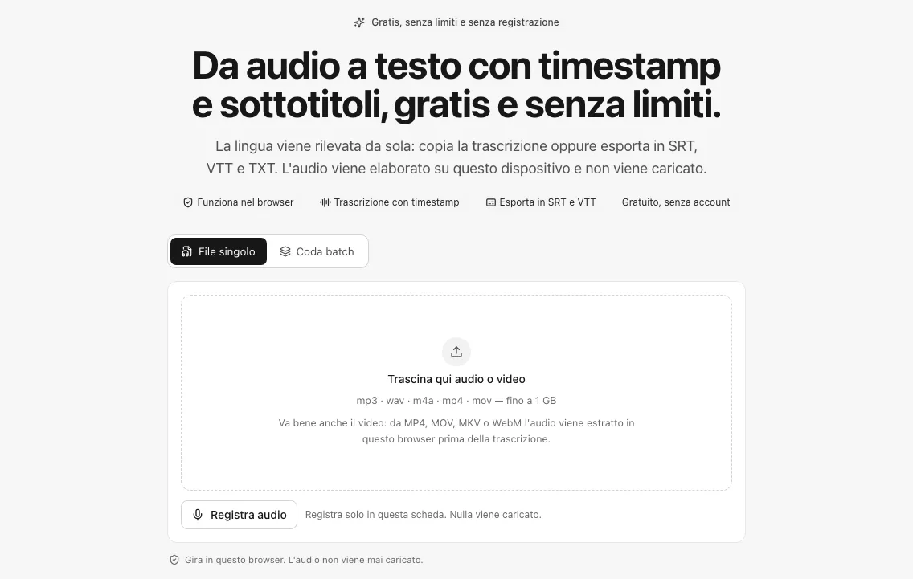

<p align="center">
  <b>🌐 Languages:</b><br/>
  <a href="README.md">English</a> ·
  <a href="README.zh-CN.md">简体中文</a> ·
  <a href="README.zh-TW.md">繁體中文</a> ·
  <a href="README.ja.md">日本語</a> ·
  <a href="README.ko.md">한국어</a> ·
  <a href="README.es.md">Español</a> ·
  <a href="README.pt-BR.md">Português</a> ·
  <a href="README.fr.md">Français</a> ·
  <a href="README.de.md">Deutsch</a> ·
  <a href="README.it.md">Italiano</a> ·
  <a href="README.nl.md">Nederlands</a> ·
  <a href="README.pl.md">Polski</a> ·
  <a href="README.ru.md">Русский</a> ·
  <a href="README.uk.md">Українська</a> ·
  <a href="README.sv.md">Svenska</a> ·
  <a href="README.nb.md">Norsk</a> ·
  <a href="README.da.md">Dansk</a> ·
  <a href="README.fi.md">Suomi</a> ·
  <a href="README.id.md">Bahasa Indonesia</a> ·
  <a href="README.tr.md">Türkçe</a> ·
  <a href="README.vi.md">Tiếng Việt</a> ·
  <a href="README.th.md">ไทย</a> ·
  <a href="README.hi.md">हिन्दी</a> ·
  <a href="README.bn.md">বাংলা</a>
</p>

<h1 align="center">EarScribe — Trascrizione gratuita di audio e video nel browser</h1>

<p align="center">
  <b>Trascina un file audio, un video, oppure registra dal microfono. Ottieni una trascrizione con timestamp e i sottotitoli.</b><br/>
  <sub>Whisper gira sul tuo dispositivo tramite WebGPU o WebAssembly — la registrazione non viene mai caricata.</sub>
</p>

<p align="center">
  <a href="https://earscribe.app"></a>
  <a href="https://earscribe.app"></a>
  <a href="https://earscribe.app"></a>
  <a href="https://earscribe.app"></a>
  
</p>

<p align="center">
  <a href="https://earscribe.app"></a>
</p>

<p align="center">
  <b>🔗 Apri l'app:</b> <a href="https://earscribe.app">earscribe.app</a> ·
  <a href="https://earscribe.app/guides">Guide</a> ·
  <a href="https://earscribe.app/changelog">Changelog</a> ·
  <a href="https://earscribe.app/about">Chi siamo</a>
</p>

---

## 🎙️ Cos'è EarScribe

Un'area di lavoro per la trascrizione che gira interamente nella scheda del browser. Le dai un audio, un file video o il microfono; ti restituisce testo con timestamp su cui fare clic per riascoltare, più file di sottotitoli da passare a un montatore. Nessun account, nessun caricamento e nessun costo al minuto.

Tre modi per iniziare, un'unica pipeline:

- **Un file** — MP3, WAV, M4A, AAC, OGG, FLAC, Opus o quasi tutto ciò che la Web Audio API riesce a decodificare, fino a 1 GiB.
- **Un video** — MP4, MOV, MKV, WebM, M4V, TS, QT, M2TS. La traccia audio viene demuxata e ricodificata a 16 kHz mono **dentro la scheda**, poi trascritta come qualsiasi altro file. Niente ffmpeg, niente siti di conversione.
- **Il microfono** — registra e trascrivi nello stesso posto: una lezione, una chiamata che hai il permesso di registrare, o un promemoria vocale che altrimenti perderesti.

Aggiungi la coda e puoi trascinare un'intera cartella di file e andartene; aggiungi l'area di lavoro su `/dashboard` e i risultati diventano progetti che puoi riaprire, modificare ed esportare più tardi.

> 👉 **App live:** **[earscribe.app](https://earscribe.app)**

---

## 📚 Indice

- [✨ Cosa fa](#-cosa-fa)
- [🖼️ Screenshot](#️-screenshot)
- [🚀 Avvio rapido](#-avvio-rapido)
- [🗂️ Area di lavoro](#️-area-di-lavoro)
- [💸 Quanto costa](#-quanto-costa)
- [🆚 Confronto](#-confronto)
- [🌍 Formati e lingue supportati](#-formati-e-lingue-supportati)
- [💼 Casi d'uso](#-casi-duso)
- [🚧 Cosa non fa](#-cosa-non-fa)
- [❓ FAQ](#-faq)
- [🛠️ Stack tecnico](#️-stack-tecnico)
- [🧑‍💻 Sviluppo in locale](#-sviluppo-in-locale)
- [☁️ Deploy](#️-deploy)
- [🌐 Aggiungere una lingua](#-aggiungere-una-lingua)
- [🔬 Aggiungere un modello Whisper](#-aggiungere-un-modello-whisper)
- [🤝 Contribuire](#-contribuire)
- [📄 Licenza](#-licenza)

---

## ✨ Cosa fa

| | Funzione | Cosa ottieni davvero |
|---|---|---|
| 🎬 | **Audio, video e microfono** | I contenitori video sono accettati direttamente. La traccia audio viene estratta in locale, quindi anche un MP4 da 200 MB non lascia mai la macchina. |
| 📝 | **Trascrizione con timestamp** | Ogni cue porta un orario di inizio e uno di fine. Fai clic su una riga per ascoltare quel momento; la forma d'onda segue. |
| 🔍 | **Ricerca nella trascrizione** | Un nome, un numero, un termine: salta alla frase e riascoltala invece di riascoltare tutto il file. |
| 🎞️ | **Esportazione dei sottotitoli** | SRT, WebVTT, testo semplice, JSON (l'oggetto della trascrizione con timecode a piena precisione) oppure gli appunti. |
| 🧪 | **Controllo dei sottotitoli** | Segnala i cue troppo lunghi, troppo veloci, ripetuti, vuoti o sovrapposti prima che tu li esporti. |
| 📚 | **Coda in batch** | Trascina più file, imposta un modello e una lingua parlata, e lascia che la coda li elabori in ordine. Puoi metterla in pausa dopo il file corrente in qualsiasi momento. |
| 🗂️ | **Progetti** | I risultati vengono salvati nel browser come progetti sotto `/dashboard`: trascrizioni, sottotitoli, file di origine e un cestino, riapribili più tardi. |
| ✏️ | **Modifica dei sottotitoli** | Correggi il testo, sposta il punto di ingresso o di uscita di un cue, dividi o elimina un cue, poi esporta di nuovo. |
| 💾 | **Backup e ripristino** | Esporta l'intera area di lavoro in un unico file e importala in un altro browser. |
| 🔁 | **Conversione dei sottotitoli** | SRT ⇄ VTT e SRT → testo, nel browser, senza scaricare alcun modello: è l'unico strumento qui che parte all'istante. |
| 🆓 | **Gratis e senza limiti** | Nessun piano a pagamento, nessuna quota giornaliera, nessun costo al minuto, nessun account. |
| 🔒 | **Privato per architettura** | La trascrizione gira in locale. Le pagine pubbliche contengono analytics e annunci; `/dashboard` è senza pubblicità. |
| 🌍 | **27 lingue dell'interfaccia, 99 lingue parlate** | L'interfaccia è tradotta in 27 locale; Whisper rileva da sé la lingua parlata. |

---

## 🖼️ Screenshot

> Screenshot reali dal sito live su **[earscribe.app](https://earscribe.app)**.

### 1. Trascina un file o un video, oppure registra — senza registrazione, senza caricamento

<p align="center">
  <a href="https://earscribe.app"></a>
</p>

<p align="center"><sub>Trascinamento di un file, di un video o registrazione dal microfono, senza registrazione né caricamento.</sub></p>

### 2. Trascrizione con timestamp e forma d'onda — fai clic su una riga per saltare

<p align="center">
  <a href="https://earscribe.app"></a>
</p>

<p align="center"><sub>Trascrizione con timestamp allineata alla forma d'onda; un clic su una riga riporta la riproduzione a quel punto.</sub></p>

### 3. Tre passaggi: trascina → scegli un modello Whisper → esporta

<p align="center">
  <a href="https://earscribe.app"></a>
</p>

<p align="center"><sub>I tre passaggi dell'interfaccia: trascinare un media, scegliere un modello Whisper, esportare il risultato.</sub></p>

### 4. Perché EarScribe — Whisper nel browser, privacy al primo posto

<p align="center">
  <a href="https://earscribe.app"></a>
</p>

<p align="center"><sub>Pagina delle funzioni: elaborazione sul dispositivo, WebGPU e WebAssembly, formati di esportazione.</sub></p>

### 5. Chi usa EarScribe — podcaster, giornalisti, studenti, montatori

<p align="center">
  <a href="https://earscribe.app"></a>
</p>

<p align="center"><sub>Panoramica degli usi: podcast, giornalismo, studio, montaggio video.</sub></p>

### 6. EarScribe vs Otter.ai, Rev, HappyScribe e un'installazione locale di Whisper

<p align="center">
  <a href="https://earscribe.app"></a>
</p>

<p align="center"><sub>Tabella di confronto con i servizi cloud e con un'installazione locale di Whisper.</sub></p>

### 7. FAQ — privacy, formati, esportazione dei sottotitoli, uso offline

<p align="center">
  <a href="https://earscribe.app"></a>
</p>

<p align="center"><sub>Sezione FAQ: privacy, formati accettati, esportazione dei sottotitoli, uso offline.</sub></p>

---

## 🚀 Avvio rapido

1. Apri **[earscribe.app](https://earscribe.app)** in Chrome, Edge, Safari o Firefox.
2. Trascina un file — o un video, oppure premi registra. Accetta fino a 1 GiB per file; il limite vero è la memoria del dispositivo, non la dimensione su disco.
3. Scegli un modello. **base** è il predefinito e va bene per la maggior parte del parlato; **tiny** è per un telefono o un promemoria vocale veloce; **small** e **turbo** sono per audio con accento, rumoroso o importante.
4. Premi **Trascrivi**. L'audio viene decodificato e passato a Whisper dentro la scheda. Alla prima esecuzione vengono scaricati i pesi, quindi tieni d'occhio la dimensione sul pulsante.
5. Leggi la trascrizione, fai clic su una riga per riascoltarla, correggi ciò che conta, poi **Esporta → SRT / VTT / TXT / JSON** oppure copia.

Vuoi invece un batch? Passa alla coda, trascina tutti i file che vuoi e scegli il modello una volta sola. La coda elabora un file alla volta, riusa il modello già in memoria e salva ogni risultato come progetto.

> 💡 **Nessuna conversione necessaria.** Un MP4 di due ore entra così com'è. Se preferisci tenere solo l'audio, l'app può estrarre per te la traccia audio di un video.

---

## 🗂️ Area di lavoro

`/dashboard` è lo stesso motore di trascrizione, ma con la memoria. Tutto è salvato in questo browser — IndexedDB per i record dei progetti, CacheStorage per i pesi dei modelli — e nulla viene sincronizzato con un account, perché un account non esiste.

| Sezione | Cosa contiene |
|---|---|
| **Progetti** | Tutto, dal più recente. |
| **Trascrizioni** | Progetti creati da un'esecuzione di trascrizione. Modificarne i cue li tiene qui. |
| **Sottotitoli** | Progetti creati da un file di sottotitoli — il convertitore e le importazioni — così il lavoro sui sottotitoli resta separato da quello sul parlato. |
| **File** | I media di origine che l'area di lavoro conserva, filtrabili per tipo: trascrizioni, sottotitoli, audio. L'audio originale **non** viene salvato per impostazione predefinita. |
| **Cestino** | Progetti eliminati, recuperabili finché non lo svuoti. |

Dentro un progetto puoi cercare nella trascrizione, fare clic su un timestamp per riascoltare, modificare i cue dei sottotitoli (testo, punti di ingresso e di uscita, aggiunta o rimozione), suddividere i cue lunghi in cue più brevi, riesportare in qualsiasi formato o aprire il player senza lasciare la pagina.

**Backup:** l'area di lavoro si esporta in un unico file (fino a 320 MB) e si importa in un altro browser o su un'altra macchina. Poiché i progetti non lasciano mai il dispositivo, questo file è l'unica copia che viaggia: trattalo come qualsiasi altro backup di documenti.

---

## 💸 Quanto costa

Gratis, ma non senza costi. Queste sono dimensioni di download misurate per modello e backend, non stime:

| Modello | WebGPU | WebAssembly | Uso tipico |
|---|---:|---:|---|
| **tiny** | 151 MB | 41 MB | Promemoria vocali, telefoni di fascia bassa, un primo tentativo |
| **base** *(predefinito)* | 291 MB | 77 MB | Interviste, riunioni, podcast |
| **small** | 968 MB | 249 MB | Parlato con accento, stanze rumorose |
| **turbo** | 3.24 GB | 1.09 GB | Trascrizioni di livello studio, quando l'accuratezza conta più del tempo |

- **Scarichi una volta, poi resta in cache.** I pesi vivono nella cache del browser; una seconda esecuzione non scarica nulla. Un profilo del browser diverso significa scaricare di nuovo.
- **La GPU vale la pena.** Sulla stessa macchina, WebGPU ha finito un file da 40 minuti con base in circa 3.8 minuti contro 9.4 sulla CPU — circa 2.5× più veloce, per un download da tre a quattro volte più grande. `turbo` su WebGPU non ha mai completato il download da 3.24 GB nel nostro test, quindi è indicato come non misurato anziché veloce.
- **Decide la memoria, non la dimensione del file.** Le registrazioni lunghe vengono decodificate a 16 kHz mono prima della trascrizione. Un MP3 da 40 minuti richiede qualche centinaio di megabyte; un WAV stereo da due ore può esaurire una scheda ancora prima di iniziare. La decodifica ora richiede direttamente 16 kHz, il che ha ridotto la memoria di picco su un file stereo da due ore da circa 1.6 GB a 0.5 GB.
- **Nessun server, nessuna coda sulla macchina di qualcun altro.** Il tempo è della tua CPU, quindi un portatile lento è lento. È il prezzo per non caricare nulla.

Le misure complete, con il metodo e le esecuzioni fallite, sono nelle [guide](https://earscribe.app/guides).

---

## 🆚 Confronto

Come si comporta EarScribe rispetto agli altri modi di trascrivere audio nel 2026?

| | **EarScribe** | Otter.ai Free | Rev Free Trial | HappyScribe | Local Whisper CLI |
|---|:---:|:---:|:---:|:---:|:---:|
| **Gratis e senza limiti** | ✅ | ⚠️ 300 min/mese | ❌ Solo prova | ❌ A pagamento | ✅ |
| **Nessuna registrazione / login** | ✅ | ❌ | ❌ | ❌ | ✅ |
| **Nessun caricamento (privato)** | ✅ | ❌ | ❌ | ❌ | ✅ |
| **Video senza caricarlo** | ✅ Estrazione locale | ❌ Caricamento obbligatorio | ❌ Caricamento obbligatorio | ❌ Caricamento obbligatorio | ✅ Richiede ffmpeg |
| **Funziona nel browser** | ✅ | ✅ | ✅ | ✅ | ❌ |
| **Esportazione SRT / VTT** | ✅ | ⚠️ A pagamento | ✅ | ✅ | ⚠️ Manuale |
| **Trascrizione con timestamp** | ✅ | ✅ | ✅ | ✅ | ⚠️ Manuale |
| **Inferenza locale** | ✅ | ❌ | ❌ | ❌ | ✅ |
| **99 lingue parlate** | ✅ | ⚠️ Limitate | ⚠️ Limitate | ✅ | ✅ |
| **Whisper Large v3 Turbo** | ✅ | ❌ | ❌ | ❌ | ✅ |
| **Installazione richiesta** | ❌ Nessuna | ❌ Nessuna | ❌ Nessuna | ❌ Nessuna | ⚠️ Python + GPU |
| **Costo** | $0 | $0–$30/mese | $0.25/min | €0.20/min | $0 (il tuo hardware) |

**Dove è più debole:** un'installazione locale può far girare un modello più grande su un backend più veloce di una scheda del browser, e un servizio a pagamento aggiunge le etichette degli speaker e un'area di lavoro per team. Il vantaggio di EarScribe è che è gratis, non richiede installazioni e l'audio non va da nessuna parte.

→ **[Provalo su earscribe.app](https://earscribe.app)**

---

## 🌍 Formati e lingue supportati

### Audio — MP3, WAV, M4A, AAC, OGG, FLAC, Opus

Tutto ciò che la Web Audio API riesce a decodificare è accettato; questi sette formati coprono quasi ogni registrazione che incontrerai.

- 🎵 **[Da MP3 a testo](https://earscribe.app/mp3-to-text)** — lo standard di podcast e interviste
- 🎙️ **[Da WAV a testo](https://earscribe.app/wav-to-text)** — registrazioni lossless in studio e sul campo
- 📱 **[Da M4A a testo](https://earscribe.app/m4a-to-text)** — Promemoria vocali di iPhone
- 🎧 **[Da promemoria vocale a testo](https://earscribe.app/voice-memo-to-text)** — registrazioni da telefono su mobile
- 🔊 **[Da audio a testo](https://earscribe.app/audio-to-text)** — il punto di ingresso generale
- 🎬 **[Da audio a SRT](https://earscribe.app/audio-to-srt)** — dritto ai sottotitoli

### Video — MP4, MOV, MKV, WebM, M4V, TS, QT, M2TS

La traccia audio viene demuxata con [mediabunny](https://mediabunny.dev), decodificata con WebCodecs e ricodificata come un piccolo MP3 mono a 16 kHz (o WAV dove non esiste un encoder MP3) — tutto in locale. Un contenitore che il browser non riesce a decodificare fallisce con un messaggio chiaro invece di produrre una trascrizione vuota senza avviso.

### Microfono

La registrazione avviene nella scheda con MediaRecorder. Una registrazione viene trascritta esattamente come un file trascinato; i sottotitoli in tempo reale durante la registrazione **non** sono previsti (vedi [cosa non fa](#-cosa-non-fa)).

### Lingue — 99 parlate, 27 dell'interfaccia

Whisper rileva automaticamente la lingua parlata: inglese, spagnolo, francese, tedesco, italiano, portoghese, russo, giapponese, coreano, cinese (semplificato e tradizionale), arabo, hindi, turco, olandese, polacco, indonesiano, svedese, norvegese, danese, finlandese, ceco, ungherese, greco, ebraico, thai, vietnamita e altre 70+ lingue.

L'interfaccia è tradotta in 27 locale. L'inglese sta su `/`, le altre 26 hanno un prefisso:

| | | | |
|---|---|---|---|
| [English](https://earscribe.app) | [简体中文](https://earscribe.app/zh-CN) | [日本語](https://earscribe.app/ja) | [한국어](https://earscribe.app/ko) |
| [Español](https://earscribe.app/es) | [Português (BR)](https://earscribe.app/pt-br) | [Deutsch](https://earscribe.app/de) | [Français](https://earscribe.app/fr) |
| [Русский](https://earscribe.app/ru) | [Italiano](https://earscribe.app/it) | [Polski](https://earscribe.app/pl) | [Nederlands](https://earscribe.app/nl) |
| [Українська](https://earscribe.app/uk) | [Türkçe](https://earscribe.app/tr) | [Tiếng Việt](https://earscribe.app/vi) | [ไทย](https://earscribe.app/th) |
| [हिन्दी](https://earscribe.app/hi) | [বাংলা](https://earscribe.app/bn) | [اردو](https://earscribe.app/ur) | [العربية](https://earscribe.app/ar) |
| [فارسی](https://earscribe.app/fa) | [Bahasa Indonesia](https://earscribe.app/id) | [Svenska](https://earscribe.app/sv) | [Norsk](https://earscribe.app/nb) |
| [Dansk](https://earscribe.app/da) | [Suomi](https://earscribe.app/fi) | [繁體中文](https://earscribe.app/zh-TW) | |

---

## 💼 Casi d'uso

### 🎙️ Podcaster e creator
La **[trascrizione di podcast](https://earscribe.app/podcast-transcription)** serve per le note dell'episodio, la SEO e l'accessibilità. Esporta SRT per la versione video, TXT per il blog.

### 📰 Giornalisti e ricercatori
La **[trascrizione di interviste](https://earscribe.app/interview-transcription)** in cui la registrazione originale resta sul tuo portatile. Non esiste una copia di terzi che possa trapelare, essere citata in giudizio o finire sotto audit.

### 🎓 Studenti e docenti
La **[trascrizione di lezioni](https://earscribe.app/audio-to-text)** di una lezione registrata, consultabile prima della sessione successiva. Funziona con i Promemoria vocali di iPhone e con gli export di Zoom.

### 📞 Riunioni e ricerche utente
**[Da registrazione di riunione a testo](https://earscribe.app/meeting-recording-to-text)** — la trascrizione della chiamata, non note di riunione generate automaticamente.

### 🎬 Montatori video
**[Da audio a SRT](https://earscribe.app/audio-to-srt)** per YouTube, Premiere, Final Cut e Resolve. Il timing dei cue viene dai timestamp di Whisper stesso, e il controllo dei sottotitoli segnala ciò che andrà fuori schermo.

### 📚 Audiolibri e registrazioni lunghe
I file da due ore sono supportati, ma sono il caso in cui decide la memoria del dispositivo. Leggi [come vengono gestiti gli audio lunghi](https://earscribe.app/guides/how-to-transcribe-long-audio) prima di iniziarne uno da quattro ore.

---

## 🚧 Cosa non fa

Essere espliciti qui fa risparmiare a tutti un'esecuzione sprecata:

- **Nessuna separazione degli speaker.** Due persone in un file producono testo senza indicazione dei parlanti, senza etichette "Speaker 1 / Speaker 2". La pagina delle interviste lo dice di proposito.
- **Nessuna traduzione.** La trascrizione resta nella lingua in cui si è parlato; la lingua dell'interfaccia e quella parlata non hanno rapporto.
- **Nessun sottotitolo in tempo reale.** Registrazione e trascrizione sono passaggi separati: prima il microfono registra, poi il file viene trascritto.
- **La coda è seriale e richiede la scheda aperta.** Un modello, un'impostazione di lingua per l'intero batch. Chiudere la scheda la ferma.
- **Nessuna sincronizzazione tra dispositivi.** I progetti vivono in questo browser. Usa l'esportazione dell'area di lavoro per spostarli.
- **Non è un'app offline.** I pesi sono in cache, ma la pagina stessa viene caricata dalla rete. Installarla aggiunge una scorciatoia su desktop o home screen, non una copia offline.
- **1 GiB per file è un limite massimo; quello pratico è la memoria.**

---

## ❓ FAQ

<details>
<summary><b>EarScribe è davvero gratis, senza limiti?</b></summary><br/>
Sì — nessun piano a pagamento, nessuna carta di credito, nessun costo al minuto, nessuna quota giornaliera o mensile, nessun account. Il calcolo gira sul tuo hardware, quindi non c'è una bolletta cloud da ribaltare. C'è un limite di 1 GiB per file, e la memoria del tuo dispositivo determina cosa riesce ad arrivare in fondo.
</details>

<details>
<summary><b>Il mio audio viene caricato da qualche parte?</b></summary><br/>
No. L'audio viene decodificato nella scheda e passato a un modello Whisper in esecuzione in un Web Worker. I pesi del modello vengono scaricati <i>verso</i> il tuo browser da una CDN, il che significa che la CDN vede il tuo indirizzo IP — ma la registrazione non viene inviata. Le pagine pubbliche contengono Google AdSense — tranne le pagine in persiano, che la policy di AdSense esclude — più analytics Plausible senza cookie; <code>/dashboard</code> non carica codice pubblicitario.
</details>

<details>
<summary><b>Posso trascrivere un video?</b></summary><br/>
Sì, direttamente — MP4, MOV, MKV, WebM, M4V, TS, QT e M2TS. La traccia audio viene estratta dentro il browser e trascritta come un file normale, quindi non servono ffmpeg né siti di conversione. Se un contenitore usa un codec che il browser non riesce a decodificare, l'app lo dice invece di produrre una trascrizione vuota.
</details>

<details>
<summary><b>Perché la prima esecuzione è lenta?</b></summary><br/>
La prima volta che usi un modello, il browser ne scarica i pesi — da 41 MB per tiny su WebAssembly fino a 3.24 GB per turbo su WebGPU. Poi restano in cache. Scegli <b>base</b> (77 MB su WebAssembly, 291 MB su WebGPU) per quasi tutto.
</details>

<details>
<summary><b>Quanto è accurato, e quale modello devo scegliere?</b></summary><br/>
Sullo stesso clip di 34 secondi i nostri quattro modelli sono stati in disaccordo su 26 parole su 111, e lo stesso modello con due dimensioni di download è stato in disaccordo con se stesso. Scegli in base alle parole che contano per te, non a una percentuale di accuratezza: <a href="https://earscribe.app/guides/which-whisper-model-should-i-use">la guida ai modelli</a> mostra le differenze reali.
</details>

<details>
<summary><b>Posso ottenere sottotitoli SRT o VTT?</b></summary><br/>
Sì: Esporta → SRT o VTT. Il timing viene dai confini dei segmenti di Whisper, non da una divisione del testo a posteriori. Il controllo dei sottotitoli segnala i cue troppo lunghi, troppo veloci, ripetuti, vuoti o sovrapposti, e puoi modificare testo e timing dei cue prima di esportare.
</details>

<details>
<summary><b>E se ho già un file SRT o VTT?</b></summary><br/>
Convertilo senza scaricare un modello: <a href="https://earscribe.app/srt-to-vtt">Da SRT a VTT</a> e <a href="https://earscribe.app/srt-to-txt">Da SRT a testo</a> analizzano il file in locale. Nulla viene caricato e nessun peso di Whisper viene scaricato.
</details>

<details>
<summary><b>Funziona offline?</b></summary><br/>
La fase di trascrizione sì: una volta caricati la pagina e il modello, l'audio viene elaborato senza contattare un server di trascrizione. L'app non è un pacchetto offline — aprirla richiede la rete, e un modello che non hai mai scaricato va recuperato. Installarla dal footer aggiunge una scorciatoia che apre l'area di lavoro; non aggiunge una copia offline.
</details>

<details>
<summary><b>Indica chi sta parlando?</b></summary><br/>
No. L'output è testo senza indicazione dei parlanti con timecode. La diarizzazione degli speaker non fa parte di questa build, e l'app non finge il contrario.
</details>

<details>
<summary><b>Dove vengono salvati i miei risultati?</b></summary><br/>
In questo browser: i progetti in IndexedDB, i pesi dei modelli in CacheStorage. L'audio originale non viene salvato insieme a un progetto, a meno che tu non lo conservi. Una pagina che non è mai stata salvata nell'area di lavoro riparte pulita al ricaricamento; usa <code>/dashboard</code> e la sua esportazione per conservare ciò che ti interessa.
</details>

<details>
<summary><b>Esiste un'alternativa gratuita a Otter.ai o Rev?</b></summary><br/>
EarScribe è un'alternativa gratuita ai servizi di trascrizione cloud: il calcolo lo fai tu, l'audio resta dov'è e non ci sono costi al minuto. Il compromesso è reale — nessuna etichetta degli speaker, nessuna area di lavoro per team, e i file lunghi sono limitati dalla tua macchina.
</details>

<details>
<summary><b>Come converto un MP3 in testo gratis?</b></summary><br/>
Trascina l'MP3 su <a href="https://earscribe.app/mp3-to-text">earscribe.app/mp3-to-text</a> (o sulla home page). Viene decodificato nel browser, trascritto in locale e può essere copiato o esportato come SRT, VTT, TXT o JSON.
</details>

> Altre risposte nella **[pagina Chi siamo](https://earscribe.app/about)**, e note di misurazione nelle **[guide](https://earscribe.app/guides)**.

---

## 🛠️ Stack tecnico

- **[Next.js 15](https://nextjs.org)** (App Router) + **React 19**
- **[@huggingface/transformers v3](https://huggingface.co/docs/transformers.js)** — ONNX Runtime Web, WebGPU con fallback su WebAssembly
- **[OpenAI Whisper](https://github.com/openai/whisper)** — tiny, base, small e large-v3-turbo, quantizzati ONNX
- **[mediabunny](https://mediabunny.dev)** + **WebCodecs** — demuxing video ed estrazione audio nella scheda
- **[next-intl](https://next-intl.dev)** — 27 locale, un catalogo di messaggi per lingua
- **[Tailwind CSS v4](https://tailwindcss.com)**
- **[Cloudflare Pages](https://pages.cloudflare.com)** per l'hosting, con alcune Pages Functions (host dei modelli, endpoint di feedback)

Il sito è renderizzato staticamente e idrata nel browser; trascrizione e conversione dei sottotitoli avvengono solo lato client. I pesi dei modelli arrivano dalla CDN di Hugging Face al primo uso e vengono messi in cache in CacheStorage.

---

## 🧑‍💻 Sviluppo in locale

```bash
git clone https://github.com/rocnubie/earscribe-free-speech-to-text.git
cd earscribe-free-speech-to-text
pnpm install
pnpm dev
# → http://localhost:3000
```

Controlli che girano prima di un deploy:

```bash
pnpm typecheck
pnpm lint
pnpm test              # node:test — queue state machine, subtitle parsers, release id
pnpm i18n:gate         # no missing keys, no English leftovers, no broken placeholders
pnpm seo:check         # page copy, keyword coverage, FAQ and cursor audits
node scripts/sitemap-audit.mjs
node scripts/llms-txt-audit.mjs
pnpm readme:audit      # README sizes vs lib/models.ts, links, 9-language parity
```

`pnpm build` produce un export statico in `out/`. Diverse verifiche leggono `out/`, quindi esegui prima la build.

---

## ☁️ Deploy

I deploy in produzione passano da un solo comando, che esegue tutte le verifiche in ordine:

```bash
pnpm pages:deploy
```

Prima confronta il marker di deploy locale (`deployId` in `lib/release.ts`) con quello servito su `/changelog` nel sito live e si rifiuta di continuare se coincidono — è così che si intercetta una build obsoleta. Poi esegue la build, lancia le verifiche su link, guide, `llms.txt`, i18n, sitemap e PWA, e pubblica `out/` su Cloudflare Pages.

`/changelog` è un elenco di modifiche pensato per chi legge, su cui qualcuno può agire. Non è un log di build: refactor interni, correzioni di copy e lavoro di traduzione ottengono un nuovo `deployId` ma nessuna voce nel changelog.

Ambiente e binding:

| Nome | A cosa serve |
|---|---|
| `NEXT_PUBLIC_SITE_URL` | URL canonici, sitemap, tag OG |
| `NEXT_PUBLIC_PLAUSIBLE_DOMAIN` | Identificatore del sito per Plausible |
| `NEXT_PUBLIC_PLAUSIBLE_SCRIPT_URL` | URL dello script Plausible |
| `FEEDBACK_DB` (binding D1) | L'endpoint `/feedback`; lo schema è in `migrations/` |

---

## 🌐 Aggiungere una lingua

1. Aggiungi il codice della locale a `ALL_LOCALE_NAMES` in [`i18n/locale.ts`](i18n/locale.ts).
2. Aggiungi `messages/<code>.json` accanto a `en.json`, completamente tradotto.
3. Esegui `pnpm i18n:gate` — routing, sitemap, hreflang e metadati OG rilevano la locale da soli, ma una chiave mancante fa fallire il gate.

Solo le locale che passano il gate appartengono a `translatedLocales`; il selettore di lingua etichetta tutte le altre come parziali.

---

## 🔬 Aggiungere un modello Whisper

Aggiungi una voce a `MODELS` in [`lib/models.ts`](lib/models.ts) con una `sizeMB` **misurata** sia per `wasm` sia per `webgpu` — i due backend distribuiscono file di pesi diversi, e citare un solo numero per entrambi è il modo in cui l'app una volta prometteva 500 MB e ne consegnava 968 MB. Il repository deve esistere su Hugging Face come `onnx-community/<name>` oppure essere compatibile con ONNX-Whisper. Aggiungi un blocco `models.<id>` corrispondente a ogni `messages/*.json` per il testo di pro e contro.

---

## 🤝 Contribuire

Le pull request sono benvenute — soprattutto:

- Traduzioni (`messages/<code>.json`) e correzioni ai README specifici per locale
- Segnalazioni di bug con il file che ha causato il problema, il browser e la memoria del dispositivo
- Misurazioni: dimensione dei modelli, tempi e memoria di picco su hardware che non abbiamo
- Correzioni di accessibilità

Apri una issue o una PR qui, oppure prova prima **[earscribe.app](https://earscribe.app)** per vedere a cosa contribuiresti.

---

## 📄 Licenza

Il sito di marketing e le pagine di questo repository sono [MIT](LICENSE): liberi per uso personale e commerciale. Il worker di trascrizione, il decoder audio e gli esportatori di sottotitoli non sono pubblicati qui, quindi questo repository non è una copia completa e auto-ospitabile del servizio.

---

<p align="center">
  <b>👉 Prova l'app live: <a href="https://earscribe.app">earscribe.app</a></b><br/>
  <sub>Da audio a testo · Da video a testo · Dal parlato al testo · Esportazione sottotitoli · 100% gratis · Nessuna registrazione · Sul dispositivo</sub>
</p>

<p align="center">
  Realizzato con ❤️ su <a href="https://github.com/openai/whisper">OpenAI Whisper</a>, <a href="https://huggingface.co/docs/transformers.js">Transformers.js</a>, <a href="https://onnxruntime.ai">ONNX Runtime Web</a> e <a href="https://mediabunny.dev">mediabunny</a>.
</p>
