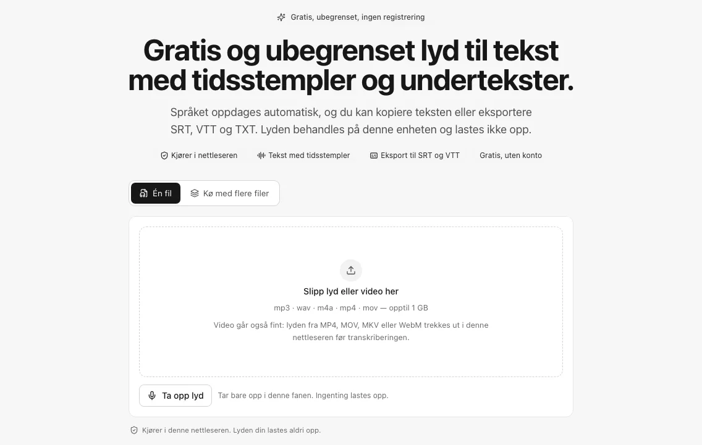

<p align="center">
  <b>🌐 Languages:</b><br/>
  <a href="README.md">English</a> ·
  <a href="README.zh-CN.md">简体中文</a> ·
  <a href="README.zh-TW.md">繁體中文</a> ·
  <a href="README.ja.md">日本語</a> ·
  <a href="README.ko.md">한국어</a> ·
  <a href="README.es.md">Español</a> ·
  <a href="README.pt-BR.md">Português</a> ·
  <a href="README.fr.md">Français</a> ·
  <a href="README.de.md">Deutsch</a> ·
  <a href="README.it.md">Italiano</a> ·
  <a href="README.nl.md">Nederlands</a> ·
  <a href="README.pl.md">Polski</a> ·
  <a href="README.ru.md">Русский</a> ·
  <a href="README.uk.md">Українська</a> ·
  <a href="README.sv.md">Svenska</a> ·
  <a href="README.nb.md">Norsk</a> ·
  <a href="README.da.md">Dansk</a> ·
  <a href="README.fi.md">Suomi</a> ·
  <a href="README.id.md">Bahasa Indonesia</a> ·
  <a href="README.tr.md">Türkçe</a> ·
  <a href="README.vi.md">Tiếng Việt</a> ·
  <a href="README.th.md">ไทย</a> ·
  <a href="README.hi.md">हिन्दी</a> ·
  <a href="README.bn.md">বাংলা</a>
</p>

<h1 align="center">EarScribe — gratis lyd og video til tekst, transkribering i nettleseren</h1>

<p align="center">
  <b>Slipp inn en lydfil eller en video, eller spill inn fra mikrofonen. Få en transkribering med tidsstempler og undertekster.</b><br/>
  <sub>Whisper kjører på din egen enhet via WebGPU eller WebAssembly — opptaket lastes aldri opp.</sub>
</p>

<p align="center">
  <a href="https://earscribe.app"></a>
  <a href="https://earscribe.app"></a>
  <a href="https://earscribe.app"></a>
  <a href="https://earscribe.app"></a>
  
</p>

<p align="center">
  <a href="https://earscribe.app"></a>
</p>

<p align="center">
  <b>🔗 Åpne appen:</b> <a href="https://earscribe.app">earscribe.app</a> ·
  <a href="https://earscribe.app/guides">Veiledninger</a> ·
  <a href="https://earscribe.app/changelog">Endringslogg</a> ·
  <a href="https://earscribe.app/about">Om</a>
</p>

---

## 🎙️ Hva EarScribe er

Et arbeidsområde for transkribering som kjører helt i nettleserfanen. Du gir det lyd, en videofil eller mikrofonen din; det gir tilbake tekst med tidsstempler du kan klikke på for å spille av igjen, pluss undertekstfiler du kan gi til en klipper. Det finnes ingen konto, ingen opplasting og ingen betaling per minutt.

Tre veier inn, én pipeline:

- **En fil** — MP3, WAV, M4A, AAC, OGG, FLAC, Opus, eller det meste Web Audio API kan dekode, opptil 1 GiB.
- **En video** — MP4, MOV, MKV, WebM, M4V, TS, QT, M2TS. Lydsporet demuxes og kodes om til 16 kHz mono **inne i fanen**, og transkriberes deretter som enhver annen fil. Ingen ffmpeg, ingen konverteringsside.
- **Mikrofonen** — spill inn og transkriber på samme sted, for en forelesning, en samtale du har lov til å ta opp, eller et talememo du ellers ville miste.

Legg til køen, og du kan slippe inn filene til en hel mappe og gå din vei; legg til arbeidsområdet på `/dashboard`, og resultatene blir prosjekter du kan åpne, redigere og eksportere senere.

> 👉 **Direkte-app:** **[earscribe.app](https://earscribe.app)**

---

## 📚 Innhold

- [✨ Hva den gjør](#-hva-den-gjør)
- [🖼️ Skjermbilder](#️-skjermbilder)
- [🚀 Kom i gang](#-kom-i-gang)
- [🗂️ Arbeidsområdet](#️-arbeidsområdet)
- [💸 Hva det koster](#-hva-det-koster)
- [🆚 Sammenligning](#-sammenligning)
- [🌍 Inndata og språk som støttes](#-inndata-og-språk-som-støttes)
- [💼 Bruksområder](#-bruksområder)
- [🚧 Hva den ikke gjør](#-hva-den-ikke-gjør)
- [❓ Ofte stilte spørsmål](#-ofte-stilte-spørsmål)
- [🛠️ Teknologistabel](#️-teknologistabel)
- [🧑‍💻 Lokal utvikling](#-lokal-utvikling)
- [☁️ Distribusjon](#️-distribusjon)
- [🌐 Legg til et nytt språk](#-legg-til-et-nytt-språk)
- [🔬 Legg til en ny Whisper-modell](#-legg-til-en-ny-whisper-modell)
- [🤝 Bidra](#-bidra)
- [📄 Lisens](#-lisens)

---

## ✨ Hva den gjør

| | Funksjon | Hva du faktisk får |
|---|---|---|
| 🎬 | **Lyd, video og mikrofon** | Videocontainere tas imot direkte. Lydsporet hentes ut lokalt, så en MP4 på 200 MB forlater aldri maskinen den heller. |
| 📝 | **Transkribering med tidsstempler** | Hver replikk har start- og sluttid. Klikk på en linje for å høre øyeblikket; markøren i bølgeformen følger med. |
| 🔍 | **Søk i transkriberingen** | Et navn, et tall, et begrep — hopp til setningen og spill den av igjen i stedet for å høre gjennom hele filen på nytt. |
| 🎞️ | **Underteksteksport** | SRT, WebVTT, ren tekst, JSON (transkriberingsobjektet med tidskoder i full presisjon) eller utklippstavlen. |
| 🧪 | **Undertekstkontroll** | Flagger replikker som er for lange, for raske, gjentatte, tomme eller overlappende før du eksporterer dem. |
| 📚 | **Batchkø** | Slipp inn flere filer, velg én modell og ett talt språk, og la køen kjøre dem i rekkefølge. Sett på pause etter gjeldende fil når som helst. |
| 🗂️ | **Prosjekter** | Resultatene lagres i nettleseren som prosjekter under `/dashboard`: transkriberinger, undertekster, kildefiler og en papirkurv, klare til å åpnes igjen senere. |
| ✏️ | **Redigering av undertekster** | Rett teksten, flytt inn- og utpunktet til en replikk, del eller slett en replikk, og eksporter på nytt. |
| 💾 | **Sikkerhetskopi og gjenoppretting** | Eksporter hele arbeidsområdet som én fil og importer det i en annen nettleser. |
| 🔁 | **Konvertering av undertekster** | SRT ⇄ VTT og SRT → tekst, i nettleseren, uten modelnedlasting — det eneste verktøyet her som starter umiddelbart. |
| 🆓 | **Gratis og ubegrenset** | Ingen betalt nivå, ingen daglig kvote, ingen minuttpris, ingen konto. |
| 🔒 | **Privat av arkitektur** | Transkriberingen kjører lokalt. Offentlige sider har analyse og annonser; `/dashboard` er annonsefri. |
| 🌍 | **27 grensesnittsspråk, 99 talte språk** | Grensesnittet er oversatt til 27 språk; Whisper oppdager det talte språket automatisk. |

---

## 🖼️ Skjermbilder

> Ekte skjermbilder fra det live nettstedet **[earscribe.app](https://earscribe.app)**.

### 1. Slipp inn en fil eller video, eller spill inn — ingen registrering, ingen opplasting

<p align="center">
  <a href="https://earscribe.app"></a>
</p>

<p align="center"><sub>Startsiden: slippsone for filer, mikrofonknapp og modellvalg i samme visning</sub></p>

### 2. Transkribering med tidsstempler og bølgeform — klikk på en hvilken som helst linje for å hoppe dit

<p align="center">
  <a href="https://earscribe.app"></a>
</p>

<p align="center"><sub>Transkripsjon med tidsstempler, bølgeform og eksportknapper for SRT og VTT</sub></p>

### 3. Tre trinn: slipp inn → velg en Whisper-modell → eksporter

<p align="center">
  <a href="https://earscribe.app"></a>
</p>

<p align="center"><sub>Tre steg i samme visning: fil, Whisper-modell og ferdig tekst klar for eksport</sub></p>

### 4. Hvorfor EarScribe — personvern først, Whisper rett i nettleseren

<p align="center">
  <a href="https://earscribe.app"></a>
</p>

<p align="center"><sub>Funksjonsoversikt: lokal behandling, automatisk språkregistrering og eksportformater</sub></p>

### 5. Hvem bruker EarScribe — podkastere, journalister, studenter, klippere

<p align="center">
  <a href="https://earscribe.app"></a>
</p>

<p align="center"><sub>Bruksområder for podkast, intervjuer, studier og undertekster</sub></p>

### 6. EarScribe mot Otter.ai, Rev, HappyScribe og en lokal Whisper-installasjon

<p align="center">
  <a href="https://earscribe.app"></a>
</p>

<p align="center"><sub>Sammenligningstabell mot Otter.ai, Rev, HappyScribe og lokal Whisper</sub></p>

### 7. Ofte stilte spørsmål — personvern, formater, underteksteksport, bruk uten nett

<p align="center">
  <a href="https://earscribe.app"></a>
</p>

<p align="center"><sub>Spørsmål og svar om personvern, formater og bruk uten nett</sub></p>

---

## 🚀 Kom i gang

1. Åpne **[earscribe.app](https://earscribe.app)** i Chrome, Edge, Safari eller Firefox.
2. Slipp inn en fil — eller en video, eller trykk på spill inn. Tar imot opptil 1 GiB per fil; den reelle grensen er enhetens minne, ikke størrelsen på disken.
3. Velg en modell. **base** er standard og riktig for det meste tale; **tiny** er for en telefon eller et raskt talememo; **small** og **turbo** er for tale med aksent, mye støy eller når det er viktig.
4. Trykk på **Transkriber**. Lyden dekodes og sendes til Whisper inne i fanen. Første kjøring laster ned vektene, så følg med på størrelsen på knappen.
5. Les transkriberingen, klikk på en linje for å spille den av igjen, rett det som betyr noe, og velg deretter **Eksporter → SRT / VTT / TXT / JSON** eller kopier.

Vil du heller kjøre en batch? Bytt til køen, slipp inn så mange filer du vil og velg modell én gang. Køen kjører én fil om gangen, gjenbruker modellen som allerede ligger i minnet, og lagrer hvert resultat som et prosjekt.

> 💡 **Ingen konverteringstrinn trengs.** En MP4 på to timer går rett inn. Vil du heller beholde bare lyden, kan appen hente ut lydsporet fra videoen for deg.

---

## 🗂️ Arbeidsområdet

`/dashboard` er den samme transkriberingsmotoren, men med hukommelse. Alt lagres i denne nettleseren — IndexedDB for prosjektpostene, CacheStorage for modellvektene — og ingenting synkroniseres til en konto, fordi det ikke finnes noen konto.

| Seksjon | Hva som ligger der |
|---|---|
| **Prosjekter** | Alt, nyeste først. |
| **Transkriberinger** | Prosjekter laget av en transkriberingskjøring. Redigering av replikkene deres holder dem her. |
| **Undertekster** | Prosjekter laget fra en undertekstfil — konvertereren og importene — slik at tekstearbeid holdes atskilt fra talearbeid. |
| **Filer** | Kildemediene som arbeidsområdet har, filtrerbare etter type: transkriberinger, undertekster, lyd. Den opprinnelige lyden lagres **ikke** som standard. |
| **Papirkurv** | Slettede prosjekter, gjenopprettbare til du tømmer den. |

Inne i et prosjekt kan du søke i transkriberingen, klikke på et tidsstempel for å spille av igjen, redigere undertekstreplikkene (tekst, inn- og utpunkter, legge til eller fjerne), dele lange replikker i kortere, eksportere på nytt i et hvilket som helst format, eller åpne mediespilleren uten å forlate siden.

**Sikkerhetskopi:** arbeidsområdet eksporteres som én enkelt fil (opptil 320 MB) og importeres i en annen nettleser eller på en annen maskin. Siden prosjektene aldri forlater enheten, er denne filen den eneste kopien som reiser — behandle den som enhver annen sikkerhetskopi av et dokument.

---

## 💸 Hva det koster

Gratis betyr ikke vektløst. Dette er målte nedlastingsstørrelser per modell og backend, ikke anslag:

| Modell | WebGPU | WebAssembly | Typisk bruk |
|---|---:|---:|---|
| **tiny** | 151 MB | 41 MB | Talememoer, enkle telefoner, et første forsøk |
| **base** *(standard)* | 291 MB | 77 MB | Intervjuer, møter, podkaster |
| **small** | 968 MB | 249 MB | Tale med aksent, støyende rom |
| **turbo** | 3.24 GB | 1.09 GB | Transkribering i studiokvalitet, når nøyaktighet betyr mer enn tid |

- **Last ned én gang, deretter bufret.** Vektene ligger i nettleserens buffer; en ny kjøring laster ikke ned noe. En annen nettleserprofil betyr å laste ned på nytt.
- **GPU-en er verdt det.** På samme maskin fullførte WebGPU en fil på 40 minutter med base på omtrent 3.8 minutter mot 9.4 på CPU — omtrent 2.5× raskere, for en nedlasting som er tre til fire ganger større. `turbo` på WebGPU rakk aldri å laste ned sine 3.24 GB i testen vår, så det står som umålt i stedet for raskt.
- **Minne avgjør, ikke filstørrelse.** Lange opptak dekodes til 16 kHz mono før transkribering. En MP3 på 40 minutter trenger noen hundre megabyte; en to timer lang stereo-WAV kan tømme en fane før den i det hele tatt starter. Dekodingen ber nå om 16 kHz direkte, noe som senket toppminnet på en to timer lang stereofil fra omtrent 1.6 GB til 0.5 GB.
- **Ingen server, ingen kø på noen andres maskin.** Tiden er CPU-ens din, så en treg laptop er treg. Det er prisen for å ikke laste opp.

Fullstendige målinger, med metode og kjøringene som feilet, finnes i [veiledningene](https://earscribe.app/guides).

---

## 🆚 Sammenligning

Hvordan står EarScribe seg mot andre måter å transkribere lyd på i 2026?

| | **EarScribe** | Otter.ai Free | Rev Free Trial | HappyScribe | Local Whisper CLI |
|---|:---:|:---:|:---:|:---:|:---:|
| **Gratis og ubegrenset** | ✅ | ⚠️ 300 min/mnd | ❌ Bare prøveperiode | ❌ Betalt | ✅ |
| **Ingen registrering / innlogging** | ✅ | ❌ | ❌ | ❌ | ✅ |
| **Ingen opplasting (privat)** | ✅ | ❌ | ❌ | ❌ | ✅ |
| **Video uten opplasting** | ✅ Hentes ut lokalt | ❌ Opplasting kreves | ❌ Opplasting kreves | ❌ Opplasting kreves | ✅ Krever ffmpeg |
| **Fungerer i nettleseren** | ✅ | ✅ | ✅ | ✅ | ❌ |
| **Eksport til SRT / VTT** | ✅ | ⚠️ Betalt | ✅ | ✅ | ⚠️ Manuelt |
| **Transkribering med tidsstempler** | ✅ | ✅ | ✅ | ✅ | ⚠️ Manuelt |
| **Inferens lokalt** | ✅ | ❌ | ❌ | ❌ | ✅ |
| **99 talte språk** | ✅ | ⚠️ Begrenset | ⚠️ Begrenset | ✅ | ✅ |
| **Whisper Large v3 Turbo** | ✅ | ❌ | ❌ | ❌ | ✅ |
| **Installasjon kreves** | ❌ Ingen | ❌ Ingen | ❌ Ingen | ❌ Ingen | ⚠️ Python + GPU |
| **Kostnad** | $0 | $0–$30/mnd | $0.25/min | €0.20/min | $0 (maskinvaren din) |

**Der den taper:** en lokal installasjon kan kjøre en større modell på en raskere backend enn en nettleserfane, og en betalt tjeneste legger til taleretiketter og et teamarbeidsområde. EarScribes fordel er at den er gratis, ikke krever noe installert, og at lyden aldri går noen vei.

→ **[Prøv på earscribe.app](https://earscribe.app)**

---

## 🌍 Inndata og språk som støttes

### Lyd — MP3, WAV, M4A, AAC, OGG, FLAC, Opus

Alt Web Audio API kan dekode tas imot; de sju formatene dekker nesten hvert opptak du møter.

- 🎵 **[MP3 til tekst](https://earscribe.app/mp3-to-text)** — standarden for podkaster og intervjuer
- 🎙️ **[WAV til tekst](https://earscribe.app/wav-to-text)** — tapsfrie studio- og feltopptak
- 📱 **[M4A til tekst](https://earscribe.app/m4a-to-text)** — iPhone Talememoer
- 🎧 **[Talememo til tekst](https://earscribe.app/voice-memo-to-text)** — telefonopptak på mobilen
- 🔊 **[Lyd til tekst](https://earscribe.app/audio-to-text)** — den generelle inngangen
- 🎬 **[Lyd til SRT](https://earscribe.app/audio-to-srt)** — rett til undertekster

### Video — MP4, MOV, MKV, WebM, M4V, TS, QT, M2TS

Lydsporet demuxes med [mediabunny](https://mediabunny.dev), dekodes med WebCodecs og kodes om til en liten mono-MP3 på 16 kHz (eller WAV der det ikke finnes noen MP3-koder) — alt lokalt. En container nettleseren ikke kan dekode, feiler med en tydelig melding i stedet for en stille, tom transkribering.

### Mikrofon

Opptaket skjer i fanen med MediaRecorder. Et opptak transkriberes akkurat som en fil du har sluppet inn; direkteteksting under opptaket tilbys **ikke** (se [hva den ikke gjør](#-hva-den-ikke-gjør)).

### Språk — 99 talte, 27 i grensesnittet

Whisper oppdager det talte språket automatisk: engelsk, spansk, fransk, tysk, italiensk, portugisisk, russisk, japansk, koreansk, kinesisk (forenklet og tradisjonell), arabisk, hindi, tyrkisk, nederlandsk, polsk, indonesisk, svensk, norsk, dansk, finsk, tsjekkisk, ungarsk, gresk, hebraisk, thai, vietnamesisk og 70+ til.

Grensesnittet er oversatt til 27 språk. Engelsk ligger på `/`, de øvrige 26 har et prefiks:

| | | | |
|---|---|---|---|
| [English](https://earscribe.app) | [简体中文](https://earscribe.app/zh-CN) | [日本語](https://earscribe.app/ja) | [한국어](https://earscribe.app/ko) |
| [Español](https://earscribe.app/es) | [Português (BR)](https://earscribe.app/pt-br) | [Deutsch](https://earscribe.app/de) | [Français](https://earscribe.app/fr) |
| [Русский](https://earscribe.app/ru) | [Italiano](https://earscribe.app/it) | [Polski](https://earscribe.app/pl) | [Nederlands](https://earscribe.app/nl) |
| [Українська](https://earscribe.app/uk) | [Türkçe](https://earscribe.app/tr) | [Tiếng Việt](https://earscribe.app/vi) | [ไทย](https://earscribe.app/th) |
| [हिन्दी](https://earscribe.app/hi) | [বাংলা](https://earscribe.app/bn) | [اردو](https://earscribe.app/ur) | [العربية](https://earscribe.app/ar) |
| [فارسی](https://earscribe.app/fa) | [Bahasa Indonesia](https://earscribe.app/id) | [Svenska](https://earscribe.app/sv) | [Norsk](https://earscribe.app/nb) |
| [Dansk](https://earscribe.app/da) | [Suomi](https://earscribe.app/fi) | [繁體中文](https://earscribe.app/zh-TW) | |

---

## 💼 Bruksområder

### 🎙️ Podkastere og skapere
**[Podkasttranskribering](https://earscribe.app/podcast-transcription)** for episodenotater, SEO for episoder og tilgjengelighet. Eksporter SRT for videoversjonen, TXT for bloggen.

### 📰 Journalister og forskere
**[Intervjutranskribering](https://earscribe.app/interview-transcription)** der kildeopptaket blir liggende på laptopen din. Det finnes ingen tredjepartskopi som kan lekke, kreves ut eller granskes.

### 🎓 Studenter og forelesere
**[Forelesningstranskribering](https://earscribe.app/audio-to-text)** av en innspilt time, søkbar før neste økt. Fungerer med iPhone Talememoer og Zoom-eksporter.

### 📞 Møter og brukerundersøkelser
**[Møteopptak til tekst](https://earscribe.app/meeting-recording-to-text)** — en transkribering av samtalen, ikke automatisk genererte møtenotater.

### 🎬 Videoklippere
**[Lyd til SRT](https://earscribe.app/audio-to-srt)** for YouTube, Premiere, Final Cut og Resolve. Replikkens timing kommer fra Whispers egne tidsstempler, og undertekstkontrollen flagger det som vil flyte over på skjermen.

### 📚 Lydbøker og lange opptak
Filer på to timer støttes, men det er her enhetens minne avgjør. Les [hvordan lang lyd håndteres](https://earscribe.app/guides/how-to-transcribe-long-audio) før du starter en på fire timer.

---

## 🚧 Hva den ikke gjør

Å være tydelig her sparer alle for en bortkastet kjøring:

- **Ingen taleratskillelse.** To personer i én fil gir tekst uten taleretiketter som «Taler 1 / Taler 2». Intervjusiden sier det med vilje.
- **Ingen oversettelse.** Transkriberingen blir på språket som ble talt; grensesnittspråk og talt språk har ingenting med hverandre å gjøre.
- **Ingen direkteteksting.** Opptak og transkribering er separate trinn — mikrofonen tar opp først, deretter transkriberes filen.
- **Køen er seriell og krever at fanen er åpen.** Én modell, én språkinnstilling for hele batchen. Lukker du fanen, stopper den.
- **Ingen synkronisering mellom enheter.** Prosjektene lever i denne nettleseren. Bruk eksporten av arbeidsområdet for å flytte dem.
- **Ingen frakoblet app.** Vektene bufres, men selve siden lastes fra nettet. Å installere den legger til en snarvei på skrivebordet eller hjemskjermen, ikke en frakoblet kopi.
- **1 GiB per fil er en hard grense; minnet er den praktiske.**

---

## ❓ Ofte stilte spørsmål

<details>
<summary><b>Er EarScribe virkelig gratis, uten grenser?</b></summary><br/>
Ja — ingen betalt nivå, ingen kredittkort, ingen minuttpris, ingen daglig eller månedlig kvote, ingen konto. Beregningen skjer på din egen maskinvare, så det finnes ingen skylregning å sende videre. Det er en grense på 1 GiB per fil, og enhetens minne begrenser hva som faktisk blir ferdig.
</details>

<details>
<summary><b>Lastes lyden min opp noe sted?</b></summary><br/>
Nei. Lyden dekodes i fanen og sendes til en Whisper-modell som kjører i en Web Worker. Modellvektene lastes ned <i>til</i> nettleseren din fra et CDN, som betyr at CDN-en ser IP-adressen din — men opptaket sendes ikke. Offentlige sider har Google AdSense — bortsett fra de persiske sidene, som AdSense-reglene utelukker — pluss cookieløs analyse fra Plausible; <code>/dashboard</code> laster ingen annonsekode.
</details>

<details>
<summary><b>Kan jeg transkribere en video?</b></summary><br/>
Ja, direkte — MP4, MOV, MKV, WebM, M4V, TS, QT og M2TS. Lydsporet hentes ut inne i nettleseren og transkriberes som en vanlig fil, så du trenger verken ffmpeg eller en konverteringsside. Hvis en container bruker en kodek nettleseren ikke kan dekode, sier appen det i stedet for å lage en tom transkribering.
</details>

<details>
<summary><b>Hvorfor er første kjøring treg?</b></summary><br/>
Første gang du bruker en modell, laster nettleseren ned vektene — fra 41 MB for tiny på WebAssembly opptil 3.24 GB for turbo på WebGPU. De bufres etterpå. Velg <b>base</b> (77 MB på WebAssembly, 291 MB på WebGPU) for nesten alt.
</details>

<details>
<summary><b>Hvor nøyaktig er den, og hvilken modell bør jeg velge?</b></summary><br/>
På det samme 34 sekunder lange klippet var de fire modellene våre uenige om 26 av 111 ord, og samme modell i to nedlastingsstørrelser var uenig med seg selv. Velg etter ordene som betyr noe for deg, ikke etter en prosent: [modellveiledningen](https://earscribe.app/guides/which-whisper-model-should-i-use) viser de faktiske forskjellene.
</details>

<details>
<summary><b>Kan jeg få undertekster i SRT eller VTT?</b></summary><br/>
Ja: Eksporter → SRT eller VTT. Timing kommer fra Whispers egne segmentgrenser, ikke fra å dele opp teksten i etterkant. Undertekstkontrollen flagger replikker som er for lange, for raske, gjentatte, tomme eller overlappende, og du kan redigere replikkens tekst og timing før du eksporterer.
</details>

<details>
<summary><b>Hva om jeg allerede har en SRT- eller VTT-fil?</b></summary><br/>
Konverter den uten å laste ned en modell: <a href="https://earscribe.app/srt-to-vtt">SRT til VTT</a> og <a href="https://earscribe.app/srt-to-txt">SRT til tekst</a> tolker filen lokalt. Ingenting lastes opp, og ingen Whisper-vekter hentes.
</details>

<details>
<summary><b>Fungerer den uten nett?</b></summary><br/>
Transkriberingstrinnet gjør det: når siden og modellen først er lastet, behandles lyden uten å kontakte en transkriberingsserver. Men appen er ikke en frakoblet pakke — å åpne den krever nett, og en modell du aldri har lastet ned, må hentes. Å installere den fra bunnteksten legger til en snarvei som åpner arbeidsområdet; det legger ikke til en frakoblet kopi.
</details>

<details>
<summary><b>Merker den hvem som snakker?</b></summary><br/>
Nei. Resultatet er tekst uten taleretiketter, med tidskoder. Talerdiarisering er ikke en del av denne utgaven, og appen later ikke som noe annet.
</details>

<details>
<summary><b>Hvor lagres resultatene mine?</b></summary><br/>
I denne nettleseren: prosjekter i IndexedDB, modellvekter i CacheStorage. Den opprinnelige lyden lagres ikke sammen med et prosjekt med mindre du beholder den. En side som aldri er lagret til arbeidsområdet, starter på nytt ved omlasting; bruk <code>/dashboard</code> og eksporten der for å beholde det du bryr deg om.
</details>

<details>
<summary><b>Finnes det et gratis alternativ til Otter.ai eller Rev?</b></summary><br/>
EarScribe er et gratis alternativ til skytjenester for transkribering: du gjør beregningen, lyden blir liggende der den er, og det finnes ingen minuttpris. Avveiningen er reell — ingen taleretiketter, ikke noe teamarbeidsområde, og lange filer begrenses av maskinen din.
</details>

<details>
<summary><b>Hvordan konverterer jeg en MP3 til tekst gratis?</b></summary><br/>
Slipp MP3-filen inn på <a href="https://earscribe.app/mp3-to-text">earscribe.app/mp3-to-text</a> (eller forsiden). Den dekodes i nettleseren din, transkriberes lokalt, og kan kopieres eller eksporteres som SRT, VTT, TXT eller JSON.
</details>

> Flere svar på **[Om-siden](https://earscribe.app/about)**, og målenotater i **[veiledningene](https://earscribe.app/guides)**.

---

## 🛠️ Teknologistabel

- **[Next.js 15](https://nextjs.org)** (App Router) + **React 19**
- **[@huggingface/transformers v3](https://huggingface.co/docs/transformers.js)** — ONNX Runtime Web, WebGPU med WebAssembly som reserve
- **[OpenAI Whisper](https://github.com/openai/whisper)** — tiny, base, small og large-v3-turbo, ONNX-kvantiserte
- **[mediabunny](https://mediabunny.dev)** + **WebCodecs** — videodemuxing og lyduthenting i fanen
- **[next-intl](https://next-intl.dev)** — 27 språk, én meldingskatalog per språk
- **[Tailwind CSS v4](https://tailwindcss.com)**
- **[Cloudflare Pages](https://pages.cloudflare.com)** for drift, med noen Pages Functions (modellvert, feedback-endepunkt)

Nettstedet rendres statisk og hydreres i nettleseren; transkribering og konvertering av undertekster skjer kun på klientsiden. Modellvektene hentes fra Hugging Face CDN ved første bruk og bufres i CacheStorage.

---

## 🧑‍💻 Lokal utvikling

```bash
git clone https://github.com/rocnubie/earscribe-free-speech-to-text.git
cd earscribe-free-speech-to-text
pnpm install
pnpm dev
# → http://localhost:3000
```

Kontroller som kjøres før en distribusjon:

```bash
pnpm typecheck
pnpm lint
pnpm test              # node:test — queue state machine, subtitle parsers, release id
pnpm i18n:gate         # no missing keys, no English leftovers, no broken placeholders
pnpm seo:check         # page copy, keyword coverage, FAQ and cursor audits
node scripts/sitemap-audit.mjs
node scripts/llms-txt-audit.mjs
pnpm readme:audit      # README sizes vs lib/models.ts, links, 9-language parity
```

`pnpm build` lager en statisk eksport i `out/`. Flere kontroller leser `out/`, så kjør bygget først.

---

## ☁️ Distribusjon

Produksjonsdistribusjoner går gjennom én kommando som kjører alle kontrollene i rekkefølge:

```bash
pnpm pages:deploy
```

Først sammenligner den den lokale distribusjonsmarkøren (`deployId` i `lib/release.ts`) med den som serveres på `/changelog` på live-nettstedet, og nekter å fortsette hvis de er like — slik fanges et utdatert bygg. Deretter bygger den, kjører kontrollene for lenker, veiledninger, `llms.txt`, i18n, sitemap og PWA, og publiserer `out/` til Cloudflare Pages.

`/changelog` er en leservendt liste over endringer noen kan handle på. Det er ikke en byggelogg: interne refaktoreringer, tekstrettinger og oversettelsesarbeid får en ny `deployId`, men ingen oppføring i endringsloggen.

Miljøvariabler og bindinger:

| Navn | Brukes til |
|---|---|
| `NEXT_PUBLIC_SITE_URL` | Kanoniske URL-er, sitemap, OG-tagger |
| `NEXT_PUBLIC_PLAUSIBLE_DOMAIN` | Plausibles nettstedsidentifikator |
| `NEXT_PUBLIC_PLAUSIBLE_SCRIPT_URL` | Plausibles skript-URL |
| `FEEDBACK_DB` (D1-binding) | Endepunktet `/feedback`; skjema i `migrations/` |

---

## 🌐 Legg til et nytt språk

1. Legg til språkkoden i `ALL_LOCALE_NAMES` i [`i18n/locale.ts`](i18n/locale.ts).
2. Legg til `messages/<code>.json` ved siden av `en.json`, fullt oversatt.
3. Kjør `pnpm i18n:gate` — ruting, sitemap, hreflang og OG-metadata plukker opp språket automatisk, men en manglende nøkkel feller kontrollen.

Bare språk som består kontrollen, hører hjemme i `translatedLocales`; språkvelgeren merker alt annet som delvis.

---

## 🔬 Legg til en ny Whisper-modell

Legg til en oppføring i `MODELS` i [`lib/models.ts`](lib/models.ts) med en **målt** `sizeMB` for både `wasm` og `webgpu` — de to backendene leverer ulike vektfiler, og å oppgi ett tall for begge er hvordan appen en gang lovet 500 MB og leverte 968 MB. Repoet må finnes på Hugging Face som `onnx-community/<name>` eller være ONNX-Whisper-kompatibelt. Legg til en tilsvarende `models.<id>`-blokk i hver `messages/*.json` for teksten om fordeler og ulemper.

---

## 🤝 Bidra

Pull requests er velkomne — spesielt:

- Oversettelser (`messages/<code>.json`) og språkspesifikke README-rettinger
- Feilrapporter med filen som feilet, nettleseren og enhetens minne
- Målinger: modellstørrelse, tid og toppminne på maskinvare vi ikke har
- Tilgjengelighetsrettinger

Åpne en issue eller en PR her, eller prøv **[earscribe.app](https://earscribe.app)** først for å se hva du ville bidratt til.

---

## 📄 Lisens

Markedssiden og sidene i dette repoet er [MIT](LICENSE): gratis for personlig og kommersiell bruk. Transkriberingsworkeren, lyddekoderen og underteksteksportørene publiseres ikke her, så dette repoet er ikke en komplett kopi av tjenesten som kan driftes selv.

---

<p align="center">
  <b>👉 Prøv direkte-appen: <a href="https://earscribe.app">earscribe.app</a></b><br/>
  <sub>Lyd til tekst · Video til tekst · Tale til tekst · Underteksteksport · 100% gratis · Ingen registrering · På enheten</sub>
</p>

<p align="center">
  Bygget med ❤️ på <a href="https://github.com/openai/whisper">OpenAI Whisper</a>, <a href="https://huggingface.co/docs/transformers.js">Transformers.js</a>, <a href="https://onnxruntime.ai">ONNX Runtime Web</a> og <a href="https://mediabunny.dev">mediabunny</a>.
</p>
