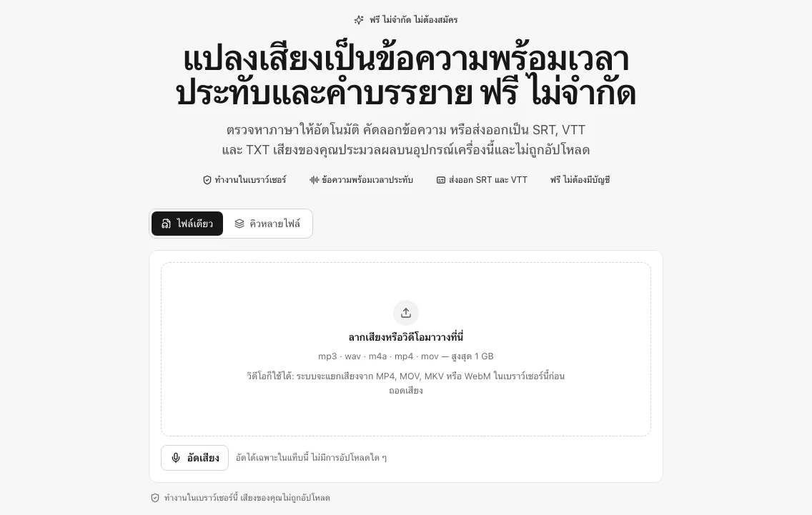

<p align="center">
  <b>🌐 Languages:</b><br/>
  <a href="README.md">English</a> ·
  <a href="README.zh-CN.md">简体中文</a> ·
  <a href="README.zh-TW.md">繁體中文</a> ·
  <a href="README.ja.md">日本語</a> ·
  <a href="README.ko.md">한국어</a> ·
  <a href="README.es.md">Español</a> ·
  <a href="README.pt-BR.md">Português</a> ·
  <a href="README.fr.md">Français</a> ·
  <a href="README.de.md">Deutsch</a> ·
  <a href="README.it.md">Italiano</a> ·
  <a href="README.nl.md">Nederlands</a> ·
  <a href="README.pl.md">Polski</a> ·
  <a href="README.ru.md">Русский</a> ·
  <a href="README.uk.md">Українська</a> ·
  <a href="README.sv.md">Svenska</a> ·
  <a href="README.nb.md">Norsk</a> ·
  <a href="README.da.md">Dansk</a> ·
  <a href="README.fi.md">Suomi</a> ·
  <a href="README.id.md">Bahasa Indonesia</a> ·
  <a href="README.tr.md">Türkçe</a> ·
  <a href="README.vi.md">Tiếng Việt</a> ·
  <a href="README.th.md">ไทย</a> ·
  <a href="README.hi.md">हिन्दी</a> ·
  <a href="README.bn.md">বাংলা</a>
</p>

<h1 align="center">EarScribe — ถอดเสียงและวิดีโอเป็นข้อความ ฟรี ในเบราว์เซอร์ของคุณ</h1>

<p align="center">
  <b>ลากไฟล์เสียง ไฟล์วิดีโอ หรืออัดเสียงจากไมโครโฟน แล้วรับข้อความถอดเสียงพร้อมการประทับเวลาและซับไตเติล</b><br/>
  <sub>Whisper ทำงานบนอุปกรณ์ของคุณเองผ่าน WebGPU หรือ WebAssembly — ไฟล์บันทึกเสียงไม่ถูกอัปโหลดเลย</sub>
</p>

<p align="center">
  <a href="https://earscribe.app"></a>
  <a href="https://earscribe.app"></a>
  <a href="https://earscribe.app"></a>
  <a href="https://earscribe.app"></a>
  
</p>

<p align="center">
  <a href="https://earscribe.app"></a>
</p>

<p align="center">
  <b>🔗 เปิดแอป:</b> <a href="https://earscribe.app">earscribe.app</a> ·
  <a href="https://earscribe.app/guides">คู่มือ</a> ·
  <a href="https://earscribe.app/changelog">บันทึกการเปลี่ยนแปลง</a> ·
  <a href="https://earscribe.app/about">เกี่ยวกับ</a>
</p>

---

## 🎙️ EarScribe คืออะไร

พื้นที่ทำงานสำหรับถอดเสียงที่ทำงานอยู่ในแท็บเบราว์เซอร์ทั้งหมด คุณป้อนไฟล์เสียง ไฟล์วิดีโอ หรือเสียงจากไมโครโฟน แล้วได้ข้อความพร้อมการประทับเวลาที่คลิกเพื่อเล่นซ้ำได้ทันที พร้อมไฟล์ซับไตเติลที่ส่งต่อให้คนตัดต่อได้เลย ไม่มีบัญชี ไม่มีการอัปโหลด และไม่คิดเงินตามนาที

สามทางเข้า กระบวนการเดียว:

- **ไฟล์** — MP3, WAV, M4A, AAC, OGG, FLAC, Opus หรือเกือบทุกฟอร์แมตที่ Web Audio API ถอดรหัสได้ ขนาดสูงสุด 1 GiB
- **วิดีโอ** — MP4, MOV, MKV, WebM, M4V, TS, QT, M2TS แอปจะแยกแทร็กเสียงออกและเข้ารหัสใหม่เป็น 16 kHz โมโน **ภายในแท็บ** แล้วถอดเสียงเหมือนไฟล์ทั่วไป ไม่ต้องใช้ ffmpeg ไม่ต้องพึ่งเว็บแปลงไฟล์
- **ไมโครโฟน** — อัดและถอดเสียงในที่เดียว เหมาะกับงานบรรยาย สายที่คุณได้รับอนุญาตให้อัด หรือบันทึกเสียงที่ถ้าไม่เก็บไว้ก็จะหายไป

เพิ่มคิวเข้าไป คุณก็ลากไฟล์ทั้งโฟลเดอร์เข้ามาแล้วไปทำอย่างอื่นต่อได้ เพิ่มพื้นที่ทำงานที่ `/dashboard` ผลลัพธ์ก็กลายเป็นโปรเจกต์ที่เปิดใหม่ แก้ไข และส่งออกได้ทุกเมื่อ

> 👉 **แอปที่ใช้งานได้จริง:** **[earscribe.app](https://earscribe.app)**

---

## 📚 สารบัญ

- [✨ ทำอะไรได้บ้าง](#-ทำอะไรได้บ้าง)
- [🖼️ ภาพหน้าจอ](#️-ภาพหน้าจอ)
- [🚀 เริ่มต้นอย่างรวดเร็ว](#-เริ่มต้นอย่างรวดเร็ว)
- [🗂️ พื้นที่ทำงาน](#️-พื้นที่ทำงาน)
- [💸 ต้องจ่ายเท่าไร](#-ต้องจ่ายเท่าไร)
- [🆚 เปรียบเทียบ](#-เปรียบเทียบ)
- [🌍 อินพุตและภาษาที่รองรับ](#-อินพุตและภาษาที่รองรับ)
- [💼 ใช้งานแบบไหนได้บ้าง](#-ใช้งานแบบไหนได้บ้าง)
- [🚧 สิ่งที่ทำไม่ได้](#-สิ่งที่ทำไม่ได้)
- [❓ คำถามที่พบบ่อย](#-คำถามที่พบบ่อย)
- [🛠️ เทคโนโลยีที่ใช้](#️-เทคโนโลยีที่ใช้)
- [🧑‍💻 รันในเครื่อง](#-รันในเครื่อง)
- [☁️ การดีพลอย](#️-การดีพลอย)
- [🌐 เพิ่มภาษาใหม่](#-เพิ่มภาษาใหม่)
- [🔬 เพิ่มโมเดล Whisper ใหม่](#-เพิ่มโมเดล-whisper-ใหม่)
- [🤝 ร่วมพัฒนา](#-ร่วมพัฒนา)
- [📄 สัญญาอนุญาต](#-สัญญาอนุญาต)

---

## ✨ ทำอะไรได้บ้าง

| | ความสามารถ | สิ่งที่คุณได้จริง |
|---|---|---|
| 🎬 | **เสียง วิดีโอ และไมโครโฟน** | รับไฟล์วิดีโอได้โดยตรง แทร็กเสียงถูกแยกออกในเครื่อง ไฟล์ MP4 ขนาด 200 MB จึงไม่เคยออกจากเครื่องคุณเช่นกัน |
| 📝 | **ข้อความถอดเสียงพร้อมการประทับเวลา** | ทุกคิวมีเวลาเริ่มและเวลาสิ้นสุด คลิกบรรทัดใดก็ได้เพื่อฟังช่วงนั้น แถบคลื่นเสียงจะเลื่อนตามไปด้วย |
| 🔍 | **ค้นหาภายในข้อความถอดเสียง** | ชื่อ ตัวเลข หรือคำศัพท์ — กระโดดไปยังประโยคนั้นแล้วเล่นซ้ำ แทนที่จะต้องฟังไฟล์ใหม่ทั้งไฟล์ |
| 🎞️ | **ส่งออกซับไตเติล** | SRT, WebVTT, ข้อความล้วน, JSON (ออบเจ็กต์ข้อความถอดเสียงพร้อมไทม์โค้ดความละเอียดเต็ม) หรือคัดลอกไปยังคลิปบอร์ด |
| 🧪 | **ตรวจซับไตเติล** | ชี้คิวที่ยาวเกินไป เร็วเกินไป ซ้ำ ว่าง หรือทับซ้อนกัน ก่อนที่คุณจะส่งออก |
| 📚 | **คิวแบบกลุ่ม** | ลากหลายไฟล์เข้ามา ตั้งโมเดลหนึ่งตัวและภาษาพูดหนึ่งภาษา แล้วปล่อยให้คิวรันตามลำดับ หยุดหลังไฟล์ปัจจุบันได้ทุกเมื่อ |
| 🗂️ | **โปรเจกต์** | ผลลัพธ์ถูกบันทึกไว้ในเบราว์เซอร์เป็นโปรเจกต์ภายใต้ `/dashboard`: ข้อความถอดเสียง ซับไตเติล ไฟล์ต้นฉบับ และถังขยะ เปิดใหม่ได้ภายหลัง |
| ✏️ | **แก้ไขซับไตเติล** | แก้ข้อความ เลื่อนจุดเข้าและจุดออกของคิว แยกหรือลบคิว แล้วส่งออกอีกครั้ง |
| 💾 | **สำรองและกู้คืน** | ส่งออกพื้นที่ทำงานทั้งหมดเป็นไฟล์เดียว แล้วนำเข้าในเบราว์เซอร์อื่น |
| 🔁 | **แปลงซับไตเติล** | SRT ⇄ VTT และ SRT → ข้อความ ทำในเบราว์เซอร์ ไม่ต้องดาวน์โหลดโมเดล — เครื่องมือเดียวในนี้ที่เปิดได้ทันที |
| 🆓 | **ฟรีและไม่จำกัด** | ไม่มีแพ็กเกจเสียเงิน ไม่มีโควตารายวัน ไม่มีค่าบริการรายนาที ไม่ต้องมีบัญชี |
| 🔒 | **เป็นส่วนตัวตั้งแต่โครงสร้าง** | การถอดเสียงทำงานในเครื่อง หน้าเว็บสาธารณะมีระบบวิเคราะห์และโฆษณา ส่วน `/dashboard` ไม่มีโฆษณา |
| 🌍 | **27 ภาษาบนหน้าจอ 99 ภาษาพูด** | หน้าจอแปลไว้ 27 ภาษา ส่วนภาษาพูด Whisper ตรวจจับให้อัตโนมัติ |

---

## 🖼️ ภาพหน้าจอ

> ภาพหน้าจอจริงจากเว็บไซต์ **[earscribe.app](https://earscribe.app)**

### 1. ลากไฟล์ ลากวิดีโอ หรืออัดเสียง — ไม่ต้องสมัคร ไม่ต้องอัปโหลด

<p align="center">
  <a href="https://earscribe.app"></a>
</p>

<p align="center"><sub>หน้าจอแรก: พื้นที่ลากไฟล์และรายการรูปแบบเสียงกับวิดีโอที่รองรับ</sub></p>

### 2. ข้อความถอดเสียงพร้อมการประทับเวลาและคลื่นเสียง — คลิกบรรทัดใดก็ได้เพื่อกระโดดไป

<p align="center">
  <a href="https://earscribe.app"></a>
</p>

<p align="center"><sub>หน้าจอถอดเสียง: ด้านซ้ายเป็นบรรทัดที่มีการประทับเวลา ด้านขวาเป็นคลื่นเสียงและตำแหน่งเล่น</sub></p>

### 3. สามขั้นตอน: ลากไฟล์ → เลือกโมเดล Whisper → ส่งออก

<p align="center">
  <a href="https://earscribe.app"></a>
</p>

<p align="center"><sub>ขั้นตอนสามขั้น: ลากไฟล์ เลือกโมเดล และส่งออก เรียงต่อกัน</sub></p>

### 4. ทำไมต้อง EarScribe — Whisper ในเบราว์เซอร์ที่ให้ความสำคัญกับความเป็นส่วนตัว

<p align="center">
  <a href="https://earscribe.app"></a>
</p>

<p align="center"><sub>ภาพรวมฟีเจอร์: ความเป็นส่วนตัว แบ็กเอนด์ที่ใช้ประมวลผล ภาษา และรูปแบบส่งออกในหน้าเดียว</sub></p>

### 5. ใครใช้ EarScribe — นักพอดแคสต์ นักข่าว นักเรียน คนตัดต่อ

<p align="center">
  <a href="https://earscribe.app"></a>
</p>

<p align="center"><sub>การใช้งาน: ทางเข้าสำหรับผู้ใช้แต่ละกลุ่ม เช่น พอดแคสต์ สัมภาษณ์ ห้องเรียน และประชุม</sub></p>

### 6. EarScribe เทียบกับ Otter.ai, Rev, HappyScribe และ Whisper ที่ติดตั้งในเครื่อง

<p align="center">
  <a href="https://earscribe.app"></a>
</p>

<p align="center"><sub>ตารางเปรียบเทียบ: EarScribe เทียบกับบริการคลาวด์และ Whisper ในเครื่องทีละหัวข้อ</sub></p>

### 7. คำถามที่พบบ่อย — ความเป็นส่วนตัว ฟอร์แมต การส่งออกซับไตเติล การใช้งานออฟไลน์

<p align="center">
  <a href="https://earscribe.app"></a>
</p>

<p align="center"><sub>คำถามที่พบบ่อย: สรุปคำตอบเรื่องความเป็นส่วนตัว รูปแบบ การส่งออกซับไตเติล และการใช้ออฟไลน์</sub></p>

---

## 🚀 เริ่มต้นอย่างรวดเร็ว

1. เปิด **[earscribe.app](https://earscribe.app)** ใน Chrome, Edge, Safari หรือ Firefox
2. ลากไฟล์เข้ามา — หรือลากวิดีโอ หรือกดอัดเสียง รับไฟล์ได้สูงสุด 1 GiB ต่อไฟล์ แต่ขีดจำกัดจริงคือหน่วยความจำของอุปกรณ์คุณ ไม่ใช่ขนาดบนดิสก์
3. เลือกโมเดล **base** เป็นค่าเริ่มต้นและเหมาะกับเสียงพูดส่วนใหญ่ **tiny** เหมาะกับมือถือหรือเสียงบันทึกสั้น ๆ **small** และ **turbo** เหมาะกับเสียงที่มีสำเนียง รก หรือสำคัญมาก
4. กด **ถอดเสียง** เสียงจะถูกถอดรหัสและป้อนให้ Whisper ภายในแท็บ รอบแรกต้องดาวน์โหลดน้ำหนักโมเดล จึงควรดูขนาดที่แสดงบนปุ่ม
5. อ่านข้อความถอดเสียง คลิกบรรทัดเพื่อฟังซ้ำ แก้ส่วนที่สำคัญ แล้ว **ส่งออก → SRT / VTT / TXT / JSON** หรือคัดลอกออกมา

อยากทำทีละหลายไฟล์? สลับไปที่คิว ลากไฟล์เข้ามาได้ตามต้องการ แล้วเลือกโมเดลครั้งเดียว คิวจะรันทีละไฟล์ ใช้โมเดลที่อยู่ในหน่วยความจำแล้วซ้ำ และบันทึกผลแต่ละไฟล์เป็นโปรเจกต์

> 💡 **ไม่ต้องแปลงไฟล์ก่อน** ไฟล์ MP4 ยาวสองชั่วโมงลากเข้ามาได้เลย ถ้าอยากเก็บเฉพาะเสียง แอปแยกแทร็กเสียงจากวิดีโอให้คุณได้

---

## 🗂️ พื้นที่ทำงาน

`/dashboard` คือเครื่องถอดเสียงตัวเดิม แต่มีความจำ ทุกอย่างถูกเก็บไว้ในเบราว์เซอร์นี้ — IndexedDB สำหรับข้อมูลโปรเจกต์ และ CacheStorage สำหรับน้ำหนักโมเดล — และไม่มีอะไรซิงก์ขึ้นบัญชี เพราะไม่มีบัญชีตั้งแต่แรก

| ส่วน | เก็บอะไรไว้ |
|---|---|
| **โปรเจกต์** | ทุกอย่าง เรียงใหม่สุดขึ้นก่อน |
| **ข้อความถอดเสียง** | โปรเจกต์ที่เกิดจากการถอดเสียงหนึ่งรอบ การแก้ไขคิวของโปรเจกต์เหล่านี้ยังคงเก็บไว้ที่นี่ |
| **ซับไตเติล** | โปรเจกต์ที่สร้างจากไฟล์ซับไตเติล — ทั้งตัวแปลงและการนำเข้า — งานคำบรรยายจึงแยกจากงานถอดเสียง |
| **ไฟล์** | สื่อต้นฉบับที่พื้นที่ทำงานเก็บไว้ กรองตามประเภทได้: ข้อความถอดเสียง ซับไตเติล เสียง โดยค่าเริ่มต้นจะ **ไม่** บันทึกเสียงต้นฉบับ |
| **ถังขยะ** | โปรเจกต์ที่ลบแล้ว กู้คืนได้จนกว่าคุณจะล้างถัง |

ภายในโปรเจกต์ คุณค้นหาข้อความถอดเสียง คลิกการประทับเวลาเพื่อฟังซ้ำ แก้ไขคิวซับไตเติล (ข้อความ จุดเข้าและจุดออก เพิ่มหรือลบ) รวมคิวที่ยาวให้สั้นลง ส่งออกใหม่ในฟอร์แมตใดก็ได้ หรือเปิดเครื่องเล่นสื่อโดยไม่ต้องออกจากหน้านี้

**การสำรองข้อมูล:** พื้นที่ทำงานส่งออกเป็นไฟล์เดียว (สูงสุด 320 MB) และนำเข้าในเบราว์เซอร์อื่นหรือเครื่องอื่นได้ เพราะโปรเจกต์ไม่เคยออกจากอุปกรณ์ ไฟล์นี้จึงเป็นสำเนาเดียวที่เดินทางได้ — ควรดูแลมันเหมือนไฟล์เอกสารสำรองอื่น ๆ

---

## 💸 ต้องจ่ายเท่าไร

ฟรีไม่ได้แปลว่าไม่มีต้นทุน นี่คือขนาดดาวน์โหลดที่วัดจริงของแต่ละโมเดลและแต่ละแบ็กเอนด์ ไม่ใช่การประมาณ:

| โมเดล | WebGPU | WebAssembly | ใช้กับงานแบบไหน |
|---|---:|---:|---|
| **tiny** | 151 MB | 41 MB | บันทึกเสียงสั้น ๆ มือถือรุ่นล่าง ลองครั้งแรก |
| **base** *(ค่าเริ่มต้น)* | 291 MB | 77 MB | สัมภาษณ์ ประชุม พอดแคสต์ |
| **small** | 968 MB | 249 MB | เสียงที่มีสำเนียง ห้องที่มีเสียงรบกวน |
| **turbo** | 3.24 GB | 1.09 GB | ข้อความระดับสตูดิโอ เมื่อความแม่นยำสำคัญกว่าเวลา |

- **ดาวน์โหลดครั้งเดียว แล้วแคชไว้** น้ำหนักโมเดลอยู่ในแคชของเบราว์เซอร์ รอบถัดไปไม่ต้องดาวน์โหลดอะไรเลย แต่ถ้าเปลี่ยนโปรไฟล์เบราว์เซอร์ก็ต้องโหลดใหม่
- **GPU คุ้มจริง** บนเครื่องเดียวกัน WebGPU ถอดไฟล์ 40 นาทีด้วย base เสร็จในราว 3.8 นาที เทียบกับ 9.4 นาทีบน CPU — เร็วขึ้นราว 2.5× แลกกับขนาดดาวน์โหลดที่ใหญ่กว่าสามถึงสี่เท่า ส่วน `turbo` บน WebGPU ดาวน์โหลด 3.24 GB ไม่เสร็จในการทดสอบของเรา จึงบันทึกว่า "ยังไม่ได้วัด" ไม่ใช่ "เร็ว"
- **หน่วยความจำตัดสิน ไม่ใช่ขนาดไฟล์** ไฟล์บันทึกยาวจะถูกถอดรหัสเป็น 16 kHz โมโนก่อนถอดเสียง ไฟล์ MP3 40 นาทีใช้หน่วยความจำไม่กี่ร้อยเมกะไบต์ ส่วน WAV สเตอริโอ 2 ชั่วโมงอาจทำให้แท็บหมดหน่วยความจำก่อนเริ่ม ตอนนี้การถอดรหัสขอ 16 kHz โดยตรง ทำให้หน่วยความจำสูงสุดของไฟล์สเตอริโอ 2 ชั่วโมงลดจากราว 1.6 GB เหลือ 0.5 GB
- **ไม่มีเซิร์ฟเวอร์ ไม่มีคิวบนเครื่องคนอื่น** เวลาขึ้นอยู่กับ CPU ของคุณ โน้ตบุ๊กที่ช้าก็ช้าจริง นั่นคือข้อแลกเปลี่ยนของการไม่อัปโหลด

ผลการวัดแบบเต็ม พร้อมวิธีวัดและรอบที่ล้มเหลว อยู่ใน[คู่มือ](https://earscribe.app/guides)

---

## 🆚 เปรียบเทียบ

ในปี 2026 EarScribe ต่างจากวิธีถอดเสียงอื่นอย่างไร?

| | **EarScribe** | Otter.ai Free | Rev Free Trial | HappyScribe | Local Whisper CLI |
|---|:---:|:---:|:---:|:---:|:---:|
| **ฟรีและไม่จำกัด** | ✅ | ⚠️ 300 นาที/เดือน | ❌ ทดลองเท่านั้น | ❌ ต้องจ่าย | ✅ |
| **ไม่ต้องสมัคร / ล็อกอิน** | ✅ | ❌ | ❌ | ❌ | ✅ |
| **ไม่อัปโหลด (เป็นส่วนตัว)** | ✅ | ❌ | ❌ | ❌ | ✅ |
| **วิดีโอโดยไม่อัปโหลด** | ✅ แยกเสียงในเครื่อง | ❌ ต้องอัปโหลด | ❌ ต้องอัปโหลด | ❌ ต้องอัปโหลด | ✅ ต้องมี ffmpeg |
| **ใช้ได้ในเบราว์เซอร์** | ✅ | ✅ | ✅ | ✅ | ❌ |
| **ส่งออก SRT / VTT** | ✅ | ⚠️ ต้องจ่าย | ✅ | ✅ | ⚠️ ต้องทำเอง |
| **ข้อความพร้อมการประทับเวลา** | ✅ | ✅ | ✅ | ✅ | ⚠️ ต้องทำเอง |
| **ประมวลผลในเครื่อง** | ✅ | ❌ | ❌ | ❌ | ✅ |
| **99 ภาษาพูด** | ✅ | ⚠️ จำกัด | ⚠️ จำกัด | ✅ | ✅ |
| **Whisper Large v3 Turbo** | ✅ | ❌ | ❌ | ❌ | ✅ |
| **ต้องติดตั้ง** | ❌ ไม่ต้อง | ❌ ไม่ต้อง | ❌ ไม่ต้อง | ❌ ไม่ต้อง | ⚠️ Python + GPU |
| **ค่าใช้จ่าย** | $0 | $0–$30/เดือน | $0.25/นาที | €0.20/นาที | $0 (ฮาร์ดแวร์ของคุณ) |

**จุดที่แพ้:** การติดตั้งในเครื่องรันโมเดลใหญ่กว่าและใช้แบ็กเอนด์เร็วกว่าแท็บเบราว์เซอร์ได้ ส่วนบริการเสียเงินมีป้ายชื่อผู้พูดและพื้นที่ทำงานแบบทีม ข้อได้เปรียบของ EarScribe คือฟรี ไม่ต้องติดตั้งอะไร และเสียงไม่เคยออกไปไหน

→ **[ลองได้ที่ earscribe.app](https://earscribe.app)**

---

## 🌍 อินพุตและภาษาที่รองรับ

### เสียง — MP3, WAV, M4A, AAC, OGG, FLAC, Opus

อะไรก็ตามที่ Web Audio API ถอดรหัสได้นั้นรับหมด และเจ็ดฟอร์แมตนี้ครอบคลุมไฟล์บันทึกเกือบทุกแบบที่คุณจะเจอ

- 🎵 **[MP3 เป็นข้อความ](https://earscribe.app/mp3-to-text)** — มาตรฐานของพอดแคสต์และบทสัมภาษณ์
- 🎙️ **[WAV เป็นข้อความ](https://earscribe.app/wav-to-text)** — ไฟล์สตูดิโอและงานภาคสนามแบบไม่สูญเสียข้อมูล
- 📱 **[M4A เป็นข้อความ](https://earscribe.app/m4a-to-text)** — บันทึกเสียงใน iPhone
- 🎧 **[บันทึกเสียงเป็นข้อความ](https://earscribe.app/voice-memo-to-text)** — เสียงอัดจากมือถือ
- 🔊 **[เสียงเป็นข้อความ](https://earscribe.app/audio-to-text)** — ทางเข้าหลัก
- 🎬 **[เสียงเป็น SRT](https://earscribe.app/audio-to-srt)** — ตรงไปที่ซับไตเติลเลย

### วิดีโอ — MP4, MOV, MKV, WebM, M4V, TS, QT, M2TS

แทร็กเสียงจะถูกแยกด้วย [mediabunny](https://mediabunny.dev) ถอดรหัสด้วย WebCodecs แล้วเข้ารหัสใหม่เป็น MP3 โมโน 16 kHz ขนาดเล็ก (หรือ WAV ในกรณีที่ไม่มีตัวเข้ารหัส MP3) — ทั้งหมดทำในเครื่อง ถ้าคอนเทนเนอร์ใช้โคเดกที่เบราว์เซอร์ถอดรหัสไม่ได้ แอปจะแจ้งข้อความชัดเจน แทนที่จะปล่อยข้อความถอดเสียงว่างเปล่าออกมาเงียบ ๆ

### ไมโครโฟน

การอัดเสียงเกิดขึ้นในแท็บด้วย MediaRecorder ไฟล์ที่อัดจะถูกถอดเสียงเหมือนไฟล์ที่ลากเข้ามาทุกประการ ส่วนคำบรรยายสดระหว่างอัดนั้น **ไม่มี** (ดู [สิ่งที่ทำไม่ได้](#-สิ่งที่ทำไม่ได้))

### ภาษา — 99 ภาษาพูด 27 ภาษาบนหน้าจอ

Whisper ตรวจจับภาษาพูดให้อัตโนมัติ: อังกฤษ สเปน ฝรั่งเศส เยอรมัน อิตาลี โปรตุเกส รัสเซีย ญี่ปุ่น เกาหลี จีน (ตัวย่อและตัวเต็ม) อาหรับ ฮินดี ตุรกี ดัตช์ โปแลนด์ อินโดนีเซีย สวีเดน นอร์เวย์ เดนมาร์ก ฟินแลนด์ เช็ก ฮังการี กรีก ฮีบรู ไทย เวียดนาม และอีก 70+ ภาษา

หน้าจอแปลไว้ 27 ภาษา ภาษาอังกฤษอยู่ที่ `/` ส่วนอีก 26 ภาษามีคำนำหน้า:

| | | | |
|---|---|---|---|
| [English](https://earscribe.app) | [简体中文](https://earscribe.app/zh-CN) | [日本語](https://earscribe.app/ja) | [한국어](https://earscribe.app/ko) |
| [Español](https://earscribe.app/es) | [Português (BR)](https://earscribe.app/pt-br) | [Deutsch](https://earscribe.app/de) | [Français](https://earscribe.app/fr) |
| [Русский](https://earscribe.app/ru) | [Italiano](https://earscribe.app/it) | [Polski](https://earscribe.app/pl) | [Nederlands](https://earscribe.app/nl) |
| [Українська](https://earscribe.app/uk) | [Türkçe](https://earscribe.app/tr) | [Tiếng Việt](https://earscribe.app/vi) | [ไทย](https://earscribe.app/th) |
| [हिन्दी](https://earscribe.app/hi) | [বাংলা](https://earscribe.app/bn) | [اردو](https://earscribe.app/ur) | [العربية](https://earscribe.app/ar) |
| [فارسی](https://earscribe.app/fa) | [Bahasa Indonesia](https://earscribe.app/id) | [Svenska](https://earscribe.app/sv) | [Norsk](https://earscribe.app/nb) |
| [Dansk](https://earscribe.app/da) | [Suomi](https://earscribe.app/fi) | [繁體中文](https://earscribe.app/zh-TW) | |

---

## 💼 ใช้งานแบบไหนได้บ้าง

### 🎙️ นักพอดแคสต์และครีเอเตอร์
**[ถอดเสียงพอดแคสต์](https://earscribe.app/podcast-transcription)** สำหรับโน้ตรายการ SEO ของตอน และการเข้าถึง ส่งออก SRT สำหรับเวอร์ชันวิดีโอ และ TXT สำหรับบล็อก

### 📰 นักข่าวและนักวิจัย
**[ถอดเสียงบทสัมภาษณ์](https://earscribe.app/interview-transcription)** ที่ไฟล์ต้นฉบับยังอยู่บนแล็ปท็อปของคุณ ไม่มีสำเนาของบุคคลที่สามให้รั่วไหล ถูกเรียกดู หรือถูกตรวจสอบ

### 🎓 นักเรียนและอาจารย์
**[ถอดเสียงการบรรยาย](https://earscribe.app/audio-to-text)** ของคาบเรียนที่อัดไว้ ค้นหาได้ก่อนคาบถัดไป ใช้ได้กับบันทึกเสียง iPhone และไฟล์ที่ส่งออกจาก Zoom

### 📞 ประชุมและงานวิจัยผู้ใช้
**[บันทึกการประชุมเป็นข้อความ](https://earscribe.app/meeting-recording-to-text)** — ได้ข้อความถอดเสียงของสายนั้น ไม่ใช่สรุปการประชุมที่สร้างขึ้นอัตโนมัติ

### 🎬 คนตัดต่อวิดีโอ
**[เสียงเป็น SRT](https://earscribe.app/audio-to-srt)** สำหรับ YouTube, Premiere, Final Cut และ Resolve เวลาของคิวมาจากการประทับเวลาของ Whisper เอง และการตรวจซับไตเติลจะชี้จุดที่จะล้นจอ

### 📚 หนังสือเสียงและไฟล์บันทึกยาว
รองรับไฟล์ยาวสองชั่วโมง แต่เป็นกรณีที่หน่วยความจำของอุปกรณ์เป็นตัวตัดสิน อ่าน[วิธีจัดการไฟล์เสียงยาว](https://earscribe.app/guides/how-to-transcribe-long-audio) ก่อนเริ่มไฟล์สี่ชั่วโมง

---

## 🚧 สิ่งที่ทำไม่ได้

การบอกให้ชัดตรงนี้ช่วยให้ทุกคนไม่ต้องเสียเวลารันฟรี:

- **ไม่แยกผู้พูด** คนสองคนในไฟล์เดียวจะได้ข้อความที่ไม่มีป้ายผู้พูด อย่าง "ผู้พูด 1 / ผู้พูด 2" หน้าเว็บสำหรับบทสัมภาษณ์ระบุเรื่องนี้ไว้อย่างตั้งใจ
- **ไม่แปลภาษา** ข้อความถอดเสียงยังเป็นภาษาที่พูด ภาษาของหน้าจอกับภาษาที่พูดไม่เกี่ยวข้องกัน
- **ไม่มีคำบรรยายสด** การอัดและการถอดเสียงเป็นสองขั้นตอนแยกกัน — ไมโครโฟนอัดก่อน แล้วจึงถอดเสียงจากไฟล์
- **คิวเป็นแบบเรียงลำดับและต้องเปิดแท็บไว้** ใช้โมเดลเดียวและตั้งค่าภาษาเดียวทั้งชุด ปิดแท็บแล้วก็หยุด
- **ไม่ซิงก์ข้ามอุปกรณ์** โปรเจกต์อยู่ในเบราว์เซอร์นี้ ใช้การส่งออกของพื้นที่ทำงานเพื่อย้ายมันไป
- **ไม่ใช่แอปออฟไลน์** น้ำหนักโมเดลถูกแคชไว้ แต่ตัวหน้าเว็บโหลดจากเครือข่าย การติดตั้งจะเพิ่มทางลัดบนเดสก์ท็อปหรือหน้าจอโฮม ไม่ใช่สำเนาที่ใช้แบบออฟไลน์ได้
- **1 GiB ต่อไฟล์เป็นเพดานแข็ง แต่หน่วยความจำคือเพดานจริงในทางปฏิบัติ**

---

## ❓ คำถามที่พบบ่อย

<details>
<summary><b>EarScribe ฟรีจริงและไม่จำกัดจริงหรือ?</b></summary><br/>
จริง — ไม่มีแพ็กเกจเสียเงิน ไม่ต้องใช้บัตรเครดิต ไม่มีค่าบริการรายนาที ไม่มีโควตารายวันหรือรายเดือน ไม่ต้องมีบัญชี การประมวลผลเกิดบนฮาร์ดแวร์ของคุณเอง จึงไม่มีบิลคลาวด์ที่ต้องส่งต่อให้ใคร มีเพดาน 1 GiB ต่อไฟล์ และหน่วยความจำของอุปกรณ์เป็นตัวกำหนดว่าอะไรจะทำเสร็จจริง
</details>

<details>
<summary><b>เสียงของฉันถูกอัปโหลดไปที่ไหนหรือเปล่า?</b></summary><br/>
ไม่ เสียงถูกถอดรหัสในแท็บแล้วป้อนให้โมเดล Whisper ที่ทำงานใน Web Worker น้ำหนักโมเดลถูกดาวน์โหลด<i>เข้ามาใน</i>เบราว์เซอร์ของคุณจาก CDN ซึ่งหมายความว่า CDN เห็นที่อยู่ IP ของคุณ — แต่ไฟล์บันทึกเสียงไม่ถูกส่งไป หน้าเว็บสาธารณะมี Google AdSense ยกเว้นหน้าภาษาเปอร์เซียที่กฎของ AdSense ไม่อนุญาต และมี Plausible ระบบวิเคราะห์ที่ไม่ใช้คุกกี้ ส่วน <code>/dashboard</code> ไม่โหลดโค้ดโฆษณาเลย
</details>

<details>
<summary><b>ถอดเสียงจากวิดีโอได้ไหม?</b></summary><br/>
ได้เลย — MP4, MOV, MKV, WebM, M4V, TS, QT และ M2TS แทร็กเสียงถูกแยกออกภายในเบราว์เซอร์แล้วถอดเสียงเหมือนไฟล์ปกติ คุณจึงไม่ต้องใช้ ffmpeg หรือเว็บแปลงไฟล์ ถ้าคอนเทนเนอร์ใช้โคเดกที่เบราว์เซอร์ถอดรหัสไม่ได้ แอปจะบอกคุณ แทนที่จะปล่อยข้อความถอดเสียงว่างเปล่า
</details>

<details>
<summary><b>ทำไมรอบแรกถึงช้า?</b></summary><br/>
ครั้งแรกที่ใช้โมเดลหนึ่ง เบราว์เซอร์ต้องดาวน์โหลดน้ำหนักของมัน — 41 MB สำหรับ tiny บน WebAssembly ไปจนถึง 3.24 GB สำหรับ turbo บน WebGPU หลังจากนั้นจะถูกแคชไว้ แนะนำให้เลือก <b>base</b> (77 MB บน WebAssembly, 291 MB บน WebGPU) ซึ่งใช้ได้กับเกือบทุกงาน
</details>

<details>
<summary><b>แม่นแค่ไหน และควรเลือกโมเดลไหน?</b></summary><br/>
ในคลิปยาว 34 วินาทีคลิปเดียวกัน โมเดลทั้งสี่ของเราเห็นไม่ตรงกัน 26 คำจาก 111 คำ และโมเดลเดียวกันที่ขนาดดาวน์โหลดต่างกันสองแบบก็ยังไม่ตรงกับตัวเอง ให้เลือกจากคำที่สำคัญกับคุณ ไม่ใช่จากเปอร์เซ็นต์ความแม่นยำ: <a href="https://earscribe.app/guides/which-whisper-model-should-i-use">คู่มือเลือกโมเดล</a> แสดงความต่างที่เกิดขึ้นจริง
</details>

<details>
<summary><b>ขอไฟล์ซับไตเติล SRT หรือ VTT ได้ไหม?</b></summary><br/>
ได้: ส่งออก → SRT หรือ VTT เวลามาจากขอบเขตเซกเมนต์ของ Whisper เอง ไม่ได้มาจากการตัดข้อความทีหลัง การตรวจซับไตเติลจะชี้คิวที่ยาวเกินไป เร็วเกินไป ซ้ำ ว่าง หรือทับซ้อนกัน และคุณแก้ข้อความกับเวลาในคิวก่อนส่งออกได้
</details>

<details>
<summary><b>ถ้ามีไฟล์ SRT หรือ VTT อยู่แล้วล่ะ?</b></summary><br/>
แปลงได้โดยไม่ต้องดาวน์โหลดโมเดล: <a href="https://earscribe.app/srt-to-vtt">SRT เป็น VTT</a> และ <a href="https://earscribe.app/srt-to-txt">SRT เป็นข้อความ</a> อ่านไฟล์ในเครื่อง ไม่มีการอัปโหลดและไม่มีการดึงน้ำหนัก Whisper เลย
</details>

<details>
<summary><b>ใช้แบบออฟไลน์ได้ไหม?</b></summary><br/>
ขั้นตอนถอดเสียงทำได้: เมื่อโหลดหน้าและโมเดลแล้ว เสียงจะถูกประมวลผลโดยไม่ติดต่อเซิร์ฟเวอร์ถอดเสียงใด ๆ แต่ตัวแอปไม่ใช่ชุดออฟไลน์ — การเปิดต้องใช้เครือข่าย และโมเดลที่ยังไม่เคยดาวน์โหลดก็ต้องโหลดก่อน การติดตั้งจากส่วนท้ายหน้าเว็บเพิ่มทางลัดที่เปิดเข้าสู่พื้นที่ทำงาน ไม่ได้เพิ่มสำเนาที่ใช้แบบออฟไลน์ได้
</details>

<details>
<summary><b>มีป้ายบอกไหมว่าใครพูด?</b></summary><br/>
ไม่มี ผลลัพธ์เป็นข้อความที่ไม่มีป้ายผู้พูดพร้อมไทม์โค้ด การแยกผู้พูดไม่ใช่ส่วนหนึ่งของเวอร์ชันนี้ และแอปก็ไม่แกล้งทำเป็นว่ามี
</details>

<details>
<summary><b>ผลลัพธ์ถูกเก็บไว้ที่ไหน?</b></summary><br/>
ในเบราว์เซอร์นี้: โปรเจกต์อยู่ใน IndexedDB น้ำหนักโมเดลอยู่ใน CacheStorage เสียงต้นฉบับจะไม่ถูกบันทึกไปกับโปรเจกต์ เว้นแต่คุณจะเก็บไว้ หน้าที่ไม่เคยบันทึกลงพื้นที่ทำงานจะเริ่มใหม่เอี่ยมเมื่อโหลดซ้ำ ให้ใช้ <code>/dashboard</code> และการส่งออกของมันเพื่อเก็บสิ่งที่คุณต้องการไว้
</details>

<details>
<summary><b>มีตัวเลือกฟรีแทน Otter.ai หรือ Rev ไหม?</b></summary><br/>
EarScribe เป็นทางเลือกฟรีแทนบริการถอดเสียงบนคลาวด์: คุณเป็นคนประมวลผล เสียงอยู่กับที่ และไม่มีค่าบริการรายนาที ข้อแลกเปลี่ยนมีอยู่จริง — ไม่มีป้ายผู้พูด ไม่มีพื้นที่ทำงานแบบทีม และไฟล์ยาวถูกจำกัดด้วยเครื่องของคุณ
</details>

<details>
<summary><b>จะแปลง MP3 เป็นข้อความฟรีได้อย่างไร?</b></summary><br/>
ลากไฟล์ MP3 ไปที่ <a href="https://earscribe.app/mp3-to-text">earscribe.app/mp3-to-text</a> (หรือหน้าแรก) ไฟล์จะถูกถอดรหัสในเบราว์เซอร์ ถอดเสียงในเครื่อง แล้วคัดลอกหรือส่งออกเป็น SRT, VTT, TXT หรือ JSON ได้
</details>

> คำตอบเพิ่มเติมอยู่ที่ **[หน้าเกี่ยวกับ](https://earscribe.app/about)** และบันทึกการวัดอยู่ใน **[คู่มือ](https://earscribe.app/guides)**

---

## 🛠️ เทคโนโลยีที่ใช้

- **[Next.js 15](https://nextjs.org)** (App Router) + **React 19**
- **[@huggingface/transformers v3](https://huggingface.co/docs/transformers.js)** — ONNX Runtime Web, WebGPU พร้อมทางถอยเป็น WebAssembly
- **[OpenAI Whisper](https://github.com/openai/whisper)** — tiny, base, small และ large-v3-turbo แบบ ONNX-quantized
- **[mediabunny](https://mediabunny.dev)** + **WebCodecs** — แยกคอนเทนเนอร์วิดีโอและดึงเสียงในแท็บ
- **[next-intl](https://next-intl.dev)** — 27 ภาษา แค็ตตาล็อกข้อความหนึ่งชุดต่อภาษา
- **[Tailwind CSS v4](https://tailwindcss.com)**
- **[Cloudflare Pages](https://pages.cloudflare.com)** สำหรับโฮสติ้ง พร้อม Pages Functions สองสามตัว (โฮสต์โมเดล และปลายทางรับฟีดแบ็ก)

เว็บไซต์เรนเดอร์แบบสถิตแล้วไฮเดรตในเบราว์เซอร์ การถอดเสียงและการแปลงซับไตเติลทำงานฝั่งไคลเอนต์เท่านั้น น้ำหนักโมเดลมาจาก CDN ของ Hugging Face ในการใช้งานครั้งแรก แล้วถูกแคชไว้ใน CacheStorage

---

## 🧑‍💻 รันในเครื่อง

```bash
git clone https://github.com/rocnubie/earscribe-free-speech-to-text.git
cd earscribe-free-speech-to-text
pnpm install
pnpm dev
# → http://localhost:3000
```

การตรวจสอบที่รันก่อนดีพลอย:

```bash
pnpm typecheck
pnpm lint
pnpm test              # node:test — queue state machine, subtitle parsers, release id
pnpm i18n:gate         # no missing keys, no English leftovers, no broken placeholders
pnpm seo:check         # page copy, keyword coverage, FAQ and cursor audits
node scripts/sitemap-audit.mjs
node scripts/llms-txt-audit.mjs
pnpm readme:audit      # README sizes vs lib/models.ts, links, 9-language parity
```

`pnpm build` สร้าง static export ไว้ใน `out/` และเนื่องจากการตรวจหลายตัวอ่าน `out/` จึงควร build ก่อน

---

## ☁️ การดีพลอย

การดีพลอยขึ้นโปรดักชันใช้คำสั่งเดียว ซึ่งรันการตรวจทุกตัวตามลำดับ:

```bash
pnpm pages:deploy
```

คำสั่งนี้จะเทียบเครื่องหมายดีพลอยในเครื่อง (`deployId` ใน `lib/release.ts`) กับค่าที่ให้บริการที่ `/changelog` บนเว็บจริงก่อน และจะไม่ทำต่อถ้าค่าตรงกัน — นี่คือวิธีจับบิลด์ที่ค้างเก่า จากนั้นจึง build รันการตรวจลิงก์ คู่มือ `llms.txt` i18n sitemap และ PWA แล้วเผยแพร่ `out/` ขึ้น Cloudflare Pages

`/changelog` คือรายการการเปลี่ยนแปลงที่ผู้อ่านนำไปใช้ต่อได้ ไม่ใช่บันทึกบิลด์: การรีแฟกเตอร์ภายใน การแก้ข้อความ และงานแปล จะได้ `deployId` ใหม่แต่ไม่มีรายการใน changelog

สภาพแวดล้อมและ binding:

| ชื่อ | ใช้ทำอะไร |
|---|---|
| `NEXT_PUBLIC_SITE_URL` | URL แบบ canonical, sitemap, แท็ก OG |
| `NEXT_PUBLIC_PLAUSIBLE_DOMAIN` | ตัวระบุไซต์ใน Plausible |
| `NEXT_PUBLIC_PLAUSIBLE_SCRIPT_URL` | URL สคริปต์ Plausible |
| `FEEDBACK_DB` (D1 binding) | ปลายทาง `/feedback` สคีมาอยู่ใน `migrations/` |

---

## 🌐 เพิ่มภาษาใหม่

1. ต่อรหัส locale เข้าไปใน `ALL_LOCALE_NAMES` ใน [`i18n/locale.ts`](i18n/locale.ts)
2. เพิ่ม `messages/<code>.json` ไว้ข้าง `en.json` และแปลให้ครบ
3. รัน `pnpm i18n:gate` — routing, sitemap, hreflang และเมทาดาทา OG จะรับ locale ใหม่เอง แต่ถ้าขาดคีย์ใดคีย์หนึ่ง gate จะไม่ผ่าน

เฉพาะ locale ที่ผ่าน gate เท่านั้นที่ควรอยู่ใน `translatedLocales` ส่วนตัวสลับภาษาจะติดป้ายภาษาที่เหลือว่าแปลไม่ครบ

---

## 🔬 เพิ่มโมเดล Whisper ใหม่

เพิ่มรายการใน `MODELS` ที่ [`lib/models.ts`](lib/models.ts) พร้อม `sizeMB` ที่ **วัดจริง** ทั้งของ `wasm` และ `webgpu` — สองแบ็กเอนด์นี้ส่งไฟล์น้ำหนักคนละชุด และการอ้างตัวเลขเดียวสำหรับทั้งคู่คือสาเหตุที่แอปเคยสัญญา 500 MB แต่ส่งมอบ 968 MB รีโปต้องมีอยู่บน Hugging Face ในชื่อ `onnx-community/<name>` หรือเข้ากันได้กับ ONNX-Whisper และเพิ่มบล็อก `models.<id>` ให้ตรงกันใน `messages/*.json` ทุกไฟล์สำหรับข้อความข้อดีข้อเสีย

---

## 🤝 ร่วมพัฒนา

ยินดีรับ pull request โดยเฉพาะ:

- งานแปล (`messages/<code>.json`) และการแก้ README เฉพาะภาษา
- รายงานบั๊ก พร้อมไฟล์ที่ทำให้พัง เบราว์เซอร์ และหน่วยความจำของอุปกรณ์
- ผลการวัด: ขนาดโมเดล เวลา และหน่วยความจำสูงสุดบนฮาร์ดแวร์ที่เราไม่มี
- การแก้ปัญหา accessibility

เปิด issue หรือ PR ที่นี่ หรือลองใช้ **[earscribe.app](https://earscribe.app)** ก่อน เพื่อดูว่าคุณจะร่วมพัฒนาอะไร

---

## 📄 สัญญาอนุญาต

เว็บไซต์การตลาดและหน้าเว็บต่าง ๆ ในรีโปนี้อยู่ภายใต้ [MIT](LICENSE): ใช้ฟรีทั้งส่วนตัวและเชิงพาณิชย์ ตัว worker สำหรับถอดเสียง ตัวถอดรหัสเสียง และตัวส่งออกซับไตเติลไม่ได้เผยแพร่ที่นี่ รีโปนี้จึงไม่ใช่สำเนาที่โฮสต์เองได้ครบทั้งบริการ

---

<p align="center">
  <b>👉 ลองแอปจริง: <a href="https://earscribe.app">earscribe.app</a></b><br/>
  <sub>เสียงเป็นข้อความ · วิดีโอเป็นข้อความ · คำพูดเป็นข้อความ · ส่งออกซับไตเติล · ฟรี 100% · ไม่ต้องสมัคร · ประมวลผลบนอุปกรณ์</sub>
</p>

<p align="center">
  สร้างด้วย ❤️ บน <a href="https://github.com/openai/whisper">OpenAI Whisper</a>, <a href="https://huggingface.co/docs/transformers.js">Transformers.js</a>, <a href="https://onnxruntime.ai">ONNX Runtime Web</a> และ <a href="https://mediabunny.dev">mediabunny</a>
</p>
