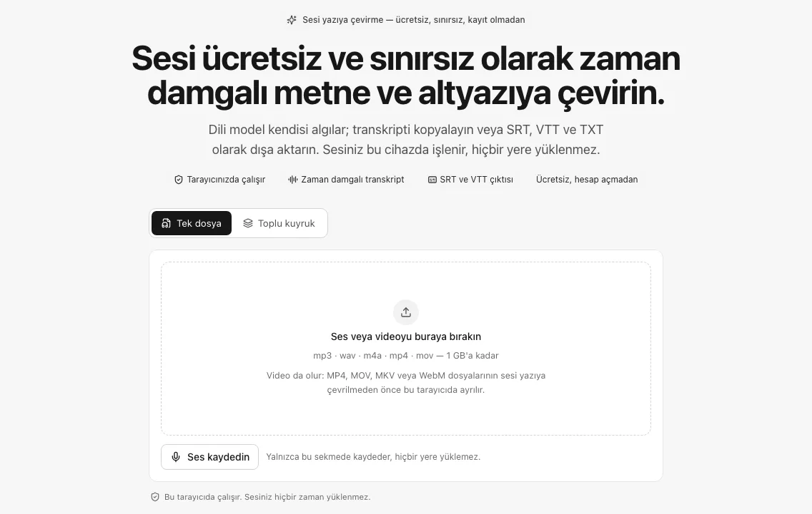

<p align="center">
  <b>🌐 Languages:</b><br/>
  <a href="README.md">English</a> ·
  <a href="README.zh-CN.md">简体中文</a> ·
  <a href="README.zh-TW.md">繁體中文</a> ·
  <a href="README.ja.md">日本語</a> ·
  <a href="README.ko.md">한국어</a> ·
  <a href="README.es.md">Español</a> ·
  <a href="README.pt-BR.md">Português</a> ·
  <a href="README.fr.md">Français</a> ·
  <a href="README.de.md">Deutsch</a> ·
  <a href="README.it.md">Italiano</a> ·
  <a href="README.nl.md">Nederlands</a> ·
  <a href="README.pl.md">Polski</a> ·
  <a href="README.ru.md">Русский</a> ·
  <a href="README.uk.md">Українська</a> ·
  <a href="README.sv.md">Svenska</a> ·
  <a href="README.nb.md">Norsk</a> ·
  <a href="README.da.md">Dansk</a> ·
  <a href="README.fi.md">Suomi</a> ·
  <a href="README.id.md">Bahasa Indonesia</a> ·
  <a href="README.tr.md">Türkçe</a> ·
  <a href="README.vi.md">Tiếng Việt</a> ·
  <a href="README.th.md">ไทย</a> ·
  <a href="README.hi.md">हिन्दी</a> ·
  <a href="README.bn.md">বাংলা</a>
</p>

<h1 align="center">EarScribe — sesi ve videoyu metne çevirme, tarayıcıda ücretsiz transkripsiyon</h1>

<p align="center">
  <b>Bir ses dosyası, video sürükleyin ya da mikrofondan kaydedin. Zaman damgalı bir transkript ve altyazı alın.</b><br/>
  <sub>Whisper, WebGPU veya WebAssembly üzerinden kendi cihazınızda çalışır — kayıt hiçbir zaman yüklenmez.</sub>
</p>

<p align="center">
  <a href="https://earscribe.app"></a>
  <a href="https://earscribe.app"></a>
  <a href="https://earscribe.app"></a>
  <a href="https://earscribe.app"></a>
  
</p>

<p align="center">
  <a href="https://earscribe.app"></a>
</p>

<p align="center">
  <b>🔗 Uygulamayı açın:</b> <a href="https://earscribe.app">earscribe.app</a> ·
  <a href="https://earscribe.app/guides">Rehberler</a> ·
  <a href="https://earscribe.app/changelog">Değişiklik günlüğü</a> ·
  <a href="https://earscribe.app/about">Hakkında</a>
</p>

---

## 🎙️ EarScribe nedir

Tamamen tarayıcı sekmesinde çalışan bir transkripsiyon çalışma alanı. Ona ses, bir video dosyası ya da mikrofonunuzu verirsiniz; size tıklayınca o anı yeniden çalan zaman damgalı bir metin ve doğrudan kurgucuya verebileceğiniz altyazı dosyaları verir. Hesap yok, yükleme yok, dakika başına ücret yok.

Üç giriş, tek bir akış:

- **Dosya** — MP3, WAV, M4A, AAC, OGG, FLAC, Opus veya Web Audio API'nin çözebildiği hemen her şey, dosya başına 1 GiB'a kadar.
- **Video** — MP4, MOV, MKV, WebM, M4V, TS, QT, M2TS. Ses kanalı **sekmenin içinde** ayrıştırılıp 16 kHz mono olarak yeniden kodlanır, sonra herhangi bir dosya gibi yazıya dökülür. ffmpeg yok, dönüştürücü sitesi yok.
- **Mikrofon** — aynı yerde kaydedin, aynı yerde yazıya dökün: bir ders, kaydetmeye izniniz olan bir görüşme ya da kaydedilmezse kaybolacak bir sesli not.

Kuyruğu ekleyin, bir klasör dolusu dosyayı bırakıp gidebilirsiniz; `/dashboard` adresindeki çalışma alanını ekleyin, sonuçlar daha sonra yeniden açabileceğiniz, düzenleyebileceğiniz ve dışa aktarabileceğiniz projelere dönüşür.

> 👉 **Canlı uygulama:** **[earscribe.app](https://earscribe.app)**

---

## 📚 İçindekiler

- [✨ Neler yapıyor](#-neler-yapıyor)
- [🖼️ Ekran görüntüleri](#️-ekran-görüntüleri)
- [🚀 Hızlı başlangıç](#-hızlı-başlangıç)
- [🗂️ Çalışma alanı](#️-çalışma-alanı)
- [💸 Maliyeti nedir](#-maliyeti-nedir)
- [🆚 Karşılaştırma](#-karşılaştırma)
- [🌍 Desteklenen girdiler ve diller](#-desteklenen-girdiler-ve-diller)
- [💼 Kullanım senaryoları](#-kullanım-senaryoları)
- [🚧 Yapmadıkları](#-yapmadıkları)
- [❓ SSS](#-sss)
- [🛠️ Teknoloji yığını](#️-teknoloji-yığını)
- [🧑‍💻 Yerel geliştirme](#-yerel-geliştirme)
- [☁️ Dağıtım](#️-dağıtım)
- [🌐 Yeni bir dil ekleme](#-yeni-bir-dil-ekleme)
- [🔬 Yeni bir Whisper modeli ekleme](#-yeni-bir-whisper-modeli-ekleme)
- [🤝 Katkıda bulunma](#-katkıda-bulunma)
- [📄 Lisans](#-lisans)

---

## ✨ Neler yapıyor

| | Yetenek | Elinize geçen |
|---|---|---|
| 🎬 | **Ses, video ve mikrofon** | Video kapsayıcıları doğrudan kabul edilir. Ses kanalı yerelde çıkarılır, böylece 200 MB'lık bir MP4 de makineden hiç ayrılmaz. |
| 📝 | **Zaman damgalı transkript** | Her satırın bir başlangıç ve bitiş zamanı vardır. O anı dinlemek için bir satıra tıklayın; dalga formu kaydırıcısı da sizinle birlikte ilerler. |
| 🔍 | **Transkript içinde arama** | Bir isim, bir sayı, bir terim — dosyayı baştan dinlemek yerine cümleye atlayıp yeniden oynatın. |
| 🎞️ | **Altyazı dışa aktarma** | SRT, WebVTT, düz metin, JSON (tam hassasiyetli zaman kodlarıyla transkript nesnesi) veya panoya kopyalama. |
| 🧪 | **Altyazı denetimi** | Dışa aktarmadan önce çok uzun, çok hızlı, yinelenen, boş veya çakışan satırları işaretler. |
| 📚 | **Toplu kuyruk** | Birkaç dosya bırakın, tek bir model ve tek bir konuşma dili seçin, kuyruk sırayla işlesin. İstediğiniz an geçerli dosyadan sonra duraklatabilirsiniz. |
| 🗂️ | **Projeler** | Sonuçlar tarayıcıda `/dashboard` altında proje olarak saklanır: transkriptler, altyazılar, kaynak dosyalar ve bir çöp klasörü; hepsi sonra yeniden açılabilir. |
| ✏️ | **Altyazı düzenleme** | Metni düzeltin, bir satırın giriş/çıkış noktasını kaydırın, satırı bölün veya silin, sonra yeniden dışa aktarın. |
| 💾 | **Yedekleme ve geri yükleme** | Tüm çalışma alanını tek bir dosya olarak dışa aktarın ve başka bir tarayıcıda içe aktarın. |
| 🔁 | **Altyazı dönüştürme** | SRT ⇄ VTT ve SRT → metin, tarayıcıda, model indirmeden — buradaki anında çalışan tek araç. |
| 🆓 | **Ücretsiz ve sınırsız** | Ücretli katman yok, günlük kota yok, dakika başına ücret yok, hesap yok. |
| 🔒 | **Mimari gereği gizli** | Transkripsiyon yerelde çalışır. Genel sayfalarda analitik ve reklam vardır; `/dashboard` reklamsızdır. |
| 🌍 | **27 arayüz dili, 99 konuşma dili** | Arayüz 27 yerel ayara çevrilmiştir; Whisper konuşma dilini otomatik algılar. |

---

## 🖼️ Ekran görüntüleri

> **[earscribe.app](https://earscribe.app)** adresindeki canlı siteden gerçek ekran görüntüleri.

### 1. Bir dosya, video bırakın ya da kaydedin — kayıt yok, yükleme yok

<p align="center">
  <a href="https://earscribe.app"></a>
</p>

<p align="center"><sub>Ana ekran: dosya bırakma alanı, mikrofon düğmesi ve model seçimi tek görünümde</sub></p>

### 2. Dalga formlu zaman damgalı transkript — atlamak için herhangi bir satıra tıklayın

<p align="center">
  <a href="https://earscribe.app"></a>
</p>

<p align="center"><sub>Zaman damgalı transkript, dalga formu ve SRT ile VTT dışa aktarma düğmeleri</sub></p>

### 3. Üç adım: bırak → bir Whisper modeli seç → dışa aktar

<p align="center">
  <a href="https://earscribe.app"></a>
</p>

<p align="center"><sub>Tek görünümde üç adım: dosya, Whisper modeli ve dışa aktarmaya hazır metin</sub></p>

### 4. Neden EarScribe — gizliliği önceleyen, tarayıcıya özgü Whisper

<p align="center">
  <a href="https://earscribe.app"></a>
</p>

<p align="center"><sub>Özelliklere genel bakış: yerel işleme, otomatik dil algılama ve dışa aktarma biçimleri</sub></p>

### 5. EarScribe'ı kimler kullanıyor — podcast yapımcıları, gazeteciler, öğrenciler, kurgucular

<p align="center">
  <a href="https://earscribe.app"></a>
</p>

<p align="center"><sub>Podcast, söyleşi, ders ve altyazı için kullanım örnekleri</sub></p>

### 6. EarScribe, Otter.ai, Rev, HappyScribe ve yerel Whisper kurulumu karşılaştırması

<p align="center">
  <a href="https://earscribe.app"></a>
</p>

<p align="center"><sub>Otter.ai, Rev, HappyScribe ve yerel Whisper ile karşılaştırma tablosu</sub></p>

### 7. SSS — gizlilik, formatlar, altyazı dışa aktarma, çevrimdışı kullanım

<p align="center">
  <a href="https://earscribe.app"></a>
</p>

<p align="center"><sub>Gizlilik, dosya biçimleri ve çevrimdışı kullanım hakkında soru ve yanıtlar</sub></p>

---

## 🚀 Hızlı başlangıç

1. **[earscribe.app](https://earscribe.app)** adresini Chrome, Edge, Safari veya Firefox ile açın.
2. Bir dosya bırakın — ya da bir video, ya da kayda basın. Dosya başına 1 GiB'a kadar kabul eder; gerçek sınır cihazınızın belleğidir, diskteki boyut değil.
3. Bir model seçin. **base** varsayılandır ve çoğu konuşma için doğrudur; **tiny** telefonlar veya kısa sesli notlar içindir; **small** ve **turbo** aksanlı, gürültülü ya da önemli sesler içindir.
4. **Yazıya dök** düğmesine basın. Ses sekmenin içinde çözülür ve Whisper'a verilir. İlk çalıştırma ağırlıkları indirir, bu yüzden düğmedeki boyuta dikkat edin.
5. Transkripti okuyun, yeniden dinlemek için bir satıra tıklayın, önemli olanı düzeltin, sonra **Dışa aktar → SRT / VTT / TXT / JSON** ile dışa aktarın veya kopyalayın.

Toplu iş mi istiyorsunuz? Kuyruğa geçin, istediğiniz kadar dosya bırakın ve modeli bir kez seçin. Kuyruk dosyaları tek tek işler, bellekte zaten yüklü olan modeli yeniden kullanır ve her sonucu bir proje olarak kaydeder.

> 💡 **Dönüştürme adımı gerekmez.** İki saatlik bir MP4 doğrudan girer. Yalnızca sesi saklamayı tercih ederseniz, uygulama bir videonun ses kanalını sizin için çıkarabilir.

---

## 🗂️ Çalışma alanı

`/dashboard` aynı transkripsiyon motorunun hafızalı hâlidir. Her şey bu tarayıcıda saklanır — proje kayıtları IndexedDB'de, model ağırlıkları CacheStorage'da — ve hiçbir şey bir hesaba eşitlenmez, çünkü hesap yoktur.

| Bölüm | İçinde ne var |
|---|---|
| **Projeler** | Her şey, en yenisi en üstte. |
| **Transkriptler** | Bir transkripsiyon çalıştırmasıyla oluşan projeler. Satırlarını düzenlemek onları burada tutmaya devam eder. |
| **Altyazılar** | Bir altyazı dosyasından oluşan projeler — dönüştürücü ve içe aktarmalar — böylece altyazı işi konuşma işinden ayrı kalır. |
| **Dosyalar** | Çalışma alanının tuttuğu kaynak medya; türe göre filtrelenebilir: transkriptler, altyazılar, ses. Orijinal ses varsayılan olarak **kaydedilmez**. |
| **Çöp** | Silinen projeler, siz boşaltana kadar kurtarılabilir. |

Bir projenin içinde transkriptte arama yapabilir, yeniden dinlemek için bir zaman damgasına tıklayabilir, altyazı satırlarını düzenleyebilir (metin, giriş/çıkış noktaları, ekleme veya kaldırma), uzun satırları daha kısa parçalara bölebilir, herhangi bir biçimde yeniden dışa aktarabilir ya da sayfadan ayrılmadan medya oynatıcıyı açabilirsiniz.

**Yedekleme:** çalışma alanı tek bir dosya olarak dışa aktarılır (320 MB'a kadar) ve başka bir tarayıcıda ya da makinede içe aktarılır. Projeler cihazdan hiç ayrılmadığı için yalnızca bu dosya seyahat eder — ona diğer belge yedekleriniz gibi davranın.

---

## 💸 Maliyeti nedir

Ücretsiz, yüksüz demek değildir. Aşağıdakiler model ve arka uç başına ölçülmüş indirme boyutlarıdır, tahmin değil:

| Model | WebGPU | WebAssembly | Tipik kullanım |
|---|---:|---:|---|
| **tiny** | 151 MB | 41 MB | Sesli notlar, düşük donanımlı telefonlar, ilk deneme |
| **base** *(varsayılan)* | 291 MB | 77 MB | Görüşmeler, toplantılar, podcast'ler |
| **small** | 968 MB | 249 MB | Aksanlı konuşma, gürültülü ortamlar |
| **turbo** | 3.24 GB | 1.09 GB | Stüdyo kalitesinde transkript, doğruluk zamandan önemliyse |

- **Bir kez indir, sonra önbellekten.** Ağırlıklar tarayıcının önbelleğinde yaşar; ikinci çalıştırma hiçbir şey indirmez. Farklı bir tarayıcı profili yeniden indirme demektir.
- **GPU'ya değer.** Aynı makinede WebGPU, 40 dakikalık bir dosyayı base ile yaklaşık 3.8 dakikada bitirirken CPU 9.4 dakikada bitirdi — yaklaşık 2.5× daha hızlı, karşılığında üç dört kat daha fazla indirme. Testimizde WebGPU üzerindeki `turbo` 3.24 GB'lık indirmesini hiç tamamlayamadı, bu yüzden hızlı değil ölçülmemiş olarak listeleniyor.
- **Belirleyici olan dosya boyutu değil bellek.** Uzun kayıtlar yazıya dökülmeden önce 16 kHz mono olarak çözülür. 40 dakikalık bir MP3 birkaç yüz megabayt ister; iki saatlik stereo bir WAV başlamadan bir sekmeyi tüketebilir. Çözme artık doğrudan 16 kHz istiyor, bu da iki saatlik stereo bir dosyada tepe belleği yaklaşık 1.6 GB'tan 0.5 GB'a indirdi.
- **Sunucu yok, başkasının makinesinde kuyruk yok.** Süre sizin CPU'nuzun; yavaş bir dizüstü yavaştır. Yükleme yapmamanın bedeli budur.

Yöntem ve başarısız olan çalıştırmalar dahil tam ölçümler [rehberlerde](https://earscribe.app/guides).

---

## 🆚 Karşılaştırma

2026'da EarScribe diğer ses transkripsiyon yöntemleriyle nasıl karşılaştırılıyor?

| | **EarScribe** | Otter.ai Ücretsiz | Rev Ücretsiz Deneme | HappyScribe | Yerel Whisper CLI |
|---|:---:|:---:|:---:|:---:|:---:|
| **Ücretsiz ve sınırsız** | ✅ | ⚠️ Ayda 300 dk | ❌ Yalnızca deneme | ❌ Ücretli | ✅ |
| **Kayıt / giriş gerekmez** | ✅ | ❌ | ❌ | ❌ | ✅ |
| **Yükleme yok (gizli)** | ✅ | ❌ | ❌ | ❌ | ✅ |
| **Yüklemeden video** | ✅ Yerelde çıkarır | ❌ Yükleme gerekir | ❌ Yükleme gerekir | ❌ Yükleme gerekir | ✅ ffmpeg gerekir |
| **Tarayıcıda çalışır** | ✅ | ✅ | ✅ | ✅ | ❌ |
| **SRT / VTT dışa aktarma** | ✅ | ⚠️ Ücretli | ✅ | ✅ | ⚠️ Elle |
| **Zaman damgalı transkript** | ✅ | ✅ | ✅ | ✅ | ⚠️ Elle |
| **Yerel çıkarım** | ✅ | ❌ | ❌ | ❌ | ✅ |
| **99 konuşma dili** | ✅ | ⚠️ Sınırlı | ⚠️ Sınırlı | ✅ | ✅ |
| **Whisper Large v3 Turbo** | ✅ | ❌ | ❌ | ❌ | ✅ |
| **Kurulum gerekir** | ❌ Yok | ❌ Yok | ❌ Yok | ❌ Yok | ⚠️ Python + GPU |
| **Maliyet** | $0 | $0–$30/ay | $0.25/dk | €0.20/dk | $0 (kendi donanımınız) |

**Nerede zayıf kalıyor:** yerel bir kurulum, bir tarayıcı sekmesinden daha hızlı bir arka uçta daha büyük bir model çalıştırabilir; ücretli bir hizmet ise konuşmacı etiketi ve ekip çalışma alanı ekler. EarScribe'ın avantajı ücretsiz olması, hiçbir kurulum gerektirmemesi ve sesin hiçbir yere gitmemesi.

→ **[earscribe.app üzerinde deneyin](https://earscribe.app)**

---

## 🌍 Desteklenen girdiler ve diller

### Ses — MP3, WAV, M4A, AAC, OGG, FLAC, Opus

Web Audio API'nin çözebildiği her şey kabul edilir; bu yedisi karşılaşacağınız kayıtların neredeyse tamamını kapsar.

- 🎵 **[MP3 metne dönüştürme](https://earscribe.app/mp3-to-text)** — podcast ve görüşme standardı
- 🎙️ **[WAV metne dönüştürme](https://earscribe.app/wav-to-text)** — kayıpsız stüdyo ve saha kayıtları
- 📱 **[M4A metne dönüştürme](https://earscribe.app/m4a-to-text)** — iPhone Sesli Notlar
- 🎧 **[Sesli not metne dönüştürme](https://earscribe.app/voice-memo-to-text)** — mobilde telefon kayıtları
- 🔊 **[Ses metne dönüştürme](https://earscribe.app/audio-to-text)** — genel giriş noktası
- 🎬 **[Ses SRT'ye dönüştürme](https://earscribe.app/audio-to-srt)** — doğrudan altyazıya

### Video — MP4, MOV, MKV, WebM, M4V, TS, QT, M2TS

Ses kanalı [mediabunny](https://mediabunny.dev) ile ayrıştırılır, WebCodecs ile çözülür ve küçük, mono bir 16 kHz MP3 olarak yeniden kodlanır (MP3 kodlayıcı olmayan yerlerde WAV olarak) — hepsi yerelde. Tarayıcının çözemediği bir kapsayıcı, sessizce boş bir transkript üretmek yerine net bir mesajla başarısız olur.

### Mikrofon

Kayıt, sekmede MediaRecorder ile yapılır. Kayıt, bırakılan bir dosyayla tamamen aynı şekilde yazıya dökülür; kayıt sırasında canlı altyazı **sunulmaz** (bkz. [yapmadıkları](#-yapmadıkları)).

### Diller — 99 konuşma, 27 arayüz

Whisper konuşma dilini otomatik algılar: İngilizce, İspanyolca, Fransızca, Almanca, İtalyanca, Portekizce, Rusça, Japonca, Korece, Çince (Basitleştirilmiş ve Geleneksel), Arapça, Hintçe, Türkçe, Felemenkçe, Lehçe, Endonezce, İsveççe, Norveççe, Danca, Fince, Çekçe, Macarca, Yunanca, İbranice, Tayca, Vietnamca ve 70+ dil daha.

Arayüz 27 yerel ayara çevrilmiştir. İngilizce `/` kökünde, diğer 26 dil bir önekle:

| | | | |
|---|---|---|---|
| [English](https://earscribe.app) | [简体中文](https://earscribe.app/zh-CN) | [日本語](https://earscribe.app/ja) | [한국어](https://earscribe.app/ko) |
| [Español](https://earscribe.app/es) | [Português (BR)](https://earscribe.app/pt-br) | [Deutsch](https://earscribe.app/de) | [Français](https://earscribe.app/fr) |
| [Русский](https://earscribe.app/ru) | [Italiano](https://earscribe.app/it) | [Polski](https://earscribe.app/pl) | [Nederlands](https://earscribe.app/nl) |
| [Українська](https://earscribe.app/uk) | [Türkçe](https://earscribe.app/tr) | [Tiếng Việt](https://earscribe.app/vi) | [ไทย](https://earscribe.app/th) |
| [हिन्दी](https://earscribe.app/hi) | [বাংলা](https://earscribe.app/bn) | [اردو](https://earscribe.app/ur) | [العربية](https://earscribe.app/ar) |
| [فارسی](https://earscribe.app/fa) | [Bahasa Indonesia](https://earscribe.app/id) | [Svenska](https://earscribe.app/sv) | [Norsk](https://earscribe.app/nb) |
| [Dansk](https://earscribe.app/da) | [Suomi](https://earscribe.app/fi) | [繁體中文](https://earscribe.app/zh-TW) | |

---

## 💼 Kullanım senaryoları

### 🎙️ Podcast yapımcıları ve içerik üreticileri
Program notları, bölüm SEO'su ve erişilebilirlik için **[podcast transkripsiyonu](https://earscribe.app/podcast-transcription)**. Video sürümü için SRT, blog için TXT dışa aktarın.

### 📰 Gazeteciler ve araştırmacılar
Kaynak kaydın dizüstü bilgisayarınızda kaldığı **[görüşme transkripsiyonu](https://earscribe.app/interview-transcription)**. Sızabilecek, mahkemece istenebilecek ya da denetlenebilecek bir üçüncü taraf kopyası yok.

### 🎓 Öğrenciler ve akademisyenler
Kaydedilmiş bir dersin **[ders transkripsiyonu](https://earscribe.app/audio-to-text)**, bir sonraki oturumdan önce aranabilir. iPhone Sesli Notlar ve Zoom çıktılarıyla çalışır.

### 📞 Toplantılar ve kullanıcı araştırması
**[Toplantı kaydını metne dönüştürme](https://earscribe.app/meeting-recording-to-text)** — otomatik oluşturulmuş toplantı notları değil, görüşmenin transkripti.

### 🎬 Video kurgucuları
YouTube, Premiere, Final Cut ve Resolve için **[ses SRT'ye dönüştürme](https://earscribe.app/audio-to-srt)**. Satır zamanlaması Whisper'ın kendi zaman damgalarından gelir ve altyazı denetimi ekranda taşacak olanı işaretler.

### 📚 Sesli kitaplar ve uzun kayıtlar
İki saatlik dosyalar desteklenir, ama cihaz belleğinin belirleyici olduğu durum tam olarak budur. Dört saatlik bir dosyaya başlamadan önce [uzun sesin nasıl işlendiğini](https://earscribe.app/guides/how-to-transcribe-long-audio) okuyun.

---

## 🚧 Yapmadıkları

Burada açık olmak herkesin boşa giden bir denemesini önler:

- **Konuşmacı ayrımı yok.** Tek dosyadaki iki kişi, "Konuşmacı 1 / Konuşmacı 2" gibi konuşmacı etiketleri olmadan tek bir metin üretir. Görüşme sayfası bunu bilerek söylüyor.
- **Çeviri yok.** Transkript konuşulan dilde kalır; arayüz dili ile konuşma dili birbirinden bağımsızdır.
- **Canlı altyazı yok.** Kayıt ve transkripsiyon ayrı adımlardır — önce mikrofon kaydeder, sonra dosya yazıya dökülür.
- **Kuyruk sıralıdır ve sekmenin açık kalmasını gerektirir.** Tüm toplu iş için tek model, tek dil ayarı. Sekmeyi kapatmak onu durdurur.
- **Cihazlar arası eşitleme yok.** Projeler bu tarayıcıda yaşar. Taşımak için çalışma alanı dışa aktarmasını kullanın.
- **Çevrimdışı uygulama değil.** Ağırlıklar önbelleğe alınır, ama sayfanın kendisi ağdan yüklenir. Yüklemek çevrimdışı bir kopya değil, masaüstü veya ana ekran kısayolu ekler.
- **Dosya başına 1 GiB kesin üst sınırdır; pratikteki sınır bellektir.**

---

## ❓ SSS

<details>
<summary><b>EarScribe gerçekten ücretsiz mi, hiç sınırı yok mu?</b></summary><br/>
Evet — ücretli katman yok, kredi kartı yok, dakika başına ücret yok, günlük veya aylık kota yok, hesap yok. Hesaplama kendi donanımınızda çalışır, yani aktarılacak bir bulut faturası yoktur. Dosya başına 1 GiB sınırı vardır ve fiilen neyin biteceğini cihazınızın belleği belirler.
</details>

<details>
<summary><b>Sesim bir yere yükleniyor mu?</b></summary><br/>
Hayır. Ses sekmede çözülür ve bir Web Worker içinde çalışan Whisper modeline verilir. Model ağırlıkları bir CDN'den tarayıcınıza indirilir, yani CDN IP adresinizi görür — ama kayıt gönderilmez. Genel sayfalarda Google AdSense — AdSense politikasının dışladığı Farsça sayfalar hariç — ve çerezsiz Plausible analitiği vardır; <code>/dashboard</code> hiçbir reklam kodu yüklemez.
</details>

<details>
<summary><b>Bir videoyu yazıya dökebilir miyim?</b></summary><br/>
Evet, doğrudan — MP4, MOV, MKV, WebM, M4V, TS, QT ve M2TS. Ses kanalı tarayıcının içinde çıkarılır ve normal bir dosya gibi yazıya dökülür, yani ffmpeg veya bir dönüştürücü sitesine ihtiyacınız yok. Kapsayıcı tarayıcının çözemediği bir kodek kullanıyorsa uygulama bunu söyler, boş bir transkript üretmez.
</details>

<details>
<summary><b>İlk çalıştırma neden yavaş?</b></summary><br/>
Bir modeli ilk kez kullandığınızda tarayıcı ağırlıklarını indirir — WebAssembly'de tiny için 41 MB'tan WebGPU'da turbo için 3.24 GB'a kadar. Sonrasında önbelleğe alınır. Neredeyse her şey için <b>base</b> seçin (WebAssembly'de 77 MB, WebGPU'da 291 MB).
</details>

<details>
<summary><b>Ne kadar doğru ve hangi modeli seçmeliyim?</b></summary><br/>
Aynı 34 saniyelik klipte dört modelimiz 111 kelimenin 26'sında birbiriyle anlaşamadı ve aynı model iki farklı indirme boyutunda kendisiyle çelişti. Doğruluk yüzdesine göre değil, sizin için önemli olan kelimelere göre seçin: <a href="https://earscribe.app/guides/which-whisper-model-should-i-use">model rehberi</a> gerçek farkları gösteriyor.
</details>

<details>
<summary><b>SRT veya VTT altyazı alabilir miyim?</b></summary><br/>
Evet: Dışa aktar → SRT veya VTT. Zamanlama, metni sonradan bölmekten değil Whisper'ın kendi segment sınırlarından gelir. Altyazı denetimi çok uzun, çok hızlı, yinelenen, boş veya çakışan satırları işaretler; dışa aktarmadan önce satır metnini ve zamanlamasını düzenleyebilirsiniz.
</details>

<details>
<summary><b>Zaten bir SRT veya VTT dosyam varsa ne olacak?</b></summary><br/>
Model indirmeden dönüştürün: <a href="https://earscribe.app/srt-to-vtt">SRT'den VTT'ye</a> ve <a href="https://earscribe.app/srt-to-txt">SRT'den metne</a> dosyayı yerelde ayrıştırır. Hiçbir şey yüklenmez ve hiçbir Whisper ağırlığı indirilmez.
</details>

<details>
<summary><b>Çevrimdışı çalışır mı?</b></summary><br/>
Transkripsiyon adımı çalışır: sayfa ve model yüklendikten sonra ses, bir transkripsiyon sunucusuna bağlanmadan işlenir. Uygulama çevrimdışı bir paket değildir — açmak için ağ gerekir ve hiç indirmediğiniz bir modelin önce getirilmesi gerekir. Alt bilgiden yüklemek, çalışma alanına açılan bir kısayol ekler; çevrimdışı bir kopya eklemez.
</details>

<details>
<summary><b>Kimin konuştuğunu etiketliyor mu?</b></summary><br/>
Hayır. Çıktı, zaman kodlu, konuşmacı etiketi olmayan bir metindir. Konuşmacı ayrıştırması bu sürümün parçası değildir ve uygulama aksini iddia etmez.
</details>

<details>
<summary><b>Sonuçlarım nerede saklanıyor?</b></summary><br/>
Bu tarayıcıda: projeler IndexedDB'de, model ağırlıkları CacheStorage'da. Orijinal ses, siz tutmadıkça projeyle birlikte kaydedilmez. Çalışma alanına hiç kaydedilmemiş bir sayfa yeniden yüklendiğinde boş başlar; önemsediğiniz her şeyi saklamak için <code>/dashboard</code> ve dışa aktarmasını kullanın.
</details>

<details>
<summary><b>Ücretsiz bir Otter.ai veya Rev alternatifi var mı?</b></summary><br/>
EarScribe bulut transkripsiyon hizmetlerine ücretsiz bir alternatiftir: hesaplamayı siz yaparsınız, ses yerinde kalır ve dakika başına ücret yoktur. Ödün gerçek: konuşmacı etiketi yok, ekip çalışma alanı yok ve uzun dosyalar makinenizle sınırlı.
</details>

<details>
<summary><b>Bir MP3'ü ücretsiz olarak nasıl metne dönüştürürüm?</b></summary><br/>
MP3'ü <a href="https://earscribe.app/mp3-to-text">earscribe.app/mp3-to-text</a> adresine (veya ana sayfaya) bırakın. Tarayıcınızda çözülür, yerelde yazıya dökülür ve SRT, VTT, TXT ya da JSON olarak kopyalanabilir veya dışa aktarılabilir.
</details>

> Daha fazla yanıt **[Hakkında sayfasında](https://earscribe.app/about)**, ölçüm notları ise **[rehberlerde](https://earscribe.app/guides)**.

---

## 🛠️ Teknoloji yığını

- **[Next.js 15](https://nextjs.org)** (App Router) + **React 19**
- **[@huggingface/transformers v3](https://huggingface.co/docs/transformers.js)** — ONNX Runtime Web, WebGPU ve WebAssembly yedeği
- **[OpenAI Whisper](https://github.com/openai/whisper)** — tiny, base, small ve large-v3-turbo, ONNX ile nicemlenmiş
- **[mediabunny](https://mediabunny.dev)** + **WebCodecs** — sekmede video ayrıştırma ve ses çıkarma
- **[next-intl](https://next-intl.dev)** — 27 yerel ayar, dil başına bir mesaj kataloğu
- **[Tailwind CSS v4](https://tailwindcss.com)**
- Barındırma için **[Cloudflare Pages](https://pages.cloudflare.com)**, birkaç Pages Function ile (model sunucusu, geri bildirim uç noktası)

Site statik olarak oluşturulur ve tarayıcıda hydrate edilir; transkripsiyon ve altyazı dönüştürme yalnızca istemci tarafındadır. Model ağırlıkları ilk kullanımda Hugging Face CDN'inden gelir ve CacheStorage'da önbelleğe alınır.

---

## 🧑‍💻 Yerel geliştirme

```bash
git clone https://github.com/rocnubie/earscribe-free-speech-to-text.git
cd earscribe-free-speech-to-text
pnpm install
pnpm dev
# → http://localhost:3000
```

Dağıtımdan önce çalışan denetimler:

```bash
pnpm typecheck
pnpm lint
pnpm test              # node:test — queue state machine, subtitle parsers, release id
pnpm i18n:gate         # no missing keys, no English leftovers, no broken placeholders
pnpm seo:check         # page copy, keyword coverage, FAQ and cursor audits
node scripts/sitemap-audit.mjs
node scripts/llms-txt-audit.mjs
pnpm readme:audit      # README sizes vs lib/models.ts, links, 9-language parity
```

`pnpm build`, `out/` içinde statik bir dışa aktarma üretir. Birkaç denetim `out/` klasörünü okur, bu yüzden önce derlemeyi çalıştırın.

---

## ☁️ Dağıtım

Üretim dağıtımları, tüm denetimleri sırayla çalıştıran tek bir komutla yapılır:

```bash
pnpm pages:deploy
```

Önce yerel dağıtım işaretini (`lib/release.ts` içindeki `deployId`) canlı sitede `/changelog` üzerinden sunulanla karşılaştırır ve eşleşirlerse devam etmeyi reddeder — bayat bir derleme böyle yakalanır. Sonra derler; bağlantı, rehber, `llms.txt`, i18n, site haritası ve PWA denetimlerini çalıştırır ve `out/` klasörünü Cloudflare Pages'e yayınlar.

`/changelog`, birinin harekete geçebileceği, okuyucuya dönük değişikliklerin listesidir. Bir derleme günlüğü değildir: iç refaktörler, metin düzeltmeleri ve çeviri çalışmaları yeni bir `deployId` alır ama değişiklik günlüğüne giriş almaz.

Ortam değişkenleri ve bağlamalar:

| Ad | Ne için kullanılır |
|---|---|
| `NEXT_PUBLIC_SITE_URL` | Kanonik URL'ler, site haritası, OG etiketleri |
| `NEXT_PUBLIC_PLAUSIBLE_DOMAIN` | Plausible site tanımlayıcısı |
| `NEXT_PUBLIC_PLAUSIBLE_SCRIPT_URL` | Plausible betik URL'si |
| `FEEDBACK_DB` (D1 bağlaması) | `/feedback` uç noktası; şeması `migrations/` içinde |

---

## 🌐 Yeni bir dil ekleme

1. Yerel ayar kodunu [`i18n/locale.ts`](i18n/locale.ts) içindeki `ALL_LOCALE_NAMES` sonuna ekleyin.
2. `en.json` yanına `messages/<code>.json` ekleyin ve tamamen çevirin.
3. `pnpm i18n:gate` komutunu çalıştırın — yönlendirme, site haritası, hreflang ve OG üst verileri yerel ayarı otomatik olarak alır, ama eksik bir anahtar denetimi düşürür.

Yalnızca denetimi geçen yerel ayarlar `translatedLocales` içinde yer almalıdır; dil değiştirici geri kalanları kısmi olarak etiketler.

---

## 🔬 Yeni bir Whisper modeli ekleme

[`lib/models.ts`](lib/models.ts) içindeki `MODELS` listesine, hem `wasm` hem `webgpu` için **ölçülmüş** bir `sizeMB` ile bir giriş ekleyin — iki arka uç farklı ağırlık dosyaları gönderir ve ikisi için tek bir sayı yazmak, uygulamanın bir zamanlar 500 MB vaat edip 968 MB teslim etmesinin nedenidir. Depo, Hugging Face'te `onnx-community/<name>` olarak bulunmalı ya da ONNX-Whisper uyumlu olmalıdır. Artı/eksi metinleri için her `messages/*.json` dosyasına karşılık gelen bir `models.<id>` bloğu ekleyin.

---

## 🤝 Katkıda bulunma

Pull request'ler memnuniyetle karşılanır — özellikle:

- Çeviriler (`messages/<code>.json`) ve dile özgü README düzeltmeleri
- Bozulan dosyayı, tarayıcıyı ve cihazın belleğini içeren hata bildirimleri
- Ölçümler: bizde olmayan donanımda model boyutu, süre ve tepe bellek
- Erişilebilirlik düzeltmeleri

Burada bir issue veya PR açın ya da neye katkıda bulunacağınızı görmek için önce **[earscribe.app](https://earscribe.app)** adresini deneyin.

---

## 📄 Lisans

Bu depodaki pazarlama sitesi ve sayfalar [MIT](LICENSE) lisanslıdır: kişisel ve ticari kullanım için ücretsizdir. Transkripsiyon worker'ı, ses çözücü ve altyazı dışa aktarıcıları burada yayımlanmamıştır, bu nedenle bu depo hizmetin eksiksiz ve kendi kendine barındırılabilir bir kopyası değildir.

---

<p align="center">
  <b>👉 Canlı uygulamayı deneyin: <a href="https://earscribe.app">earscribe.app</a></b><br/>
  <sub>Ses metne · Video metne · Konuşma metne · Altyazı dışa aktarma · %100 ücretsiz · Kayıt yok · Cihazda</sub>
</p>

<p align="center">
  <a href="https://github.com/openai/whisper">OpenAI Whisper</a>, <a href="https://huggingface.co/docs/transformers.js">Transformers.js</a>, <a href="https://onnxruntime.ai">ONNX Runtime Web</a> ve <a href="https://mediabunny.dev">mediabunny</a> üzerinde ❤️ ile yapıldı.
</p>
