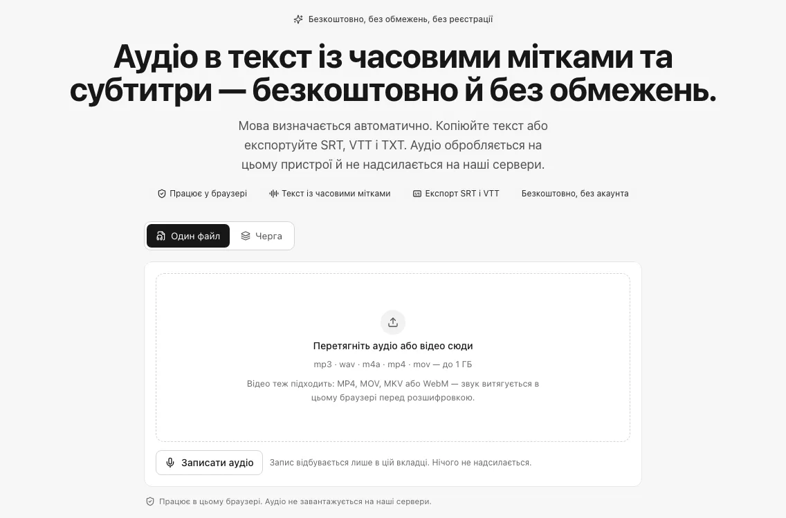

<p align="center">
  <b>🌐 Languages:</b><br/>
  <a href="README.md">English</a> ·
  <a href="README.zh-CN.md">简体中文</a> ·
  <a href="README.zh-TW.md">繁體中文</a> ·
  <a href="README.ja.md">日本語</a> ·
  <a href="README.ko.md">한국어</a> ·
  <a href="README.es.md">Español</a> ·
  <a href="README.pt-BR.md">Português</a> ·
  <a href="README.fr.md">Français</a> ·
  <a href="README.de.md">Deutsch</a> ·
  <a href="README.it.md">Italiano</a> ·
  <a href="README.nl.md">Nederlands</a> ·
  <a href="README.pl.md">Polski</a> ·
  <a href="README.ru.md">Русский</a> ·
  <a href="README.uk.md">Українська</a> ·
  <a href="README.sv.md">Svenska</a> ·
  <a href="README.nb.md">Norsk</a> ·
  <a href="README.da.md">Dansk</a> ·
  <a href="README.fi.md">Suomi</a> ·
  <a href="README.id.md">Bahasa Indonesia</a> ·
  <a href="README.tr.md">Türkçe</a> ·
  <a href="README.vi.md">Tiếng Việt</a> ·
  <a href="README.th.md">ไทย</a> ·
  <a href="README.hi.md">हिन्दी</a> ·
  <a href="README.bn.md">বাংলা</a>
</p>

<h1 align="center">EarScribe — безкоштовна розшифровка аудіо та відео в текст у браузері</h1>

<p align="center">
  <b>Перетягніть аудіофайл або відео чи запишіть звук із мікрофона. Отримайте розшифровку з мітками часу та субтитри.</b><br/>
  <sub>Whisper працює на вашому власному пристрої через WebGPU або WebAssembly — запис ніколи не вивантажується.</sub>
</p>

<p align="center">
  <a href="https://earscribe.app"></a>
  <a href="https://earscribe.app"></a>
  <a href="https://earscribe.app"></a>
  <a href="https://earscribe.app"></a>
  
</p>

<p align="center">
  <a href="https://earscribe.app"></a>
</p>

<p align="center">
  <b>🔗 Відкрити застосунок:</b> <a href="https://earscribe.app">earscribe.app</a> ·
  <a href="https://earscribe.app/guides">Посібники</a> ·
  <a href="https://earscribe.app/changelog">Журнал змін</a> ·
  <a href="https://earscribe.app/about">Про проєкт</a>
</p>

---

## 🎙️ Що таке EarScribe

Робоча область для розшифровки, яка повністю працює у вкладці браузера. Ви даєте їй аудіо, відеофайл або мікрофон — вона повертає текст із мітками часу, за якими можна клацнути, щоб переслухати момент, а також файли субтитрів, які можна передати монтажеру. Ні облікового запису, ні вивантаження, ні погодинної оплати.

Три способи почати, один конвеєр:

- **Файл** — MP3, WAV, M4A, AAC, OGG, FLAC, Opus або майже все, що вміє декодувати Web Audio API, до 1 GiB.
- **Відео** — MP4, MOV, MKV, WebM, M4V, TS, QT, M2TS. Звукова доріжка демультиплексується й перекодується в моно 16 kHz **всередині вкладки**, після чого розшифровується як будь-який інший файл. Без ffmpeg і без сайтів-конвертерів.
- **Мікрофон** — запис і розшифровка в одному місці: для лекції, розмови, яку вам дозволено записувати, або голосової нотатки, яку ви інакше втратили б.

Додайте чергу — і можна закинути файли на цілу теку та піти у справах; додайте робочу область за адресою `/dashboard` — і результати стануть проєктами, які можна знову відкрити, відредагувати й вивантажити пізніше.

> 👉 **Робочий застосунок:** **[earscribe.app](https://earscribe.app)**

---

## 📚 Зміст

- [✨ Що він робить](#-що-він-робить)
- [🖼️ Скриншоти](#️-скриншоти)
- [🚀 Швидкий старт](#-швидкий-старт)
- [🗂️ Робоча область](#️-робоча-область)
- [💸 Скільки це коштує](#-скільки-це-коштує)
- [🆚 Порівняння](#-порівняння)
- [🌍 Підтримувані вхідні дані та мови](#-підтримувані-вхідні-дані-та-мови)
- [💼 Сценарії використання](#-сценарії-використання)
- [🚧 Чого EarScribe не робить](#-чого-earscribe-не-робить)
- [❓ Часті запитання](#-часті-запитання)
- [🛠️ Технологічний стек](#️-технологічний-стек)
- [🧑‍💻 Локальна розробка](#-локальна-розробка)
- [☁️ Розгортання](#️-розгортання)
- [🌐 Як додати нову мову](#-як-додати-нову-мову)
- [🔬 Як додати нову модель Whisper](#-як-додати-нову-модель-whisper)
- [🤝 Участь у проєкті](#-участь-у-проєкті)
- [📄 Ліцензія](#-ліцензія)

---

## ✨ Що він робить

| | Можливість | Що ви отримуєте насправді |
|---|---|---|
| 🎬 | **Аудіо, відео та мікрофон** | Відеоконтейнери приймаються напряму. Звукова доріжка видобувається локально, тож MP4 на 200 MB теж не покидає пристрій. |
| 📝 | **Розшифровка з мітками часу** | Кожна репліка має час початку й кінця. Клацніть рядок — почуєте цей момент, а повзунок по хвильовій формі рухатиметься слідом. |
| 🔍 | **Пошук усередині розшифровки** | Ім'я, число, термін — перейдіть до речення й переслухайте його замість повторного прослуховування файлу. |
| 🎞️ | **Експорт субтитрів** | SRT, WebVTT, звичайний текст, JSON (об'єкт розшифровки з часовими кодами повної точності) або буфер обміну. |
| 🧪 | **Перевірка субтитрів** | Позначає репліки, що задовгі, занадто швидкі, повторювані, порожні чи перекриваються, ще до експорту. |
| 📚 | **Пакетна черга** | Перетягніть кілька файлів, задайте одну модель і одну мову мовлення — і нехай черга обробить їх по порядку. Пауза після поточного файлу будь-коли. |
| 🗂️ | **Проєкти** | Результати зберігаються в браузері як проєкти за адресою `/dashboard`: розшифровки, субтитри, вихідні файли та тека кошика; їх можна відкрити пізніше. |
| ✏️ | **Редагування субтитрів** | Виправте текст, пересуньте точки входу й виходу репліки, розділіть або видаліть її, потім експортуйте знову. |
| 💾 | **Резервне копіювання та відновлення** | Вивантажте всю робочу область одним файлом і імпортуйте її в іншому браузері. |
| 🔁 | **Конвертація субтитрів** | SRT ⇄ VTT і SRT → текст у браузері, без завантаження моделі — єдиний інструмент тут, що запускається миттєво. |
| 🆓 | **Безкоштовно й без обмежень** | Ні платного тарифу, ні денної квоти, ні погодинної плати, ні облікового запису. |
| 🔒 | **Приватність за архітектурою** | Розшифровка виконується локально. Публічні сторінки містять аналітику й рекламу; `/dashboard` — без реклами. |
| 🌍 | **27 мов інтерфейсу, 99 мов мовлення** | Інтерфейс перекладено 27 мовами; Whisper визначає мову мовлення автоматично. |

---

## 🖼️ Скриншоти

> Справжні скриншоти з живого сайту **[earscribe.app](https://earscribe.app)**.

### 1. Перетягніть файл чи відео або запишіть звук — без реєстрації та вивантаження

<p align="center">
  <a href="https://earscribe.app"></a>
</p>

<p align="center"><sub>Головний екран: зона перетягування файлів, кнопка запису з мікрофона та вибір моделі в одному вікні</sub></p>

### 2. Розшифровка з мітками часу та хвильовою формою — клацніть будь-який рядок, щоб перейти

<p align="center">
  <a href="https://earscribe.app"></a>
</p>

<p align="center"><sub>Розшифровка з мітками часу, хвильовою формою та кнопками експорту SRT і VTT</sub></p>

### 3. Три кроки: перетягнути → вибрати модель Whisper → експортувати

<p align="center">
  <a href="https://earscribe.app"></a>
</p>

<p align="center"><sub>Три кроки на одному екрані: файл, модель Whisper і готовий текст для експорту</sub></p>

### 4. Чому EarScribe — приватність передусім, Whisper прямо в браузері

<p align="center">
  <a href="https://earscribe.app"></a>
</p>

<p align="center"><sub>Огляд можливостей: локальна обробка, автовизначення мови та формати експорту</sub></p>

### 5. Хто користується EarScribe — подкастери, журналісти, студенти, монтажери

<p align="center">
  <a href="https://earscribe.app"></a>
</p>

<p align="center"><sub>Приклади застосування для подкастів, співбесід, навчання й субтитрів</sub></p>

### 6. EarScribe проти Otter.ai, Rev, HappyScribe та локальної установки Whisper

<p align="center">
  <a href="https://earscribe.app"></a>
</p>

<p align="center"><sub>Таблиця порівняння з Otter.ai, Rev, HappyScribe та локальним Whisper</sub></p>

### 7. Часті запитання — приватність, формати, експорт субтитрів, робота офлайн

<p align="center">
  <a href="https://earscribe.app"></a>
</p>

<p align="center"><sub>Блок запитань і відповідей про приватність, формати та роботу офлайн</sub></p>

---

## 🚀 Швидкий старт

1. Відкрийте **[earscribe.app](https://earscribe.app)** у Chrome, Edge, Safari або Firefox.
2. Перетягніть файл — чи відео, чи натисніть запис. Приймається до 1 GiB на файл; справжня межа — пам'ять вашого пристрою, а не розмір на диску.
3. Виберіть модель. **base** — типова й доречна для більшості мовлення; **tiny** — для телефона чи швидкої голосової нотатки; **small** і **turbo** — для мовлення з акцентом, у шумі або коли воно важливе.
4. Натисніть **Розшифрувати**. Аудіо декодується й подається Whisper усередині вкладки. Перший запуск завантажує ваги, тож зверніть увагу на розмір на кнопці.
5. Прочитайте розшифровку, клацніть рядок, щоб переслухати його, виправте важливе, а далі **Експорт → SRT / VTT / TXT / JSON** або скопіюйте.

Потрібен пакет? Перемкніться на чергу, перетягніть скільки завгодно файлів і виберіть модель один раз. Черга обробляє по одному файлу за раз, повторно використовує модель, уже завантажену в пам'ять, і зберігає кожен результат як проєкт.

> 💡 **Крок конвертації не потрібен.** Двогодинний MP4 іде напряму. Якщо ви хочете лишити тільки звук, застосунок може видобути звукову доріжку відео за вас.

---

## 🗂️ Робоча область

`/dashboard` — це той самий рушій розшифровки, але з пам'яттю. Усе зберігається в цьому браузері — IndexedDB для записів проєктів, CacheStorage для ваг моделей — і нічого не синхронізується з обліковим записом, бо облікового запису немає.

| Розділ | Що там лежить |
|---|---|
| **Проєкти** | Усе, найновіше зверху. |
| **Розшифровки** | Проєкти, створені запуском розшифровки. Редагування їхніх реплік залишає їх тут. |
| **Субтитри** | Проєкти, створені з файлу субтитрів — конвертер і імпорти, — тож робота з титрами не змішується з роботою з мовленням. |
| **Файли** | Вихідні медіа, які тримає робоча область, з фільтром за типом: розшифровки, субтитри, аудіо. Оригінальне аудіо за замовчуванням **не** зберігається. |
| **Кошик** | Видалені проєкти; їх можна відновити, доки ви не спорожните кошик. |

Усередині проєкту можна шукати в розшифровці, клацати мітку часу, щоб переслухати момент, редагувати репліки субтитрів (текст, точки входу й виходу, додавання чи видалення), розбивати довгі репліки на коротші, знову експортувати в будь-якому форматі або відкрити медіаплеєр, не залишаючи сторінку.

**Резервна копія:** робоча область експортується одним файлом (до 320 MB) і імпортується в іншому браузері чи на іншій машині. Оскільки проєкти ніколи не залишають пристрій, цей файл — єдина копія, що подорожує; поводьтеся з ним як із будь-якою іншою резервною копією документа.

---

## 💸 Скільки це коштує

Безкоштовно не означає без витрат. Це виміряні розміри завантаження для кожної моделі та бекенду, а не оцінки:

| Модель | WebGPU | WebAssembly | Типове застосування |
|---|---:|---:|---|
| **tiny** | 151 MB | 41 MB | Голосові нотатки, слабкі телефони, перша спроба |
| **base** *(за замовчуванням)* | 291 MB | 77 MB | Інтерв'ю, зустрічі, подкасти |
| **small** | 968 MB | 249 MB | Мовлення з акцентом, галасливі приміщення |
| **turbo** | 3.24 GB | 1.09 GB | Студійні розшифровки, коли точність важливіша за час |

- **Завантажується один раз, далі — з кешу.** Ваги лежать у кеші браузера; повторний запуск нічого не завантажує. Інший профіль браузера означає нове завантаження.
- **GPU себе виправдовує.** На тій самій машині WebGPU обробив 40-хвилинний файл моделлю base приблизно за 3.8 хвилини проти 9.4 на CPU — приблизно у 2.5× швидше, ціною завантаження у три-чотири рази більшого. `turbo` на WebGPU у нашому тесті так і не довантажив свої 3.24 GB, тож його позначено як невиміряний, а не як швидкий.
- **Вирішує пам'ять, а не розмір файлу.** Довгі записи декодуються в моно 16 kHz перед розшифровкою. 40-хвилинному MP3 вистачить кількох сотень мегабайтів; двогодинний стерео WAV може вичерпати вкладку ще до старту. Тепер декодування одразу запитує 16 kHz, і пікова пам'ять на двогодинному стереофайлі впала приблизно з 1.6 GB до 0.5 GB.
- **Ні сервера, ні черги на чужій машині.** Час — це час вашого процесора, тож повільний ноутбук буде повільним. Така плата за відмову від вивантаження.

Повні вимірювання, з методикою та невдалими запусками, — у [посібниках](https://earscribe.app/guides).

---

## 🆚 Порівняння

Як EarScribe виглядає поряд з іншими способами розшифрувати аудіо у 2026 році?

| | **EarScribe** | Otter.ai Free | Rev Free Trial | HappyScribe | Local Whisper CLI |
|---|:---:|:---:|:---:|:---:|:---:|
| **Безкоштовно й без обмежень** | ✅ | ⚠️ 300 хв/міс | ❌ Лише пробний період | ❌ Платно | ✅ |
| **Без реєстрації та входу** | ✅ | ❌ | ❌ | ❌ | ✅ |
| **Без вивантаження (приватно)** | ✅ | ❌ | ❌ | ❌ | ✅ |
| **Відео без вивантаження** | ✅ Видобування локально | ❌ Потрібне вивантаження | ❌ Потрібне вивантаження | ❌ Потрібне вивантаження | ✅ Потрібен ffmpeg |
| **Працює в браузері** | ✅ | ✅ | ✅ | ✅ | ❌ |
| **Експорт SRT / VTT** | ✅ | ⚠️ Платно | ✅ | ✅ | ⚠️ Вручну |
| **Розшифровка з мітками часу** | ✅ | ✅ | ✅ | ✅ | ⚠️ Вручну |
| **Виведення на пристрої** | ✅ | ❌ | ❌ | ❌ | ✅ |
| **99 мов мовлення** | ✅ | ⚠️ Обмежено | ⚠️ Обмежено | ✅ | ✅ |
| **Whisper Large v3 Turbo** | ✅ | ❌ | ❌ | ❌ | ✅ |
| **Потрібна установка** | ❌ Ні | ❌ Ні | ❌ Ні | ❌ Ні | ⚠️ Python + GPU |
| **Вартість** | $0 | $0–$30/міс | $0.25/хв | €0.20/хв | $0 (ваше обладнання) |

**Де він програє:** локальна установка може запустити більшу модель на швидшому бекенді, ніж вкладка браузера, а платний сервіс додає позначки мовців і командну робочу область. Перевага EarScribe в тому, що він безкоштовний, нічого не треба встановлювати, а аудіо нікуди не йде.

→ **[Спробуйте на earscribe.app](https://earscribe.app)**

---

## 🌍 Підтримувані вхідні дані та мови

### Аудіо — MP3, WAV, M4A, AAC, OGG, FLAC, Opus

Приймається все, що вміє декодувати Web Audio API; ці сім форматів охоплюють майже кожен запис, який вам трапиться.

- 🎵 **[MP3 у текст](https://earscribe.app/mp3-to-text)** — стандарт для подкастів та інтерв'ю
- 🎙️ **[WAV у текст](https://earscribe.app/wav-to-text)** — студійні та польові записи без втрат
- 📱 **[M4A у текст](https://earscribe.app/m4a-to-text)** — диктофон iPhone
- 🎧 **[Голосова нотатка в текст](https://earscribe.app/voice-memo-to-text)** — записи з телефона на мобільному
- 🔊 **[Аудіо в текст](https://earscribe.app/audio-to-text)** — загальна точка входу
- 🎬 **[Аудіо в SRT](https://earscribe.app/audio-to-srt)** — одразу до субтитрів

### Відео — MP4, MOV, MKV, WebM, M4V, TS, QT, M2TS

Звукова доріжка демультиплексується за допомогою [mediabunny](https://mediabunny.dev), декодується через WebCodecs і перекодується в невеликий моно MP3 16 kHz (або WAV там, де немає кодера MP3) — усе локально. Контейнер, який браузер не може декодувати, завершується зрозумілим повідомленням, а не тихою порожньою розшифровкою.

### Мікрофон

Запис відбувається у вкладці через MediaRecorder. Запис розшифровується точно так само, як перетягнутий файл; живі субтитри під час запису **не** надаються (див. [чого EarScribe не робить](#-чого-earscribe-не-робить)).

### Мови — 99 мовленнєвих, 27 інтерфейсних

Whisper визначає мову мовлення автоматично: англійська, іспанська, французька, німецька, італійська, португальська, російська, японська, корейська, китайська (спрощена й традиційна), арабська, гінді, турецька, нідерландська, польська, індонезійська, шведська, норвезька, данська, фінська, чеська, угорська, грецька, іврит, тайська, в'єтнамська та ще 70+.

Інтерфейс перекладено 27 мовами. Англійська живе за адресою `/`, решта 26 мають префікс:

| | | | |
|---|---|---|---|
| [English](https://earscribe.app) | [简体中文](https://earscribe.app/zh-CN) | [日本語](https://earscribe.app/ja) | [한국어](https://earscribe.app/ko) |
| [Español](https://earscribe.app/es) | [Português (BR)](https://earscribe.app/pt-br) | [Deutsch](https://earscribe.app/de) | [Français](https://earscribe.app/fr) |
| [Русский](https://earscribe.app/ru) | [Italiano](https://earscribe.app/it) | [Polski](https://earscribe.app/pl) | [Nederlands](https://earscribe.app/nl) |
| [Українська](https://earscribe.app/uk) | [Türkçe](https://earscribe.app/tr) | [Tiếng Việt](https://earscribe.app/vi) | [ไทย](https://earscribe.app/th) |
| [हिन्दी](https://earscribe.app/hi) | [বাংলা](https://earscribe.app/bn) | [اردو](https://earscribe.app/ur) | [العربية](https://earscribe.app/ar) |
| [فارسی](https://earscribe.app/fa) | [Bahasa Indonesia](https://earscribe.app/id) | [Svenska](https://earscribe.app/sv) | [Norsk](https://earscribe.app/nb) |
| [Dansk](https://earscribe.app/da) | [Suomi](https://earscribe.app/fi) | [繁體中文](https://earscribe.app/zh-TW) | |

---

## 💼 Сценарії використання

### 🎙️ Подкастери та автори контенту
**[Розшифровка подкастів](https://earscribe.app/podcast-transcription)** для приміток до випусків, SEO епізодів і доступності. Експортуйте SRT для відеоверсії, TXT для блогу.

### 📰 Журналісти та дослідники
**[Розшифровка інтерв'ю](https://earscribe.app/interview-transcription)**, де вихідний запис залишається на вашому ноутбуці. Жодної сторонньої копії, яка могла б просочитися, бути витребувана чи піддана аудиту.

### 🎓 Студенти та викладачі
**[Розшифровка лекцій](https://earscribe.app/audio-to-text)** із записаного заняття з можливістю пошуку ще до наступної сесії. Працює з диктофоном iPhone та експортами Zoom.

### 📞 Зустрічі та дослідження користувачів
**[Запис зустрічі в текст](https://earscribe.app/meeting-recording-to-text)** — розшифровка розмови, а не автоматично згенеровані нотатки зустрічі.

### 🎬 Монтажери відео
**[Аудіо в SRT](https://earscribe.app/audio-to-srt)** для YouTube, Premiere, Final Cut і Resolve. Тайминг реплік походить із власних міток Whisper, а перевірка субтитрів позначає те, що вилізе за екран.

### 📚 Аудіокниги та довгі записи
Двогодинні файли підтримуються, але саме тут вирішує пам'ять пристрою. Прочитайте [як обробляються довгі аудіо](https://earscribe.app/guides/how-to-transcribe-long-audio), перш ніж братися за чотиригодинний.

---

## 🚧 Чого EarScribe не робить

Бути відвертим тут — це зекономити всім один марний запуск:

- **Без розділення мовців.** Двоє людей в одному файлі дають плаский текст без позначок «Мовець 1 / Мовець 2». Сторінка про інтерв'ю каже це навмисно.
- **Без перекладу.** Розшифровка залишається мовою, якою говорили; мова інтерфейсу й мова мовлення не пов'язані.
- **Без живих субтитрів.** Запис і розшифровка — окремі кроки: спершу мікрофон записує, потім файл розшифровується.
- **Черга послідовна й потребує відкритої вкладки.** Одна модель, одне налаштування мови на весь пакет. Закриття вкладки її зупиняє.
- **Без синхронізації між пристроями.** Проєкти живуть у цьому браузері. Переносьте їх експортом робочої області.
- **Це не офлайн-застосунок.** Ваги кешуються, але сама сторінка завантажується з мережі. Встановлення додає ярлик на робочому столі чи домашньому екрані, а не офлайн-копію.
- **1 GiB на файл — жорстка межа; практична межа — пам'ять.**

---

## ❓ Часті запитання

<details>
<summary><b>EarScribe справді безкоштовний, без обмежень?</b></summary><br/>
Так — ні платного тарифу, ні кредитної картки, ні погодинної плати, ні денної чи місячної квоти, ні облікового запису. Обчислення йдуть на вашому обладнанні, тож немає рахунку за хмару, який треба перекладати на вас. Є обмеження 1 GiB на файл, а пам'ять вашого пристрою визначає, що справді завершиться.
</details>

<details>
<summary><b>Чи вивантажується моє аудіо кудись?</b></summary><br/>
Ні. Аудіо декодується у вкладці й подається моделі Whisper, що працює у Web Worker. Ваги моделі завантажуються <i>у</i> ваш браузер із CDN, тобто CDN бачить вашу IP-адресу — але сам запис не надсилається. Публічні сторінки містять Google AdSense — крім перських сторінок, які політика AdSense виключає — плюс аналітику Plausible без cookie; <code>/dashboard</code> не завантажує рекламного коду.
</details>

<details>
<summary><b>Чи можна розшифрувати відео?</b></summary><br/>
Так, напряму — MP4, MOV, MKV, WebM, M4V, TS, QT і M2TS. Звукова доріжка видобувається всередині браузера й розшифровується як звичайний файл, тож ffmpeg чи сайт-конвертер не потрібні. Якщо контейнер використовує кодек, який браузер не може декодувати, застосунок каже про це, а не видає порожню розшифровку.
</details>

<details>
<summary><b>Чому перший запуск повільний?</b></summary><br/>
Першого разу, коли ви користуєтеся моделлю, браузер завантажує її ваги — від 41 MB для tiny на WebAssembly до 3.24 GB для turbo на WebGPU. Далі вони кешуються. Вибирайте <b>base</b> (77 MB на WebAssembly, 291 MB на WebGPU) майже для всього.
</details>

<details>
<summary><b>Наскільки це точно і яку модель вибрати?</b></summary><br/>
На тому самому 34-секундному кліпі наші чотири моделі розійшлися на 26 з 111 слів, а та сама модель у двох розмірах завантаження розійшлася сама з собою. Вибирайте за словами, які для вас важливі, а не за відсотком точності: [посібник із моделей](https://earscribe.app/guides/which-whisper-model-should-i-use) показує реальні відмінності.
</details>

<details>
<summary><b>Чи можна отримати субтитри SRT або VTT?</b></summary><br/>
Так: Експорт → SRT або VTT. Тайминг походить із власних меж сегментів Whisper, а не з поділу тексту постфактум. Перевірка субтитрів позначає репліки, що задовгі, занадто швидкі, повторювані, порожні чи перекриваються, а текст і тайминг реплік можна редагувати до експорту.
</details>

<details>
<summary><b>А якщо у мене вже є файл SRT або VTT?</b></summary><br/>
Сконвертуйте його без завантаження моделі: <a href="https://earscribe.app/srt-to-vtt">SRT у VTT</a> і <a href="https://earscribe.app/srt-to-txt">SRT у текст</a> розбирають файл локально. Нічого не вивантажується і жодні ваги Whisper не завантажуються.
</details>

<details>
<summary><b>Чи працює це офлайн?</b></summary><br/>
Крок розшифровки — так: щойно сторінку й модель завантажено, аудіо обробляється без звернення до сервера розшифровки. Але застосунок не є офлайн-пакетом — відкриття потребує мережі, а модель, яку ви ніколи не завантажували, доведеться завантажити. Встановлення з підвалу додає ярлик, що відкривається в робочій області; офлайн-копії воно не додає.
</details>

<details>
<summary><b>Чи підписує він, хто говорить?</b></summary><br/>
Ні. Результат — плаский текст із часовими кодами. Діаризація мовців не входить до цієї збірки, і застосунок не вдає інакше.
</details>

<details>
<summary><b>Де зберігаються мої результати?</b></summary><br/>
У цьому браузері: проєкти в IndexedDB, ваги моделей у CacheStorage. Оригінальне аудіо не зберігається разом із проєктом, якщо ви його не залишите. Сторінка, яку жодного разу не зберегли в робочу область, після перезавантаження починається з чистого аркуша; користуйтеся <code>/dashboard</code> та його експортом, щоб зберегти все важливе.
</details>

<details>
<summary><b>Чи є безкоштовна альтернатива Otter.ai або Rev?</b></summary><br/>
EarScribe — безкоштовна альтернатива хмарним сервісам розшифровки: обчислення робите ви, аудіо лишається на місці, і жодної погодинної плати. Компроміс реальний — без позначок мовців, без командної робочої області, а довгі файли обмежені вашою машиною.
</details>

<details>
<summary><b>Як безкоштовно перетворити MP3 на текст?</b></summary><br/>
Перетягніть MP3 на <a href="https://earscribe.app/mp3-to-text">earscribe.app/mp3-to-text</a> (або на головну сторінку). Він декодується у вашому браузері, розшифровується локально, і результат можна скопіювати чи експортувати як SRT, VTT, TXT або JSON.
</details>

> Більше відповідей на **[сторінці «Про проєкт»](https://earscribe.app/about)**, а нотатки про вимірювання — у **[посібниках](https://earscribe.app/guides)**.

---

## 🛠️ Технологічний стек

- **[Next.js 15](https://nextjs.org)** (App Router) + **React 19**
- **[@huggingface/transformers v3](https://huggingface.co/docs/transformers.js)** — ONNX Runtime Web, WebGPU із запасним варіантом WebAssembly
- **[OpenAI Whisper](https://github.com/openai/whisper)** — tiny, base, small і large-v3-turbo, квантовані в ONNX
- **[mediabunny](https://mediabunny.dev)** + **WebCodecs** — демультиплексування відео та видобування аудіо у вкладці
- **[next-intl](https://next-intl.dev)** — 27 локалей, один каталог повідомлень на мову
- **[Tailwind CSS v4](https://tailwindcss.com)**
- **[Cloudflare Pages](https://pages.cloudflare.com)** для хостингу, з кількома Pages Functions (хостинг моделей, кінцева точка зворотного зв'язку)

Сайт рендериться статично й гідратується в браузері; розшифровка та конвертація субтитрів виконуються лише на клієнті. Ваги моделей надходять із CDN Hugging Face під час першого використання й кешуються в CacheStorage.

---

## 🧑‍💻 Локальна розробка

```bash
git clone https://github.com/rocnubie/earscribe-free-speech-to-text.git
cd earscribe-free-speech-to-text
pnpm install
pnpm dev
# → http://localhost:3000
```

Перевірки, що виконуються перед розгортанням:

```bash
pnpm typecheck
pnpm lint
pnpm test              # node:test — queue state machine, subtitle parsers, release id
pnpm i18n:gate         # no missing keys, no English leftovers, no broken placeholders
pnpm seo:check         # page copy, keyword coverage, FAQ and cursor audits
node scripts/sitemap-audit.mjs
node scripts/llms-txt-audit.mjs
pnpm readme:audit      # README sizes vs lib/models.ts, links, 9-language parity
```

`pnpm build` створює статичний експорт у `out/`. Кілька аудитів читають `out/`, тож спершу виконайте збірку.

---

## ☁️ Розгортання

Виробничі розгортання йдуть однією командою, яка запускає всі аудити по порядку:

```bash
pnpm pages:deploy
```

Спершу вона порівнює локальний маркер розгортання (`deployId` у `lib/release.ts`) із тим, що віддається на `/changelog` живого сайту, і відмовляється продовжувати, якщо вони збігаються — так ловиться застаріла збірка. Далі вона збирає, запускає аудити посилань, посібників, `llms.txt`, i18n, sitemap і PWA та публікує `out/` у Cloudflare Pages.

`/changelog` — це орієнтований на читача список змін, із якими можна щось зробити. Це не журнал збірки: внутрішні рефакторинги, правки текстів і робота над перекладами отримують новий `deployId`, але без запису в журналі змін.

Змінні середовища та прив'язки:

| Назва | Для чого |
|---|---|
| `NEXT_PUBLIC_SITE_URL` | Канонічні URL, sitemap, теги OG |
| `NEXT_PUBLIC_PLAUSIBLE_DOMAIN` | Ідентифікатор сайту Plausible |
| `NEXT_PUBLIC_PLAUSIBLE_SCRIPT_URL` | URL скрипта Plausible |
| `FEEDBACK_DB` (прив'язка D1) | Кінцева точка `/feedback`; схема в `migrations/` |

---

## 🌐 Як додати нову мову

1. Додайте код локалі в `ALL_LOCALE_NAMES` у [`i18n/locale.ts`](i18n/locale.ts).
2. Створіть `messages/<code>.json` поряд з `en.json`, повністю перекладений.
3. Виконайте `pnpm i18n:gate` — маршрутизація, sitemap, hreflang і метадані OG підхоплюють локаль автоматично, але пропущений ключ валить перевірку.

До `translatedLocales` належать лише локалі, що проходять перевірку; перемикач мов усе інше позначає як часткове.

---

## 🔬 Як додати нову модель Whisper

Додайте запис до `MODELS` у [`lib/models.ts`](lib/models.ts) з **виміряним** `sizeMB` і для `wasm`, і для `webgpu` — два бекенди постачають різні файли ваг, і саме через одне число на обидва застосунок колись обіцяв 500 MB, а віддавав 968 MB. Репозиторій має існувати на Hugging Face як `onnx-community/<name>` або бути сумісним з ONNX-Whisper. Додайте відповідний блок `models.<id>` до кожного `messages/*.json` для тексту про переваги й недоліки.

---

## 🤝 Участь у проєкті

Pull request'и вітаються — особливо:

- Переклади (`messages/<code>.json`) і виправлення README для конкретних локалей
- Звіти про помилки з файлом, що зламався, браузером і пам'яттю пристрою
- Вимірювання: розмір моделі, час і пікова пам'ять на обладнанні, якого в нас немає
- Виправлення доступності

Відкрийте issue чи PR тут або спершу спробуйте **[earscribe.app](https://earscribe.app)**, щоб побачити, у що ви робите внесок.

---

## 📄 Ліцензія

Маркетинговий сайт і сторінки в цьому репозиторії — [MIT](LICENSE): безкоштовно для особистого й комерційного використання. Воркер розшифровки, аудіодекодер і експортери субтитрів тут не публікуються, тож цей репозиторій не є повною копією сервісу, яку можна розгорнути самостійно.

---

<p align="center">
  <b>👉 Спробуйте робочий застосунок: <a href="https://earscribe.app">earscribe.app</a></b><br/>
  <sub>Аудіо в текст · Відео в текст · Мовлення в текст · Експорт субтитрів · 100% безкоштовно · Без реєстрації · На пристрої</sub>
</p>

<p align="center">
  Створено з ❤️ на <a href="https://github.com/openai/whisper">OpenAI Whisper</a>, <a href="https://huggingface.co/docs/transformers.js">Transformers.js</a>, <a href="https://onnxruntime.ai">ONNX Runtime Web</a> і <a href="https://mediabunny.dev">mediabunny</a>.
</p>
