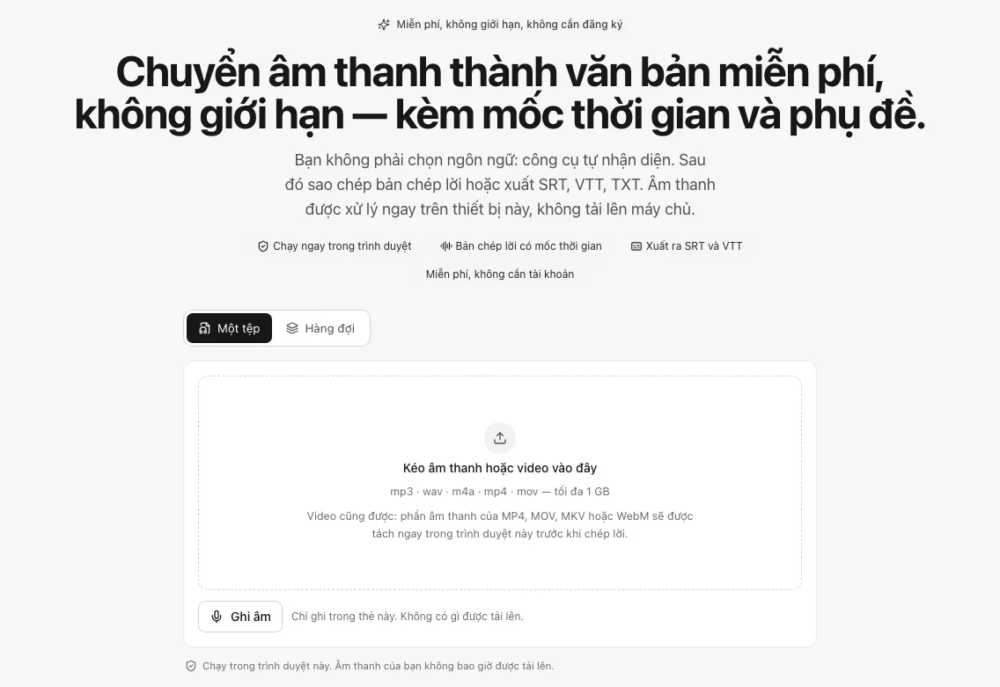

<p align="center">
  <b>🌐 Ngôn ngữ:</b><br/>
  <a href="README.md">English</a> ·
  <a href="README.zh-CN.md">简体中文</a> ·
  <a href="README.zh-TW.md">繁體中文</a> ·
  <a href="README.ja.md">日本語</a> ·
  <a href="README.ko.md">한국어</a> ·
  <a href="README.es.md">Español</a> ·
  <a href="README.pt-BR.md">Português</a> ·
  <a href="README.fr.md">Français</a> ·
  <a href="README.de.md">Deutsch</a> ·
  <a href="README.it.md">Italiano</a> ·
  <a href="README.nl.md">Nederlands</a> ·
  <a href="README.pl.md">Polski</a> ·
  <a href="README.ru.md">Русский</a> ·
  <a href="README.uk.md">Українська</a> ·
  <a href="README.sv.md">Svenska</a> ·
  <a href="README.nb.md">Norsk</a> ·
  <a href="README.da.md">Dansk</a> ·
  <a href="README.fi.md">Suomi</a> ·
  <a href="README.id.md">Bahasa Indonesia</a> ·
  <a href="README.tr.md">Türkçe</a> ·
  <a href="README.vi.md">Tiếng Việt</a> ·
  <a href="README.th.md">ไทย</a> ·
  <a href="README.hi.md">हिन्दी</a> ·
  <a href="README.bn.md">বাংলা</a>
</p>

<h1 align="center">EarScribe — chuyển âm thanh và video thành văn bản miễn phí trên trình duyệt</h1>

<p align="center">
  <b>Thả một tệp âm thanh, một video hoặc ghi trực tiếp từ micro. Nhận bản phiên âm có mốc thời gian và phụ đề.</b><br/>
  <sub>Whisper chạy trên chính máy của bạn qua WebGPU hoặc WebAssembly — bản ghi không bao giờ được tải lên.</sub>
</p>

<p align="center">
  <a href="https://earscribe.app"></a>
  <a href="https://earscribe.app"></a>
  <a href="https://earscribe.app"></a>
  <a href="https://earscribe.app"></a>
  
</p>

<p align="center">
  <a href="https://earscribe.app"></a>
</p>

<p align="center">
  <b>🔗 Mở ứng dụng:</b> <a href="https://earscribe.app">earscribe.app</a> ·
  <a href="https://earscribe.app/guides">Hướng dẫn</a> ·
  <a href="https://earscribe.app/changelog">Nhật ký thay đổi</a> ·
  <a href="https://earscribe.app/about">Giới thiệu</a>
</p>

---

## 🎙️ EarScribe là gì

Một không gian làm việc phiên âm chạy hoàn toàn trong thẻ trình duyệt. Bạn đưa vào âm thanh, một tệp video hoặc micro của mình; nó trả lại văn bản có mốc thời gian mà bạn có thể nhấp để phát lại, cùng các tệp phụ đề bạn có thể giao cho người biên tập. Không có tài khoản, không tải lên và không tính phí theo phút.

Ba cách đưa vào, một quy trình:

- **Một tệp** — MP3, WAV, M4A, AAC, OGG, FLAC, Opus, hoặc hầu hết những gì Web Audio API giải mã được, tối đa 1 GiB.
- **Một video** — MP4, MOV, MKV, WebM, M4V, TS, QT, M2TS. Rãnh âm thanh được tách và mã hóa lại thành mono 16 kHz **ngay trong thẻ**, rồi được phiên âm như mọi tệp khác. Không cần ffmpeg, không cần trang chuyển đổi.
- **Micro** — ghi và phiên âm ngay tại chỗ, cho một buổi giảng, một cuộc gọi mà bạn được phép ghi, hoặc một ghi chú thoại mà nếu không sẽ bị mất.

Thêm hàng đợi và bạn có thể thả cả một thư mục tệp rồi rời đi; thêm không gian làm việc tại `/dashboard` và kết quả trở thành các dự án bạn có thể mở lại, chỉnh sửa và xuất sau này.

> 👉 **Ứng dụng trực tuyến:** **[earscribe.app](https://earscribe.app)**

---

## 📚 Mục lục

- [✨ Tính năng](#-tính-năng)
- [🖼️ Ảnh chụp màn hình](#️-ảnh-chụp-màn-hình)
- [🚀 Bắt đầu nhanh](#-bắt-đầu-nhanh)
- [🗂️ Không gian làm việc](#️-không-gian-làm-việc)
- [💸 Chi phí](#-chi-phí)
- [🆚 So sánh](#-so-sánh)
- [🌍 Định dạng đầu vào & ngôn ngữ được hỗ trợ](#-định-dạng-đầu-vào--ngôn-ngữ-được-hỗ-trợ)
- [💼 Các trường hợp sử dụng](#-các-trường-hợp-sử-dụng)
- [🚧 Những gì nó không làm](#-những-gì-nó-không-làm)
- [❓ Câu hỏi thường gặp](#-câu-hỏi-thường-gặp)
- [🛠️ Công nghệ](#️-công-nghệ)
- [🧑‍💻 Phát triển cục bộ](#-phát-triển-cục-bộ)
- [☁️ Triển khai](#️-triển-khai)
- [🌐 Thêm một ngôn ngữ mới](#-thêm-một-ngôn-ngữ-mới)
- [🔬 Thêm một mô hình Whisper mới](#-thêm-một-mô-hình-whisper-mới)
- [🤝 Đóng góp](#-đóng-góp)
- [📄 Giấy phép](#-giấy-phép)

---

## ✨ Tính năng

| | Khả năng | Bạn thực sự nhận được gì |
|---|---|---|
| 🎬 | **Âm thanh, video và micro** | Các vùng chứa video được chấp nhận trực tiếp. Rãnh âm thanh được trích xuất cục bộ, nên một tệp MP4 200 MB cũng không bao giờ rời khỏi máy. |
| 📝 | **Bản phiên âm có mốc thời gian** | Mỗi câu đều có thời điểm bắt đầu và kết thúc. Nhấp vào một dòng để nghe đúng khoảnh khắc đó; thanh tua dạng sóng chạy theo. |
| 🔍 | **Tìm kiếm trong bản phiên âm** | Một cái tên, một con số, một thuật ngữ — nhảy đến câu đó và phát lại thay vì nghe lại cả tệp. |
| 🎞️ | **Xuất phụ đề** | SRT, WebVTT, văn bản thuần, JSON (đối tượng phiên âm với mã thời gian độ chính xác đầy đủ) hoặc sao chép vào bộ nhớ tạm. |
| 🧪 | **Kiểm tra phụ đề** | Đánh dấu những câu quá dài, quá nhanh, lặp lại, trống hoặc chồng lấn trước khi bạn xuất. |
| 📚 | **Hàng đợi theo lô** | Thả nhiều tệp, chọn một mô hình và một ngôn ngữ nói, rồi để hàng đợi chạy lần lượt. Tạm dừng sau tệp hiện tại bất cứ lúc nào. |
| 🗂️ | **Dự án** | Kết quả được lưu trong trình duyệt dưới dạng dự án tại `/dashboard`: bản phiên âm, phụ đề, tệp nguồn và một thư mục thùng rác, có thể mở lại sau. |
| ✏️ | **Chỉnh sửa phụ đề** | Sửa văn bản, di chuyển điểm vào/ra của một câu, tách hoặc xóa một câu, rồi xuất lại. |
| 💾 | **Sao lưu và khôi phục** | Xuất toàn bộ không gian làm việc thành một tệp và nhập vào một trình duyệt khác. |
| 🔁 | **Chuyển đổi phụ đề** | SRT ⇄ VTT và SRT → văn bản, ngay trong trình duyệt, không cần tải mô hình — công cụ duy nhất ở đây khởi động tức thì. |
| 🆓 | **Miễn phí và không giới hạn** | Không có gói trả phí, không hạn mức hàng ngày, không phí theo phút, không tài khoản. |
| 🔒 | **Riêng tư nhờ kiến trúc** | Phiên âm chạy cục bộ. Các trang công khai có phân tích và quảng cáo; `/dashboard` không có quảng cáo. |
| 🌍 | **27 ngôn ngữ giao diện, 99 ngôn ngữ nói** | Giao diện được dịch sang 27 ngôn ngữ; Whisper tự động nhận diện ngôn ngữ nói. |

---

## 🖼️ Ảnh chụp màn hình

> Ảnh chụp thật từ trang trực tuyến tại **[earscribe.app](https://earscribe.app)**.

### 1. Thả một tệp, một video hoặc ghi âm — không đăng ký, không tải lên

<p align="center">
  <a href="https://earscribe.app"></a>
</p>

<p align="center"><sub>Màn hình đầu: vùng kéo thả tệp và danh sách định dạng âm thanh, video được hỗ trợ.</sub></p>

### 2. Bản phiên âm có mốc thời gian kèm dạng sóng — nhấp vào bất kỳ dòng nào để nhảy

<p align="center">
  <a href="https://earscribe.app"></a>
</p>

<p align="center"><sub>Màn hình bản ghi: bên trái là các dòng có mốc thời gian, bên phải là dạng sóng và vị trí phát.</sub></p>

### 3. Ba bước: thả → chọn mô hình Whisper → xuất

<p align="center">
  <a href="https://earscribe.app"></a>
</p>

<p align="center"><sub>Ba bước: kéo tệp vào, chọn mô hình và xuất kết quả xếp theo thứ tự.</sub></p>

### 4. Vì sao chọn EarScribe — ưu tiên riêng tư, Whisper gốc trình duyệt

<p align="center">
  <a href="https://earscribe.app"></a>
</p>

<p align="center"><sub>Tổng quan tính năng: quyền riêng tư, backend suy luận, ngôn ngữ và định dạng xuất gói trong một màn hình.</sub></p>

### 5. Ai dùng EarScribe — người làm podcast, nhà báo, sinh viên, biên tập viên

<p align="center">
  <a href="https://earscribe.app"></a>
</p>

<p align="center"><sub>Trường hợp sử dụng: lối vào riêng cho podcast, phỏng vấn, lớp học và cuộc họp.</sub></p>

### 6. EarScribe so với Otter.ai, Rev, HappyScribe và một bản cài Whisper cục bộ

<p align="center">
  <a href="https://earscribe.app"></a>
</p>

<p align="center"><sub>Bảng so sánh: EarScribe đối chiếu từng mục với các dịch vụ đám mây và Whisper chạy cục bộ.</sub></p>

### 7. Câu hỏi thường gặp — quyền riêng tư, định dạng, xuất phụ đề, dùng ngoại tuyến

<p align="center">
  <a href="https://earscribe.app"></a>
</p>

<p align="center"><sub>Câu hỏi thường gặp: tóm tắt câu trả lời về quyền riêng tư, định dạng, xuất phụ đề và dùng ngoại tuyến.</sub></p>

---

## 🚀 Bắt đầu nhanh

1. Mở **[earscribe.app](https://earscribe.app)** trong Chrome, Edge, Safari hoặc Firefox.
2. Thả một tệp — hoặc một video, hoặc nhấn ghi âm. Chấp nhận tối đa 1 GiB mỗi tệp; giới hạn thực sự là bộ nhớ của thiết bị, không phải kích thước trên đĩa.
3. Chọn một mô hình. **base** là mặc định và phù hợp với hầu hết giọng nói; **tiny** dành cho điện thoại hoặc một ghi chú thoại nhanh; **small** và **turbo** dành cho âm thanh có giọng địa phương, nhiễu hoặc quan trọng.
4. Nhấn **Phiên âm**. Âm thanh được giải mã và đưa vào Whisper ngay trong thẻ. Lần chạy đầu tiên sẽ tải trọng số, nên hãy để ý kích thước hiển thị trên nút.
5. Đọc bản phiên âm, nhấp vào một dòng để phát lại, sửa những gì quan trọng, rồi **Xuất → SRT / VTT / TXT / JSON** hoặc sao chép.

Muốn chạy theo lô? Chuyển sang hàng đợi, thả bao nhiêu tệp tùy thích và chọn mô hình một lần. Hàng đợi chạy từng tệp một, tái sử dụng mô hình đã có trong bộ nhớ và lưu mỗi kết quả thành một dự án.

> 💡 **Không cần bước chuyển đổi.** Một tệp MP4 dài hai giờ được đưa thẳng vào. Nếu bạn muốn giữ lại chỉ phần âm thanh, ứng dụng có thể trích rãnh âm thanh của video giúp bạn.

---

## 🗂️ Không gian làm việc

`/dashboard` là cùng một công cụ phiên âm nhưng có bộ nhớ. Mọi thứ được lưu trong trình duyệt này — IndexedDB cho bản ghi dự án, CacheStorage cho trọng số mô hình — và không có gì được đồng bộ lên tài khoản, vì không có tài khoản.

| Mục | Những gì nằm ở đó |
|---|---|
| **Dự án** | Tất cả, mới nhất trước. |
| **Bản phiên âm** | Các dự án được tạo bởi một lần chạy phiên âm. Việc chỉnh sửa các câu giữ chúng ở đây. |
| **Phụ đề** | Các dự án được tạo từ một tệp phụ đề — công cụ chuyển đổi và các lần nhập — để công việc phụ đề tách biệt với công việc phiên âm lời nói. |
| **Tệp** | Các phương tiện nguồn mà không gian làm việc lưu giữ, có thể lọc theo loại: bản phiên âm, phụ đề, âm thanh. Âm thanh gốc **không** được lưu mặc định. |
| **Thùng rác** | Các dự án đã xóa, có thể khôi phục cho đến khi bạn dọn sạch. |

Trong một dự án, bạn có thể tìm kiếm bản phiên âm, nhấp vào mốc thời gian để phát lại, chỉnh sửa các câu phụ đề (văn bản, điểm vào/ra, thêm hoặc bớt), dàn lại các câu dài thành ngắn hơn, xuất lại ở bất kỳ định dạng nào, hoặc mở trình phát media mà không rời trang.

**Sao lưu:** không gian làm việc được xuất thành một tệp duy nhất (tối đa 320 MB) và nhập vào một trình duyệt khác hoặc một máy khác. Vì dự án không bao giờ rời khỏi thiết bị, tệp này là bản sao duy nhất có thể mang đi — hãy đối xử với nó như bất kỳ bản sao lưu tài liệu nào.

---

## 💸 Chi phí

Miễn phí không có nghĩa là không tốn gì. Đây là kích thước tải xuống được đo thực tế theo từng mô hình và từng backend, không phải ước lượng:

| Mô hình | WebGPU | WebAssembly | Cách dùng điển hình |
|---|---:|---:|---|
| **tiny** | 151 MB | 41 MB | Ghi chú thoại, điện thoại cấu hình thấp, lần thử đầu tiên |
| **base** *(mặc định)* | 291 MB | 77 MB | Phỏng vấn, cuộc họp, podcast |
| **small** | 968 MB | 249 MB | Giọng có địa phương, phòng ồn |
| **turbo** | 3.24 GB | 1.09 GB | Bản phiên âm chuẩn studio, khi độ chính xác quan trọng hơn thời gian |

- **Tải một lần, sau đó được lưu đệm.** Trọng số nằm trong bộ nhớ đệm của trình duyệt; lần chạy thứ hai không tải gì. Một hồ sơ trình duyệt khác nghĩa là phải tải lại.
- **GPU rất đáng.** Trên cùng một máy, WebGPU hoàn thành một tệp 40 phút với base trong khoảng 3.8 phút so với 9.4 trên CPU — nhanh hơn khoảng 2.5×, đổi lại dung lượng tải gấp ba đến bốn lần. `turbo` trên WebGPU không bao giờ hoàn tất bản tải 3.24 GB trong thử nghiệm của chúng tôi, nên nó được ghi là chưa đo chứ không phải nhanh.
- **Bộ nhớ quyết định, không phải kích thước tệp.** Các bản ghi dài được giải mã thành mono 16 kHz trước khi phiên âm. Một tệp MP3 40 phút cần vài trăm megabyte; một tệp WAV stereo hai giờ có thể làm cạn một thẻ trước khi bắt đầu. Việc giải mã giờ đây yêu cầu trực tiếp 16 kHz, giúp giảm bộ nhớ đỉnh trên một tệp stereo hai giờ từ khoảng 1.6 GB xuống 0.5 GB.
- **Không máy chủ, không hàng đợi trên máy của người khác.** Thời gian là của CPU bạn, nên một laptop chậm sẽ chậm. Đó là cái giá của việc không tải lên.

Các phép đo đầy đủ, kèm phương pháp và những lần chạy thất bại, nằm trong [hướng dẫn](https://earscribe.app/guides).

---

## 🆚 So sánh

EarScribe so với các cách phiên âm khác trong năm 2026 như thế nào?

| | **EarScribe** | Otter.ai Free | Rev Free Trial | HappyScribe | Local Whisper CLI |
|---|:---:|:---:|:---:|:---:|:---:|
| **Miễn phí & không giới hạn** | ✅ | ⚠️ 300 phút/tháng | ❌ Chỉ dùng thử | ❌ Trả phí | ✅ |
| **Không đăng ký / đăng nhập** | ✅ | ❌ | ❌ | ❌ | ✅ |
| **Không tải lên (riêng tư)** | ✅ | ❌ | ❌ | ❌ | ✅ |
| **Video không cần tải lên** | ✅ Trích xuất cục bộ | ❌ Bắt buộc tải lên | ❌ Bắt buộc tải lên | ❌ Bắt buộc tải lên | ✅ Cần ffmpeg |
| **Chạy trong trình duyệt** | ✅ | ✅ | ✅ | ✅ | ❌ |
| **Xuất SRT / VTT** | ✅ | ⚠️ Trả phí | ✅ | ✅ | ⚠️ Thủ công |
| **Bản phiên âm có mốc thời gian** | ✅ | ✅ | ✅ | ✅ | ⚠️ Thủ công |
| **Suy luận cục bộ** | ✅ | ❌ | ❌ | ❌ | ✅ |
| **99 ngôn ngữ nói** | ✅ | ⚠️ Hạn chế | ⚠️ Hạn chế | ✅ | ✅ |
| **Whisper Large v3 Turbo** | ✅ | ❌ | ❌ | ❌ | ✅ |
| **Cần cài đặt** | ❌ Không | ❌ Không | ❌ Không | ❌ Không | ⚠️ Python + GPU |
| **Chi phí** | $0 | $0–$30/tháng | $0.25/phút | €0.20/phút | $0 (phần cứng của bạn) |

**Chỗ nó thua:** một bản cài cục bộ có thể chạy mô hình lớn hơn trên backend nhanh hơn một thẻ trình duyệt, và một dịch vụ trả phí có thêm nhãn người nói cùng không gian làm việc nhóm. Lợi thế của EarScribe là miễn phí, không cần cài gì, và âm thanh không bao giờ đi đâu cả.

→ **[Dùng thử tại earscribe.app](https://earscribe.app)**

---

## 🌍 Định dạng đầu vào & ngôn ngữ được hỗ trợ

### Âm thanh — MP3, WAV, M4A, AAC, OGG, FLAC, Opus

Mọi thứ Web Audio API giải mã được đều được chấp nhận; bảy định dạng đó bao phủ gần như mọi bản ghi bạn sẽ gặp.

- 🎵 **[MP3 thành văn bản](https://earscribe.app/mp3-to-text)** — chuẩn cho podcast và phỏng vấn
- 🎙️ **[WAV thành văn bản](https://earscribe.app/wav-to-text)** — bản ghi studio và thực địa không mất dữ liệu
- 📱 **[M4A thành văn bản](https://earscribe.app/m4a-to-text)** — Ghi chú thoại trên iPhone
- 🎧 **[Ghi chú thoại thành văn bản](https://earscribe.app/voice-memo-to-text)** — bản ghi điện thoại trên di động
- 🔊 **[Âm thanh thành văn bản](https://earscribe.app/audio-to-text)** — điểm vào chung
- 🎬 **[Âm thanh thành SRT](https://earscribe.app/audio-to-srt)** — thẳng đến phụ đề

### Video — MP4, MOV, MKV, WebM, M4V, TS, QT, M2TS

Rãnh âm thanh được tách bằng [mediabunny](https://mediabunny.dev), giải mã bằng WebCodecs và mã hóa lại thành MP3 mono 16 kHz nhỏ (hoặc WAV nếu không có bộ mã hóa MP3) — tất cả cục bộ. Một vùng chứa mà trình duyệt không giải mã được sẽ báo lỗi rõ ràng thay vì tạo ra một bản phiên âm trống im lặng.

### Micro

Việc ghi diễn ra trong thẻ bằng MediaRecorder. Một bản ghi được phiên âm y hệt như một tệp được thả vào; phụ đề trực tiếp trong lúc ghi **không** được cung cấp (xem [những gì nó không làm](#-những-gì-nó-không-làm)).

### Ngôn ngữ — 99 ngôn ngữ nói, 27 giao diện

Whisper tự động nhận diện ngôn ngữ nói: tiếng Anh, Tây Ban Nha, Pháp, Đức, Ý, Bồ Đào Nha, Nga, Nhật, Hàn, Trung (Giản thể và Phồn thể), Ả Rập, Hindi, Thổ Nhĩ Kỳ, Hà Lan, Ba Lan, Indonesia, Thụy Điển, Na Uy, Đan Mạch, Phần Lan, Séc, Hungary, Hy Lạp, Hebrew, Thái, Việt, và hơn 70 ngôn ngữ khác.

Giao diện được dịch sang 27 ngôn ngữ. Tiếng Anh ở `/`, 26 ngôn ngữ còn lại có tiền tố:

| | | | |
|---|---|---|---|
| [English](https://earscribe.app) | [简体中文](https://earscribe.app/zh-CN) | [日本語](https://earscribe.app/ja) | [한국어](https://earscribe.app/ko) |
| [Español](https://earscribe.app/es) | [Português (BR)](https://earscribe.app/pt-br) | [Deutsch](https://earscribe.app/de) | [Français](https://earscribe.app/fr) |
| [Русский](https://earscribe.app/ru) | [Italiano](https://earscribe.app/it) | [Polski](https://earscribe.app/pl) | [Nederlands](https://earscribe.app/nl) |
| [Українська](https://earscribe.app/uk) | [Türkçe](https://earscribe.app/tr) | [Tiếng Việt](https://earscribe.app/vi) | [ไทย](https://earscribe.app/th) |
| [हिन्दी](https://earscribe.app/hi) | [বাংলা](https://earscribe.app/bn) | [اردو](https://earscribe.app/ur) | [العربية](https://earscribe.app/ar) |
| [فارسی](https://earscribe.app/fa) | [Bahasa Indonesia](https://earscribe.app/id) | [Svenska](https://earscribe.app/sv) | [Norsk](https://earscribe.app/nb) |
| [Dansk](https://earscribe.app/da) | [Suomi](https://earscribe.app/fi) | [繁體中文](https://earscribe.app/zh-TW) | |

---

## 💼 Các trường hợp sử dụng

### 🎙️ Người làm podcast & nhà sáng tạo
**[Phiên âm podcast](https://earscribe.app/podcast-transcription)** cho phần mô tả tập, SEO cho tập và khả năng tiếp cận. Xuất SRT cho bản video, TXT cho blog.

### 📰 Nhà báo & nhà nghiên cứu
**[Phiên âm phỏng vấn](https://earscribe.app/interview-transcription)** nơi bản ghi nguồn ở lại trên laptop của bạn. Không có bản sao của bên thứ ba để rò rỉ, bị trát đòi hay bị kiểm toán.

### 🎓 Sinh viên & giảng viên
**[Phiên âm bài giảng](https://earscribe.app/audio-to-text)** của một buổi học đã ghi, có thể tìm kiếm trước buổi tiếp theo. Hoạt động với Ghi chú thoại iPhone và bản xuất Zoom.

### 📞 Cuộc họp & nghiên cứu người dùng
**[Bản ghi cuộc họp thành văn bản](https://earscribe.app/meeting-recording-to-text)** — một bản phiên âm của cuộc gọi, không phải biên bản họp được tạo tự động.

### 🎬 Biên tập viên video
**[Âm thanh thành SRT](https://earscribe.app/audio-to-srt)** cho YouTube, Premiere, Final Cut và Resolve. Thời điểm của phụ đề đến từ chính mốc thời gian của Whisper, và bước kiểm tra phụ đề đánh dấu những gì sẽ tràn trên màn hình.

### 📚 Sách nói & bản ghi dài
Tệp hai giờ được hỗ trợ, nhưng đây là trường hợp bộ nhớ thiết bị quyết định. Đọc [cách xử lý âm thanh dài](https://earscribe.app/guides/how-to-transcribe-long-audio) trước khi bắt đầu một tệp bốn giờ.

---

## 🚧 Những gì nó không làm

Nói rõ ở đây giúp mọi người tránh một lần chạy vô ích:

- **Không tách người nói.** Hai người trong một tệp tạo ra văn bản phẳng không có nhãn "Người nói 1 / Người nói 2". Trang phỏng vấn nói rõ điều đó có chủ ý.
- **Không dịch.** Bản phiên âm giữ nguyên ngôn ngữ đã nói; ngôn ngữ giao diện và ngôn ngữ nói không liên quan đến nhau.
- **Không có phụ đề trực tiếp.** Ghi âm và phiên âm là hai bước riêng — micro ghi trước, sau đó tệp mới được phiên âm.
- **Hàng đợi chạy tuần tự và cần mở thẻ.** Một mô hình, một cài đặt ngôn ngữ cho cả lô. Đóng thẻ sẽ dừng nó.
- **Không đồng bộ giữa các thiết bị.** Dự án nằm trong trình duyệt này. Dùng bản xuất không gian làm việc để di chuyển chúng.
- **Không phải ứng dụng ngoại tuyến.** Trọng số được lưu đệm, nhưng bản thân trang được tải từ mạng. Cài đặt nó chỉ thêm lối tắt trên màn hình chính hoặc màn hình nền, không phải một bản sao ngoại tuyến.
- **1 GiB mỗi tệp là giới hạn cứng; bộ nhớ mới là giới hạn thực tế.**

---

## ❓ Câu hỏi thường gặp

<details>
<summary><b>EarScribe có thực sự miễn phí, không giới hạn không?</b></summary><br/>
Có — không gói trả phí, không thẻ tín dụng, không phí theo phút, không hạn mức hàng ngày hay hàng tháng, không tài khoản. Việc tính toán chạy trên phần cứng của chính bạn, nên không có hóa đơn đám mây để chuyển tiếp. Có giới hạn 1 GiB mỗi tệp, và bộ nhớ máy của bạn quyết định điều gì thực sự hoàn tất.
</details>

<details>
<summary><b>Âm thanh của tôi có bị tải lên đâu không?</b></summary><br/>
Không. Âm thanh được giải mã trong thẻ và đưa vào một mô hình Whisper chạy trong Web Worker. Trọng số mô hình được tải <i>về</i> trình duyệt của bạn từ một CDN, nghĩa là CDN thấy địa chỉ IP của bạn — nhưng bản ghi thì không được gửi đi. Các trang công khai có Google AdSense — trừ các trang tiếng Ba Tư, vốn bị chính sách AdSense loại trừ — cùng phân tích Plausible không cookie; <code>/dashboard</code> không tải mã quảng cáo.
</details>

<details>
<summary><b>Tôi có thể phiên âm một video không?</b></summary><br/>
Có, trực tiếp — MP4, MOV, MKV, WebM, M4V, TS, QT và M2TS. Rãnh âm thanh được trích xuất ngay trong trình duyệt và phiên âm như một tệp thông thường, nên bạn không cần ffmpeg hay trang chuyển đổi. Nếu một vùng chứa dùng codec mà trình duyệt không giải mã được, ứng dụng sẽ báo như vậy thay vì tạo ra một bản phiên âm trống.
</details>

<details>
<summary><b>Vì sao lần chạy đầu tiên chậm?</b></summary><br/>
Lần đầu bạn dùng một mô hình, trình duyệt sẽ tải trọng số của nó — 41 MB cho tiny trên WebAssembly đến 3.24 GB cho turbo trên WebGPU. Sau đó chúng được lưu đệm. Hãy chọn <b>base</b> (77 MB trên WebAssembly, 291 MB trên WebGPU) cho gần như mọi thứ.
</details>

<details>
<summary><b>Nó chính xác đến đâu, và tôi nên chọn mô hình nào?</b></summary><br/>
Trên cùng một đoạn 34 giây, bốn mô hình của chúng tôi bất đồng ở 26 trong 111 từ, và cùng một mô hình ở hai kích thước tải khác nhau lại bất đồng với chính nó. Hãy chọn theo những từ quan trọng với bạn, không theo một tỷ lệ phần trăm độ chính xác: <a href="https://earscribe.app/guides/which-whisper-model-should-i-use">hướng dẫn về mô hình</a> cho thấy những khác biệt thực tế.
</details>

<details>
<summary><b>Tôi có thể nhận phụ đề SRT hoặc VTT không?</b></summary><br/>
Có: Xuất → SRT hoặc VTT. Thời điểm đến từ chính ranh giới phân đoạn của Whisper, không phải từ việc tách văn bản sau đó. Bước kiểm tra phụ đề đánh dấu những câu quá dài, quá nhanh, lặp lại, trống hoặc chồng lấn, và bạn có thể chỉnh sửa văn bản cùng thời điểm của câu trước khi xuất.
</details>

<details>
<summary><b>Nếu tôi đã có sẵn một tệp SRT hoặc VTT thì sao?</b></summary><br/>
Hãy chuyển đổi mà không cần tải mô hình: <a href="https://earscribe.app/srt-to-vtt">SRT sang VTT</a> và <a href="https://earscribe.app/srt-to-txt">SRT sang văn bản</a> phân tích tệp ngay cục bộ. Không có gì được tải lên và không có trọng số Whisper nào được tải về.
</details>

<details>
<summary><b>Nó có hoạt động ngoại tuyến không?</b></summary><br/>
Bước phiên âm thì có: sau khi trang và mô hình đã được tải, âm thanh được xử lý mà không liên hệ với máy chủ phiên âm. Ứng dụng không phải một gói ngoại tuyến — mở nó cần mạng, và một mô hình bạn chưa từng tải phải được tải về. Cài đặt nó từ chân trang chỉ thêm một lối tắt mở vào không gian làm việc; nó không thêm một bản sao ngoại tuyến.
</details>

<details>
<summary><b>Nó có gắn nhãn ai đang nói không?</b></summary><br/>
Không. Kết quả là văn bản phẳng kèm mã thời gian. Tách người nói không thuộc bản dựng này, và ứng dụng không giả vờ khác đi.
</details>

<details>
<summary><b>Kết quả của tôi được lưu ở đâu?</b></summary><br/>
Trong trình duyệt này: dự án trong IndexedDB, trọng số mô hình trong CacheStorage. Âm thanh gốc không được lưu cùng dự án trừ khi bạn giữ lại. Một trang chưa từng được lưu vào không gian làm việc sẽ bắt đầu sạch khi tải lại; hãy dùng <code>/dashboard</code> và bản xuất của nó để giữ lại bất cứ điều gì bạn quan tâm.
</details>

<details>
<summary><b>Có phương án thay thế miễn phí cho Otter.ai hay Rev không?</b></summary><br/>
EarScribe là một phương án miễn phí thay cho các dịch vụ phiên âm đám mây: bạn thực hiện việc tính toán, âm thanh ở yên tại chỗ, và không có phí theo phút. Sự đánh đổi là có thật — không nhãn người nói, không không gian làm việc nhóm, và các tệp dài bị giới hạn bởi máy của bạn.
</details>

<details>
<summary><b>Làm sao chuyển một tệp MP3 thành văn bản miễn phí?</b></summary><br/>
Thả tệp MP3 vào <a href="https://earscribe.app/mp3-to-text">earscribe.app/mp3-to-text</a> (hoặc trang chủ). Nó được giải mã trong trình duyệt của bạn, phiên âm cục bộ, và có thể sao chép hoặc xuất dưới dạng SRT, VTT, TXT hoặc JSON.
</details>

> Thêm câu trả lời tại **[trang Giới thiệu](https://earscribe.app/about)**, và ghi chú đo đạc trong **[hướng dẫn](https://earscribe.app/guides)**.

---

## 🛠️ Công nghệ

- **[Next.js 15](https://nextjs.org)** (App Router) + **React 19**
- **[@huggingface/transformers v3](https://huggingface.co/docs/transformers.js)** — ONNX Runtime Web, WebGPU với phương án dự phòng WebAssembly
- **[OpenAI Whisper](https://github.com/openai/whisper)** — tiny, base, small và large-v3-turbo, được lượng tử hóa ONNX
- **[mediabunny](https://mediabunny.dev)** + **WebCodecs** — tách video và trích xuất âm thanh trong thẻ
- **[next-intl](https://next-intl.dev)** — 27 ngôn ngữ, một danh mục thông điệp cho mỗi ngôn ngữ
- **[Tailwind CSS v4](https://tailwindcss.com)**
- **[Cloudflare Pages](https://pages.cloudflare.com)** để lưu trữ, cùng một vài Pages Functions (máy chủ mô hình, điểm cuối phản hồi)

Trang được kết xuất tĩnh và hydrate trong trình duyệt; việc phiên âm và chuyển đổi phụ đề chỉ diễn ra phía máy khách. Trọng số mô hình đến từ CDN của Hugging Face trong lần dùng đầu tiên và được lưu đệm trong CacheStorage.

---

## 🧑‍💻 Phát triển cục bộ

```bash
git clone https://github.com/rocnubie/earscribe-free-speech-to-text.git
cd earscribe-free-speech-to-text
pnpm install
pnpm dev
# → http://localhost:3000
```

Các kiểm tra chạy trước khi triển khai:

```bash
pnpm typecheck
pnpm lint
pnpm test              # node:test — queue state machine, subtitle parsers, release id
pnpm i18n:gate         # no missing keys, no English leftovers, no broken placeholders
pnpm seo:check         # page copy, keyword coverage, FAQ and cursor audits
node scripts/sitemap-audit.mjs
node scripts/llms-txt-audit.mjs
pnpm readme:audit      # README sizes vs lib/models.ts, links, 9-language parity
```

`pnpm build` tạo bản xuất tĩnh trong `out/`. Một số bước kiểm tra đọc `out/`, nên hãy chạy build trước.

---

## ☁️ Triển khai

Các lần triển khai production đi qua một lệnh duy nhất, lệnh này chạy mọi bước kiểm tra theo thứ tự:

```bash
pnpm pages:deploy
```

Trước tiên nó so sánh dấu triển khai cục bộ (`deployId` trong `lib/release.ts`) với dấu được phục vụ tại `/changelog` trên trang trực tuyến và từ chối tiếp tục nếu chúng trùng nhau — đó là cách phát hiện một bản build cũ. Sau đó nó build, chạy các bước kiểm tra liên kết, hướng dẫn, `llms.txt`, i18n, sitemap và PWA, rồi phát hành `out/` lên Cloudflare Pages.

`/changelog` là danh sách thay đổi hướng đến người đọc, thứ mà ai đó có thể hành động theo. Nó không phải nhật ký build: các lần tái cấu trúc nội bộ, sửa văn bản và công việc dịch thuật có `deployId` mới nhưng không có mục nhật ký thay đổi.

Môi trường và ràng buộc:

| Tên | Dùng cho |
|---|---|
| `NEXT_PUBLIC_SITE_URL` | URL chuẩn, sitemap, thẻ OG |
| `NEXT_PUBLIC_PLAUSIBLE_DOMAIN` | Mã định danh trang Plausible |
| `NEXT_PUBLIC_PLAUSIBLE_SCRIPT_URL` | URL script Plausible |
| `FEEDBACK_DB` (ràng buộc D1) | Điểm cuối `/feedback`; lược đồ trong `migrations/` |

---

## 🌐 Thêm một ngôn ngữ mới

1. Thêm mã ngôn ngữ vào `ALL_LOCALE_NAMES` trong [`i18n/locale.ts`](i18n/locale.ts).
2. Thêm `messages/<code>.json` bên cạnh `en.json`, được dịch đầy đủ.
3. Chạy `pnpm i18n:gate` — định tuyến, sitemap, hreflang và siêu dữ liệu OG tự động nhận ngôn ngữ mới, nhưng một khóa bị thiếu sẽ làm bước kiểm tra thất bại.

Chỉ những ngôn ngữ vượt qua bước kiểm tra mới thuộc `translatedLocales`; bộ chuyển ngôn ngữ đánh dấu mọi ngôn ngữ khác là một phần.

---

## 🔬 Thêm một mô hình Whisper mới

Thêm một mục vào `MODELS` trong [`lib/models.ts`](lib/models.ts) với `sizeMB` **được đo thực tế** cho cả `wasm` và `webgpu` — hai backend cung cấp các tệp trọng số khác nhau, và việc dùng một con số cho cả hai chính là cách ứng dụng từng hứa 500 MB nhưng lại giao 968 MB. Kho lưu trữ phải tồn tại trên Hugging Face dưới dạng `onnx-community/<name>` hoặc tương thích với ONNX-Whisper. Thêm khối `models.<id>` tương ứng vào mỗi `messages/*.json` cho phần văn bản ưu/nhược điểm.

---

## 🤝 Đóng góp

Hoan nghênh các pull request — đặc biệt là:

- Bản dịch (`messages/<code>.json`) và các chỉnh sửa README theo từng ngôn ngữ
- Báo lỗi kèm tệp gây lỗi, trình duyệt và bộ nhớ của thiết bị
- Các phép đo: kích thước mô hình, thời gian và bộ nhớ đỉnh trên phần cứng mà chúng tôi không có
- Các sửa lỗi về khả năng tiếp cận

Hãy mở một issue hoặc PR tại đây, hoặc dùng thử **[earscribe.app](https://earscribe.app)** trước để xem bạn sẽ đóng góp cho điều gì.

---

## 📄 Giấy phép

Trang tiếp thị và các trang trong kho lưu trữ này theo [MIT](LICENSE): miễn phí cho mục đích cá nhân và thương mại. Worker phiên âm, bộ giải mã âm thanh và các công cụ xuất phụ đề không được phát hành ở đây, nên kho lưu trữ này không phải một bản sao đầy đủ có thể tự lưu trữ của dịch vụ.

---

<p align="center">
  <b>👉 Dùng thử ứng dụng trực tuyến: <a href="https://earscribe.app">earscribe.app</a></b><br/>
  <sub>Âm thanh thành văn bản · Video thành văn bản · Giọng nói thành văn bản · Xuất phụ đề · Miễn phí 100% · Không đăng ký · Trên thiết bị</sub>
</p>

<p align="center">
  Được xây dựng với ❤️ trên <a href="https://github.com/openai/whisper">OpenAI Whisper</a>, <a href="https://huggingface.co/docs/transformers.js">Transformers.js</a>, <a href="https://onnxruntime.ai">ONNX Runtime Web</a> và <a href="https://mediabunny.dev">mediabunny</a>.
</p>
