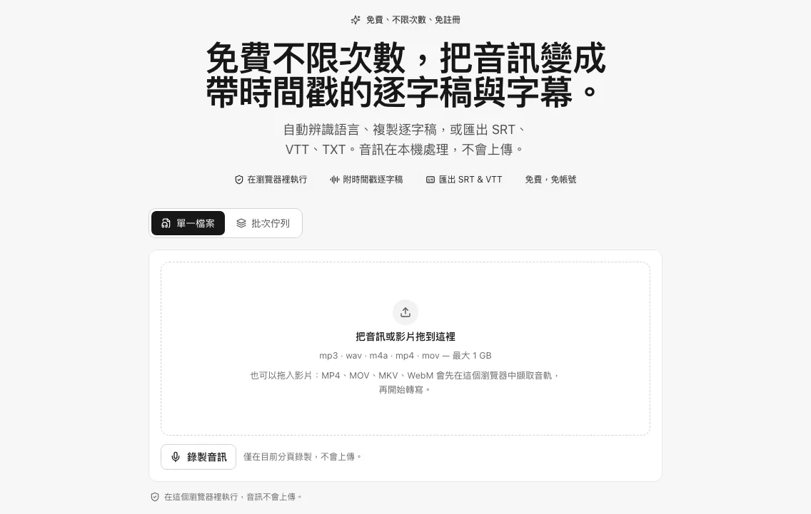

<p align="center">
  <b>🌐 Languages:</b><br/>
  <a href="README.md">English</a> ·
  <a href="README.zh-CN.md">简体中文</a> ·
  <a href="README.zh-TW.md">繁體中文</a> ·
  <a href="README.ja.md">日本語</a> ·
  <a href="README.ko.md">한국어</a> ·
  <a href="README.es.md">Español</a> ·
  <a href="README.pt-BR.md">Português</a> ·
  <a href="README.fr.md">Français</a> ·
  <a href="README.de.md">Deutsch</a> ·
  <a href="README.it.md">Italiano</a> ·
  <a href="README.nl.md">Nederlands</a> ·
  <a href="README.pl.md">Polski</a> ·
  <a href="README.ru.md">Русский</a> ·
  <a href="README.uk.md">Українська</a> ·
  <a href="README.sv.md">Svenska</a> ·
  <a href="README.nb.md">Norsk</a> ·
  <a href="README.da.md">Dansk</a> ·
  <a href="README.fi.md">Suomi</a> ·
  <a href="README.id.md">Bahasa Indonesia</a> ·
  <a href="README.tr.md">Türkçe</a> ·
  <a href="README.vi.md">Tiếng Việt</a> ·
  <a href="README.th.md">ไทย</a> ·
  <a href="README.hi.md">हिन्दी</a> ·
  <a href="README.bn.md">বাংলা</a>
</p>

<h1 align="center">EarScribe — 免費音訊轉文字、影片轉文字，就在瀏覽器裡</h1>

<p align="center">
  <b>拖進一個音訊檔、一段影片，或直接用麥克風錄音。取得帶時間戳的逐字稿與字幕。</b><br/>
  <sub>Whisper 透過 WebGPU 或 WebAssembly 在你自己的裝置上執行——錄音永遠不會上傳。</sub>
</p>

<p align="center">
  <a href="https://earscribe.app"></a>
  <a href="https://earscribe.app"></a>
  <a href="https://earscribe.app"></a>
  <a href="https://earscribe.app"></a>
  
</p>

<p align="center">
  <a href="https://earscribe.app"></a>
</p>

<p align="center">
  <b>🔗 開啟應用程式：</b> <a href="https://earscribe.app">earscribe.app</a> ·
  <a href="https://earscribe.app/guides">指南</a> ·
  <a href="https://earscribe.app/changelog">更新日誌</a> ·
  <a href="https://earscribe.app/about">關於</a>
</p>

---

## 🎙️ EarScribe 是什麼

一個完全在瀏覽器分頁裡執行的轉錄工作區。你給它音訊、影片檔或麥克風輸入，它還你一份帶時間戳、點一下就能重播的逐字稿，外加可以直接交給剪輯人員的字幕檔。沒有帳號、沒有上傳，也沒有按分鐘計費。

三種入口，同一條流程：

- **檔案**——MP3、WAV、M4A、AAC、OGG、FLAC、Opus，以及大多數 Web Audio API 能解碼的格式，單檔上限 1 GiB。
- **影片**——MP4、MOV、MKV、WebM、M4V、TS、QT、M2TS。音軌會**在分頁內**解封裝並重新編碼成 16 kHz 單聲道，接著跟一般檔案一樣轉錄。不需要 ffmpeg，也不需要找線上轉檔網站。
- **麥克風**——在同一處錄音、同一處轉錄：一堂課、一通你獲准錄音的通話，或者一段不錄下來就會忘掉的語音備忘。

再加上佇列，你可以一次丟進整個資料夾的檔案然後去做別的事；再加上 `/dashboard` 的工作區，這些結果就會變成之後能重新開啟、編輯與匯出的專案。

> 👉 **線上版本：** **[earscribe.app](https://earscribe.app)**

---

## 📚 目錄

- [✨ 功能一覽](#-功能一覽)
- [🖼️ 畫面截圖](#️-畫面截圖)
- [🚀 快速開始](#-快速開始)
- [🗂️ 工作區](#️-工作區)
- [💸 成本](#-成本)
- [🆚 比較](#-比較)
- [🌍 支援的輸入與語言](#-支援的輸入與語言)
- [💼 使用情境](#-使用情境)
- [🚧 它做不到的事](#-它做不到的事)
- [❓ 常見問題](#-常見問題)
- [🛠️ 技術架構](#️-技術架構)
- [🧑‍💻 本機開發](#-本機開發)
- [☁️ 部署](#️-部署)
- [🌐 新增一種語言](#-新增一種語言)
- [🔬 新增一個 Whisper 模型](#-新增一個-whisper-模型)
- [🤝 參與貢獻](#-參與貢獻)
- [📄 授權](#-授權)

---

## ✨ 功能一覽

| | 能力 | 你實際上拿到什麼 |
|---|---|---|
| 🎬 | **音訊、影片與麥克風** | 可直接接受影片容器。音軌在本機抽出，所以一個 200 MB 的 MP4 也一樣不會離開這台機器。 |
| 📝 | **帶時間戳的逐字稿** | 每一段都附有開始與結束時間。點一行就能聽到那個瞬間；波形拖曳軸會跟著前進。 |
| 🔍 | **在逐字稿中搜尋** | 一個名字、一個數字、一個詞——直接跳到那句話重播，不必重聽整個檔案。 |
| 🎞️ | **字幕匯出** | SRT、WebVTT、純文字、JSON（內含完整精度時間碼的逐字稿物件），或直接複製到剪貼簿。 |
| 🧪 | **字幕檢查** | 在匯出前標出過長、過快、重複、空白或互相重疊的字幕片段。 |
| 📚 | **批次佇列** | 一次丟進多個檔案，設定一個模型與一種口說語言，讓佇列依序處理。任何時候都能在目前檔案跑完後暫停。 |
| 🗂️ | **專案** | 結果以專案形式保存在瀏覽器的 `/dashboard` 底下：逐字稿、字幕、來源檔案與垃圾桶，之後都能重新開啟。 |
| ✏️ | **字幕編輯** | 修改文字、移動字幕片段的進出點、分割或刪除片段，然後再次匯出。 |
| 💾 | **備份與還原** | 把整個工作區匯出成單一檔案，再匯入另一個瀏覽器。 |
| 🔁 | **字幕轉換** | SRT ⇄ VTT 與 SRT → 純文字，全在瀏覽器內完成、不必下載模型——這是這裡唯一一個立刻就能用的工具。 |
| 🆓 | **免費且無限制** | 沒有付費方案、沒有每日額度、沒有按分鐘計費、不需要帳號。 |
| 🔒 | **架構層級的隱私** | 轉錄在本機執行。公開頁面帶有分析與廣告；`/dashboard` 沒有廣告。 |
| 🌍 | **27 種介面語言、99 種口說語言** | 介面已翻譯成 27 種語言；Whisper 會自動偵測口說語言。 |

---

## 🖼️ 畫面截圖

> 以下都是 **[earscribe.app](https://earscribe.app)** 線上網站的實際畫面。

### 1. 拖進檔案、影片，或直接錄音——免註冊、免上傳

<p align="center">
  <a href="https://earscribe.app"></a>
</p>

<p align="center"><sub>首屏：拖放區域，以及可接受的音訊、影片格式一覽。</sub></p>

### 2. 帶時間戳的逐字稿與波形——點任何一行就能跳轉

<p align="center">
  <a href="https://earscribe.app"></a>
</p>

<p align="center"><sub>逐字稿介面：左側是帶時間戳的行，右側是波形與播放進度。</sub></p>

### 3. 三個步驟：拖進 → 選一個 Whisper 模型 → 匯出

<p align="center">
  <a href="https://earscribe.app"></a>
</p>

<p align="center"><sub>三步流程：拖入檔案、選擇模型、匯出結果依序排列。</sub></p>

### 4. 為什麼選 EarScribe——隱私優先、原生於瀏覽器的 Whisper

<p align="center">
  <a href="https://earscribe.app"></a>
</p>

<p align="center"><sub>功能總覽：隱私、推論後端、語言和匯出格式集中在同一畫面。</sub></p>

### 5. 誰在用 EarScribe——播客製作、記者、學生、剪輯人員

<p align="center">
  <a href="https://earscribe.app"></a>
</p>

<p align="center"><sub>使用情境：播客、採訪、課堂、會議等幾類使用者的入口。</sub></p>

### 6. EarScribe 對比 Otter.ai、Rev、HappyScribe 與本機安裝的 Whisper

<p align="center">
  <a href="https://earscribe.app"></a>
</p>

<p align="center"><sub>比較表：EarScribe 與幾款雲端服務、本機 Whisper 的逐項對照。</sub></p>

### 7. 常見問題——隱私、格式、字幕匯出、離線使用

<p align="center">
  <a href="https://earscribe.app"></a>
</p>

<p align="center"><sub>常見問題：隱私、格式、字幕匯出和離線使用的問答摘要。</sub></p>

---

## 🚀 快速開始

1. 用 Chrome、Edge、Safari 或 Firefox 開啟 **[earscribe.app](https://earscribe.app)**。
2. 拖進一個檔案——或一段影片，或按下錄音。單檔上限 1 GiB；真正的限制是你裝置的記憶體，而不是磁碟上的大小。
3. 選一個模型。**base** 是預設值，適合大多數語音；**tiny** 適合手機或臨時語音備忘；**small** 與 **turbo** 則用於有口音、吵雜或重要的音訊。
4. 按下 **轉錄**。音訊會在分頁內解碼並送進 Whisper。第一次執行會下載模型權重，請留意按鈕上顯示的大小。
5. 閱讀逐字稿，點一行重播，修正你真正在意的地方，然後 **匯出 → SRT / VTT / TXT / JSON**，或直接複製。

想改成批次處理？切換到佇列，想丟幾個檔案就丟幾個，模型只需要選一次。佇列一次跑一個檔案，重複使用已在記憶體中的模型，並把每個結果存成專案。

> 💡 **不需要先轉檔。** 兩小時的 MP4 直接丟進來就好。如果你只想留下音訊，應用程式也能幫你把影片的音軌抽出來。

---

## 🗂️ 工作區

`/dashboard` 是同一套轉錄引擎，再加上記憶。所有東西都存在這個瀏覽器裡——專案紀錄放在 IndexedDB，模型權重放在 CacheStorage——也不會同步到任何帳號，因為根本沒有帳號。

| 分區 | 裡面有什麼 |
|---|---|
| **專案** | 全部內容，最新的排最前面。 |
| **逐字稿** | 由一次轉錄執行所建立的專案。編輯其中的字幕片段後仍會留在這裡。 |
| **字幕** | 由字幕檔建立的專案——轉換工具與匯入——讓字幕工作和語音工作分開。 |
| **檔案** | 工作區保存的來源媒體，可依類型篩選：逐字稿、字幕、音訊。原始音訊預設**不會**保存。 |
| **垃圾桶** | 已刪除的專案，在你清空之前都還能救回來。 |

在專案裡，你可以搜尋逐字稿、點時間戳重播、編輯字幕片段（文字、進出點、新增或移除）、把過長的片段重新切短、用任何格式重新匯出，或是不離開頁面就打開媒體播放器。

**備份：** 整個工作區會匯出成單一檔案（最大 320 MB），可以匯入另一個瀏覽器或另一台機器。由於專案從不離開這台裝置，這個檔案就是唯一會跟著你移動的副本——請把它當成任何其他文件備份來看待。

---

## 💸 成本

免費不代表沒有代價。以下是每個模型在兩種後端上實測的下載大小，不是估算值：

| 模型 | WebGPU | WebAssembly | 典型用途 |
|---|---:|---:|---|
| **tiny** | 151 MB | 41 MB | 語音備忘、低階手機、第一次試用 |
| **base** *(預設)* | 291 MB | 77 MB | 訪談、會議、播客 |
| **small** | 968 MB | 249 MB | 有口音的語音、吵雜的環境 |
| **turbo** | 3.24 GB | 1.09 GB | 錄音室等級的逐字稿，準確度比速度更重要時 |

- **下載一次，之後走快取。** 權重存放在瀏覽器的快取中；第二次執行不會再下載任何東西。換一個瀏覽器設定檔就得重新下載。
- **GPU 值得。** 在同一台機器上，WebGPU 用 base 處理一個 40 分鐘的檔案約 3.8 分鐘，CPU 則要 9.4 分鐘——大約快 2.5×，代價是三到四倍的下載量。在我們的測試中，WebGPU 上的 `turbo` 連 3.24 GB 的下載都沒跑完，所以它被列為未測量，而不是很快。
- **決定成敗的是記憶體，不是檔案大小。** 較長的錄音會先解碼成 16 kHz 單聲道再轉錄。一個 40 分鐘的 MP3 需要幾百 MB；一個兩小時的立體聲 WAV 可能在開始前就把分頁撐爆。現在解碼會直接要求 16 kHz，讓一個兩小時立體聲檔案的峰值記憶體從約 1.6 GB 降到 0.5 GB。
- **沒有伺服器，也不必等別人的機器空出來。** 時間花的是你的 CPU，所以慢的筆電就是慢。這就是不上傳所換來的代價。

完整的測量數據、方法，以及失敗的測試回合，都放在[指南](https://earscribe.app/guides)裡。

---

## 🆚 比較

2026 年，EarScribe 和其他轉錄音訊的方式比起來如何？

| | **EarScribe** | Otter.ai 免費版 | Rev 免費試用 | HappyScribe | 本機 Whisper CLI |
|---|:---:|:---:|:---:|:---:|:---:|
| **免費且無限制** | ✅ | ⚠️ 每月 300 分鐘 | ❌ 僅限試用 | ❌ 付費 | ✅ |
| **免註冊／免登入** | ✅ | ❌ | ❌ | ❌ | ✅ |
| **不上傳（隱私）** | ✅ | ❌ | ❌ | ❌ | ✅ |
| **不必上傳就能處理影片** | ✅ 在本機抽出音軌 | ❌ 必須上傳 | ❌ 必須上傳 | ❌ 必須上傳 | ✅ 需要 ffmpeg |
| **在瀏覽器中執行** | ✅ | ✅ | ✅ | ✅ | ❌ |
| **SRT／VTT 匯出** | ✅ | ⚠️ 付費 | ✅ | ✅ | ⚠️ 手動 |
| **帶時間戳的逐字稿** | ✅ | ✅ | ✅ | ✅ | ⚠️ 手動 |
| **本機推論** | ✅ | ❌ | ❌ | ❌ | ✅ |
| **99 種口說語言** | ✅ | ⚠️ 有限 | ⚠️ 有限 | ✅ | ✅ |
| **Whisper Large v3 Turbo** | ✅ | ❌ | ❌ | ❌ | ✅ |
| **需要安裝** | ❌ 不需要 | ❌ 不需要 | ❌ 不需要 | ❌ 不需要 | ⚠️ Python + GPU |
| **費用** | $0 | $0–$30/月 | $0.25/分鐘 | €0.20/分鐘 | $0（你自己的硬體） |

**它輸在哪裡：** 本機安裝可以在更快的後端上跑更大的模型，付費服務則多了講者標籤與團隊工作區。EarScribe 的優勢是免費、什麼都不必安裝，而且音訊哪裡都不會去。

→ **[在 earscribe.app 試用](https://earscribe.app)**

---

## 🌍 支援的輸入與語言

### 音訊——MP3、WAV、M4A、AAC、OGG、FLAC、Opus

只要是 Web Audio API 能解碼的都接受；上面這七種幾乎涵蓋了你會遇到的所有錄音。

- 🎵 **[MP3 轉文字](https://earscribe.app/mp3-to-text)**——播客與訪談的標準格式
- 🎙️ **[WAV 轉文字](https://earscribe.app/wav-to-text)**——無損的錄音室與現場錄音
- 📱 **[M4A 轉文字](https://earscribe.app/m4a-to-text)**——iPhone 語音備忘錄
- 🎧 **[語音備忘錄轉文字](https://earscribe.app/voice-memo-to-text)**——手機上的錄音
- 🔊 **[音訊轉文字](https://earscribe.app/audio-to-text)**——一般入口
- 🎬 **[音訊轉 SRT](https://earscribe.app/audio-to-srt)**——直接產出字幕

### 影片——MP4、MOV、MKV、WebM、M4V、TS、QT、M2TS

音軌會用 [mediabunny](https://mediabunny.dev) 解封裝、用 WebCodecs 解碼，再重新編碼成小的 16 kHz 單聲道 MP3（沒有 MP3 編碼器的環境則用 WAV）——全部在本機完成。瀏覽器無法解碼的容器會直接給出清楚的錯誤訊息，而不是默默產出一份空白的逐字稿。

### 麥克風

錄音在分頁內透過 MediaRecorder 進行。錄下來的內容跟拖進來的檔案完全一樣地轉錄；錄音過程中的即時字幕**不會**提供（請見[它做不到的事](#-它做不到的事)）。

### 語言——99 種口說、27 種介面

Whisper 會自動偵測口說語言：英文、西班牙文、法文、德文、義大利文、葡萄牙文、俄文、日文、韓文、中文（簡體與繁體）、阿拉伯文、印地文、土耳其文、荷蘭文、波蘭文、印尼文、瑞典文、挪威文、丹麥文、芬蘭文、捷克文、匈牙利文、希臘文、希伯來文、泰文、越南文，以及另外 70+ 種。

介面已翻譯成 27 種語言。英文位於 `/`，其餘 26 種都帶有前綴：

| | | | |
|---|---|---|---|
| [English](https://earscribe.app) | [简体中文](https://earscribe.app/zh-CN) | [日本語](https://earscribe.app/ja) | [한국어](https://earscribe.app/ko) |
| [Español](https://earscribe.app/es) | [Português (BR)](https://earscribe.app/pt-br) | [Deutsch](https://earscribe.app/de) | [Français](https://earscribe.app/fr) |
| [Русский](https://earscribe.app/ru) | [Italiano](https://earscribe.app/it) | [Polski](https://earscribe.app/pl) | [Nederlands](https://earscribe.app/nl) |
| [Українська](https://earscribe.app/uk) | [Türkçe](https://earscribe.app/tr) | [Tiếng Việt](https://earscribe.app/vi) | [ไทย](https://earscribe.app/th) |
| [हिन्दी](https://earscribe.app/hi) | [বাংলা](https://earscribe.app/bn) | [اردو](https://earscribe.app/ur) | [العربية](https://earscribe.app/ar) |
| [فارسی](https://earscribe.app/fa) | [Bahasa Indonesia](https://earscribe.app/id) | [Svenska](https://earscribe.app/sv) | [Norsk](https://earscribe.app/nb) |
| [Dansk](https://earscribe.app/da) | [Suomi](https://earscribe.app/fi) | [繁體中文](https://earscribe.app/zh-TW) | |

---

## 💼 使用情境

### 🎙️ 播客與創作者
**[播客轉錄](https://earscribe.app/podcast-transcription)** 用於節目筆記、單集 SEO 與無障礙。影片版匯出 SRT，部落格版匯出 TXT。

### 📰 記者與研究者
**[訪談轉錄](https://earscribe.app/interview-transcription)**，來源錄音始終留在你的筆電上。沒有第三方副本可供外洩、被調閱或被稽核。

### 🎓 學生與講師
**[課堂轉錄](https://earscribe.app/audio-to-text)**，把錄下來的課變成下次上課前就能搜尋的逐字稿。支援 iPhone 語音備忘錄與 Zoom 匯出的檔案。

### 📞 會議與使用者研究
**[會議錄音轉文字](https://earscribe.app/meeting-recording-to-text)**——給你的是通話的逐字稿，不是自動生成的會議紀錄。

### 🎬 影片剪輯人員
**[音訊轉 SRT](https://earscribe.app/audio-to-srt)**，適用於 YouTube、Premiere、Final Cut 與 Resolve。字幕時間取自 Whisper 自身的時間戳，字幕檢查則會標出在畫面上會溢出的內容。

### 📚 有聲書與長錄音
支援兩小時的檔案，但這正是裝置記憶體決定一切的情況。在開始四小時的檔案之前，請先讀[長音訊如何處理](https://earscribe.app/guides/how-to-transcribe-long-audio)。

---

## 🚧 它做不到的事

把話講清楚，可以省下每個人一次白跑的嘗試：

- **沒有講者分離。** 同一個檔案裡的兩個人會產出平坦的文字，沒有「講者 1／講者 2」的標籤。訪談頁面是刻意這樣寫的。
- **沒有翻譯。** 逐字稿會保持在實際口說的語言；介面語言與口說語言互不相干。
- **沒有即時字幕。** 錄音與轉錄是兩個分開的步驟——麥克風先錄，然後才把檔案拿去轉錄。
- **佇列是序列式的，而且需要分頁開著。** 整批共用一個模型、一種語言設定。關掉分頁就會停下來。
- **沒有跨裝置同步。** 專案就活在這個瀏覽器裡。要搬移請用工作區匯出。
- **不是離線應用程式。** 權重會被快取，但頁面本身仍是從網路載入。安裝它只會加上桌面或主畫面的捷徑，不會加上離線副本。
- **單檔 1 GiB 是硬性上限；記憶體才是實務上的限制。**

---

## ❓ 常見問題

<details>
<summary><b>EarScribe 真的免費、而且沒有使用上限嗎？</b></summary><br/>
是的——沒有付費方案、不需要信用卡、沒有按分鐘計費、沒有每日或每月額度、不需要帳號。運算跑在你自己的硬體上，所以沒有雲端帳單可以轉嫁。單檔上限是 1 GiB，而真正決定能不能跑完的是你裝置的記憶體。
</details>

<details>
<summary><b>我的音訊會被上傳到任何地方嗎？</b></summary><br/>
不會。音訊在分頁內解碼後，送進執行於 Web Worker 的 Whisper 模型。模型權重是從 CDN 下載<i>到</i>你的瀏覽器，這表示 CDN 會看到你的 IP 位址——但錄音本身不會被送出。公開頁面帶有 Google AdSense——波斯文頁面除外，AdSense 政策將其排除——以及不使用 Cookie 的 Plausible 分析；<code>/dashboard</code> 不會載入任何廣告程式碼。
</details>

<details>
<summary><b>我可以轉錄影片嗎？</b></summary><br/>
可以，直接就行——MP4、MOV、MKV、WebM、M4V、TS、QT 與 M2TS。音軌在瀏覽器內抽出，然後像一般檔案一樣轉錄，所以你不需要 ffmpeg 或線上轉檔網站。如果容器使用的編碼格式瀏覽器無法解碼，應用程式會直接告訴你，而不是產出一份空白的逐字稿。
</details>

<details>
<summary><b>為什麼第一次執行比較慢？</b></summary><br/>
第一次使用某個模型時，瀏覽器會下載它的權重——從 WebAssembly 上 tiny 的 41 MB，到 WebGPU 上 turbo 的 3.24 GB。之後就會走快取。絕大多數情況請選 <b>base</b>（WebAssembly 上 77 MB，WebGPU 上 291 MB）。
</details>

<details>
<summary><b>準確度如何？我該選哪個模型？</b></summary><br/>
在同一段 34 秒的影片上，我們的四個模型在 111 個字裡有 26 個不一致，而同一個模型在兩種下載大小下也會跟自己不一致。請依照你真正在意的字詞來選，而不是看一個準確度百分比：<a href="https://earscribe.app/guides/which-whisper-model-should-i-use">模型指南</a>展示了實際差異。
</details>

<details>
<summary><b>可以取得 SRT 或 VTT 字幕嗎？</b></summary><br/>
可以：匯出 → SRT 或 VTT。時間來自 Whisper 自身的分段邊界，而不是事後把文字切開。字幕檢查會標出過長、過快、重複、空白或重疊的字幕片段，而匯出前你可以編輯片段文字與時間。
</details>

<details>
<summary><b>如果我已經有 SRT 或 VTT 檔呢？</b></summary><br/>
不必下載模型就能轉換：<a href="https://earscribe.app/srt-to-vtt">SRT 轉 VTT</a> 與 <a href="https://earscribe.app/srt-to-txt">SRT 轉純文字</a>都在本機解析檔案。什麼都不會上傳，也不會抓取任何 Whisper 權重。
</details>

<details>
<summary><b>它可以在離線狀態下使用嗎？</b></summary><br/>
轉錄這一步可以：頁面與模型載入之後，音訊的處理不會連到任何轉錄伺服器。但這個應用程式不是離線包——開啟它需要網路，而你從未下載過的模型必須先抓下來。從頁尾安裝只會加上一個直接開啟工作區的捷徑，不會加上離線副本。
</details>

<details>
<summary><b>它會標示誰在說話嗎？</b></summary><br/>
不會。輸出是帶時間碼的平坦文字。講者分離不屬於這個版本的範圍，應用程式也不會假裝有。
</details>

<details>
<summary><b>我的結果存在哪裡？</b></summary><br/>
就在這個瀏覽器裡：專案存在 IndexedDB，模型權重存在 CacheStorage。除非你選擇保留，原始音訊不會跟著專案一起保存。沒有存進工作區的頁面，重新載入後就是一片空白；請使用 <code>/dashboard</code> 及其匯出功能來保存你在意的內容。
</details>

<details>
<summary><b>有免費的 Otter.ai 或 Rev 替代方案嗎？</b></summary><br/>
EarScribe 是雲端轉錄服務的免費替代方案：運算由你來做、音訊留在原地、沒有按分鐘計費。取捨也很真實——沒有講者標籤、沒有團隊工作區，長檔案能不能處理取決於你的機器。
</details>

<details>
<summary><b>怎麼免費把 MP3 轉成文字？</b></summary><br/>
把 MP3 拖到 <a href="https://earscribe.app/mp3-to-text">earscribe.app/mp3-to-text</a>（或首頁）。它會在瀏覽器中解碼、在本機轉錄，並可複製或匯出成 SRT、VTT、TXT 或 JSON。
</details>

> 更多解答在**[關於頁面](https://earscribe.app/about)**，測量說明則在**[指南](https://earscribe.app/guides)**。

---

## 🛠️ 技術架構

- **[Next.js 15](https://nextjs.org)**（App Router）+ **React 19**
- **[@huggingface/transformers v3](https://huggingface.co/docs/transformers.js)**——ONNX Runtime Web，以 WebGPU 為主、WebAssembly 為備援
- **[OpenAI Whisper](https://github.com/openai/whisper)**——tiny、base、small 與 large-v3-turbo，經 ONNX 量化
- **[mediabunny](https://mediabunny.dev)** + **WebCodecs**——在分頁內解封裝影片並抽出音訊
- **[next-intl](https://next-intl.dev)**——27 種語言，每種語言一份訊息目錄
- **[Tailwind CSS v4](https://tailwindcss.com)**
- **[Cloudflare Pages](https://pages.cloudflare.com)** 負責託管，另有少數 Pages Functions（模型主機、意見回饋端點）

網站採靜態渲染，並在瀏覽器中進行 hydrate；轉錄與字幕轉換只在用戶端執行。模型權重在首次使用時從 Hugging Face CDN 取得，並快取於 CacheStorage。

---

## 🧑‍💻 本機開發

```bash
git clone https://github.com/rocnubie/earscribe-free-speech-to-text.git
cd earscribe-free-speech-to-text
pnpm install
pnpm dev
# → http://localhost:3000
```

部署前會執行的檢查：

```bash
pnpm typecheck
pnpm lint
pnpm test              # node:test — queue state machine, subtitle parsers, release id
pnpm i18n:gate         # no missing keys, no English leftovers, no broken placeholders
pnpm seo:check         # page copy, keyword coverage, FAQ and cursor audits
node scripts/sitemap-audit.mjs
node scripts/llms-txt-audit.mjs
pnpm readme:audit      # README sizes vs lib/models.ts, links, 9-language parity
```

`pnpm build` 會在 `out/` 產出靜態匯出。有幾項稽核會讀取 `out/`，所以請先建置。

---

## ☁️ 部署

正式部署只要一個指令，它會依序跑完所有稽核：

```bash
pnpm pages:deploy
```

它會先比對本機的部署標記（`lib/release.ts` 裡的 `deployId`）與線上網站 `/changelog` 所提供的那一個，若兩者相同就拒絕繼續——過期的建置就是這樣被攔下來的。接著它會建置、執行連結、指南、`llms.txt`、i18n、sitemap 與 PWA 稽核，然後把 `out/` 發布到 Cloudflare Pages。

`/changelog` 是給讀者看的變更清單，列出使用者能實際感受到的改動。它不是建置日誌：內部重構、文案修正與翻譯工作會取得新的 `deployId`，但不會有更新日誌條目。

環境變數與繫結：

| 名稱 | 用途 |
|---|---|
| `NEXT_PUBLIC_SITE_URL` | 標準網址、sitemap、OG 標籤 |
| `NEXT_PUBLIC_PLAUSIBLE_DOMAIN` | Plausible 網站識別碼 |
| `NEXT_PUBLIC_PLAUSIBLE_SCRIPT_URL` | Plausible 腳本網址 |
| `FEEDBACK_DB`（D1 繫結） | `/feedback` 端點；結構定義在 `migrations/` |

---

## 🌐 新增一種語言

1. 在 [`i18n/locale.ts`](i18n/locale.ts) 的 `ALL_LOCALE_NAMES` 末端追加語言代碼。
2. 在 `en.json` 旁新增 `messages/<code>.json`，並完整翻譯。
3. 執行 `pnpm i18n:gate`——路由、sitemap、hreflang 與 OG 中介資料會自動納入這個語言，但只要有缺少的鍵就會讓檢查失敗。

只有通過檢查的語言才能列進 `translatedLocales`；語言切換器會把其餘的標示為部分翻譯。

---

## 🔬 新增一個 Whisper 模型

在 [`lib/models.ts`](lib/models.ts) 的 `MODELS` 追加一筆項目，為 `wasm` 與 `webgpu` 各自提供**實測**的 `sizeMB`——兩種後端出貨的是不同的權重檔，對兩者只寫一個數字，正是這個應用程式曾一度宣稱 500 MB 卻實際給出 968 MB 的原因。該儲存庫必須以 `onnx-community/<name>` 的形式存在於 Hugging Face，或與 ONNX-Whisper 相容。另外要在每個 `messages/*.json` 加上對應的 `models.<id>` 區塊，用來放優缺點文案。

---

## 🤝 參與貢獻

歡迎送 Pull Request，尤其歡迎：

- 翻譯（`messages/<code>.json`），以及特定語言的 README 修正
- 附上出問題的檔案、瀏覽器與裝置記憶體的錯誤回報
- 測量數據：在我們沒有的硬體上的模型大小、耗時與峰值記憶體
- 無障礙修正

在這裡開 issue 或 PR，或者先試試 **[earscribe.app](https://earscribe.app)**，看看你將要貢獻的是什麼。

---

## 📄 授權

本儲存庫的行銷網站與頁面採用 [MIT](LICENSE)：個人與商業用途皆免費。轉錄 worker、音訊解碼器與字幕匯出器並未在此發布，因此這個儲存庫並不是該服務完整可自架的副本。

---

<p align="center">
  <b>👉 試用線上版本：<a href="https://earscribe.app">earscribe.app</a></b><br/>
  <sub>音訊轉文字 · 影片轉文字 · 語音轉文字 · 字幕匯出 · 100% 免費 · 免註冊 · 裝置端執行</sub>
</p>

<p align="center">
  以 ❤️ 打造，建立於 <a href="https://github.com/openai/whisper">OpenAI Whisper</a>、<a href="https://huggingface.co/docs/transformers.js">Transformers.js</a>、<a href="https://onnxruntime.ai">ONNX Runtime Web</a> 與 <a href="https://mediabunny.dev">mediabunny</a> 之上。
</p>
